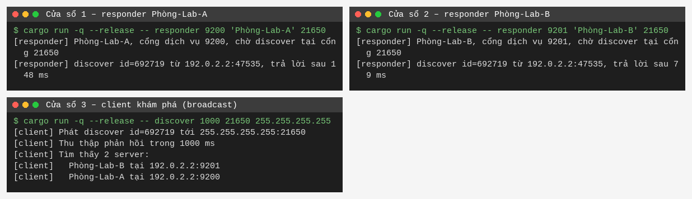

# Bài 6.5 – Khám phá server trong LAN bằng broadcast (Rust)

| Thông tin | Nội dung |
|---|---|
| Mã giả tương ứng | Mã giả 6.7 (Khám phá server trong LAN bằng broadcast: DISCOVER, RESPONDER) |
| Mục giáo trình | 6.4.2 Broadcast, 6.4.4 Thiết lập TTL và tránh ngập lụt gói tin |
| Kế thừa | Mã giả 4.4 (UDP_REQUEST): gửi một yêu cầu, thu thập nhiều phản hồi đến hết thời gian chờ |
| Thư viện | Thư viện chuẩn: `std::net::UdpSocket` (`set_broadcast`, `set_read_timeout`); crate `socket2` (REUSEADDR trước BIND), `serde_json` |

## Mục tiêu
Client phát một yêu cầu `discover` tới địa chỉ broadcast giới hạn `255.255.255.255` (bắt buộc bật tùy chọn `BROADCAST`), mỗi server trả lời bằng unicast kèm cổng dịch vụ sau một khoảng trễ ngẫu nhiên 0–200 ms (tránh bùng nổ phản hồi); client thu thập mọi phản hồi có đúng `id` trong khoảng thời gian chờ.

## Tệp
- `src/main.rs` – phân nhánh theo tham số `responder` / `discover`; `DISC_PORT`, `random_u64`, đọc tham số.
- `src/discover.rs` – Mã giả 6.7: DISCOVER.
- `src/responder.rs` – Mã giả 6.7: RESPONDER.
- `Cargo.toml`, `Cargo.lock` – gói Cargo `bai6_5_kham_pha_broadcast`.
- `demo.json` – kịch bản chạy minh họa (dùng với `tools/demo.py`).
- `ket_qua.txt`, `ket_qua.png` – kết quả thực thi thật.

## Cách chạy
Mở các cửa sổ dòng lệnh trong thư mục bài:
```bash
cargo build --release
# Trên mỗi máy chạy server: responder [cổng dịch vụ] [tên] [DISC_PORT]   (mặc định 9200 server-chat 9999)
cargo run --release -- responder 9200 Phòng-Lab-A 9999
# Trên máy client: discover [wait_ms] [DISC_PORT] [địa chỉ broadcast]   (mặc định 2000 9999 255.255.255.255)
cargo run --release -- discover 2000 9999 255.255.255.255
```
Tường lửa của máy chạy responder phải cho phép UDP đến cổng `DISC_PORT`. Dừng responder bằng Ctrl+C.

## Kết quả thực thi


Hai responder chạy trên cùng máy kiểm thử nhận cùng một yêu cầu broadcast, trả lời sau các khoảng trễ ngẫu nhiên khác nhau; client tìm thấy cả hai server với tên và cổng dịch vụ. Địa chỉ 192.0.2.2 là địa chỉ của giao diện mạng của máy kiểm thử: gói tới `255.255.255.255` được gửi qua giao diện có tuyến mặc định và đồng thời được chuyển cho các socket cục bộ. Môi trường kiểm thử không chặn broadcast tới `255.255.255.255`.

## Ghi chú
- Socket của RESPONDER bật `REUSEADDR` trước `BIND` (mã giả không có) để hai responder chạy được trên cùng một máy trong kịch bản minh họa; datagram broadcast được giao cho mọi socket cùng cổng. Trong LAN mỗi máy một responder thì không cần tùy chọn này. `UdpSocket::bind` của thư viện chuẩn gộp SOCKET và BIND nên không đặt được tùy chọn ở giữa; bài tạo socket bằng `socket2::Socket`, đặt `set_reuse_address`, `bind` rồi chuyển thành `std::net::UdpSocket`.
- `NEXT_ID()` sinh số ngẫu nhiên 1–999 999. Thư viện chuẩn Rust không có bộ sinh số ngẫu nhiên; hàm `random_u64` lấy giá trị băm của `RandomState` (mỗi lần tạo mang khóa ngẫu nhiên), đủ cho mã yêu cầu và độ trễ. Giáo trình không nêu `wait_ms` mặc định; bài chọn 2000 ms.
- Datagram không phải JSON hợp lệ bị bỏ qua mà không phản hồi, theo Mục 6.4.4.
- `SETOPT(RECV_TIMEOUT, MAX(1, deadline − NOW()))`: Rust từ chối thời gian chờ bằng 0 nên giá trị tối thiểu 1 ms là bắt buộc; hết giờ, `recv_from` trả lỗi `WouldBlock` (Linux) hoặc `TimedOut` (Windows).
- RESPONDER của mã giả là thủ tục bất đồng bộ (`RECVFROM_ASYNC`, `DELAY_ASYNC`). Vì nó xử lý tuần tự từng yêu cầu (chờ trễ xong mới nhận yêu cầu tiếp), bản Rust dùng socket chặn và `thread::sleep` cho gọn; hành vi giống nhau. Trong server thật, thủ tục này chạy trong luồng hoặc tác vụ riêng.
- Thư viện chuẩn Rust không có hàm bắt Ctrl+C, nên responder dừng ngay khi nhận tín hiệu và không in dòng `[responder] Dừng` như bản Python.
- Kiểm thử: Linux, Rust 1.97.0, socket2 0.6.5, serde_json 1.0.154.
