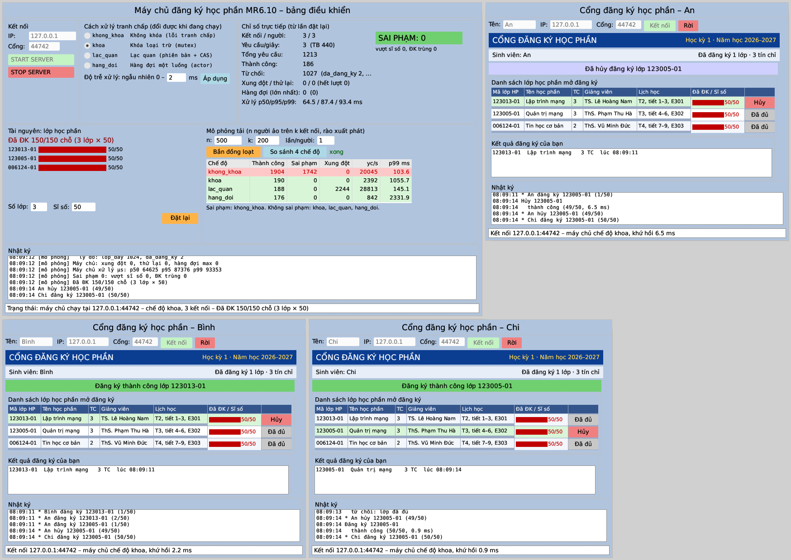
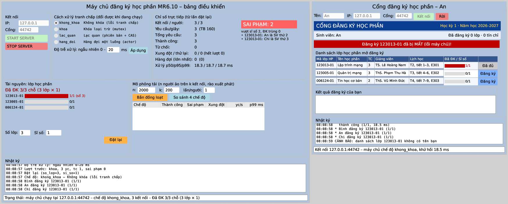
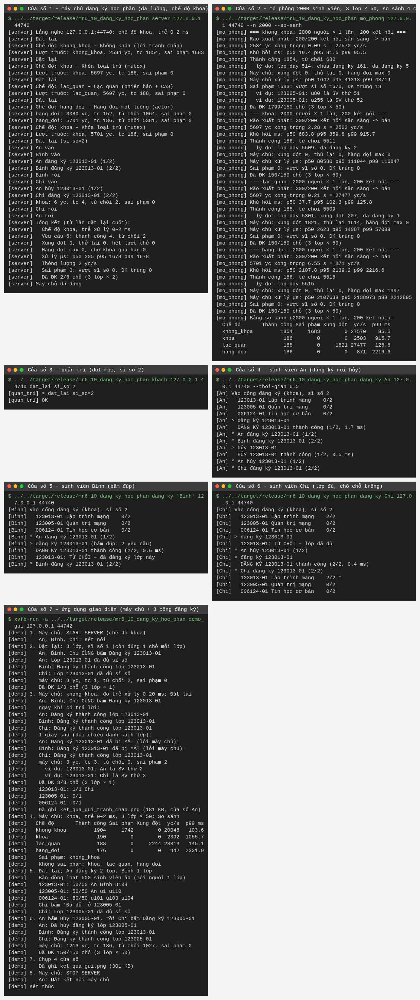

# Bài mở rộng MR6.10 – Đăng ký học phần: 2000 sinh viên tranh 150 chỗ (Rust)

| Thông tin | Nội dung |
|---|---|
| Loại | **Bài mở rộng**, không có trong giáo trình và không có mã giả tương ứng. Thuộc nhóm "tranh chấp tài nguyên" MR6.6–MR6.13, dùng chung khung của [MR6.6](../BaiMR6.6_DauGia/) |
| Liên hệ với giáo trình | Chương 6: Bài 6.1 (server đa luồng, một luồng mỗi kết nối), Bài 6.7 (kiểm thử tải); Chương 3: Bài 3.2 (định khung thông điệp theo dòng); bài mở rộng MR5.4/MR5.5 (luồng, đồng bộ) |
| Thư viện | Thư viện chuẩn Rust: `std::net`, `std::thread`, `std::sync` (`Mutex`, `RwLock`, `Condvar`, `AtomicU64`, `mpsc`), `std::collections::BTreeSet`; crate `serde_json` 1.0.154 (`preserve_order`), `socket2` 0.5.10, `ctrlc` 3.4.7, `chrono` 0.4.41, `miniz_oxide` 0.8.9; giao diện `eframe`/`egui` 0.29.1. Mọi crate ghim bằng `=` và `Cargo.lock` |
| Bản ngôn ngữ khác | [Python](../../../python/Chuong06/BaiMR6.10_DangKyHocPhan/), [C#](../../../csharp/Chuong06/BaiMR6.10_DangKyHocPhan/), [Java](../../../java/Chuong06/BaiMR6.10_DangKyHocPhan/), [Go](../../../go/Chuong06/BaiMR6.10_DangKyHocPhan/) |

## Mục tiêu
Bài mô phỏng giờ mở cổng đăng ký học phần. Có vài lớp học phần (mặc định **3 lớp, sĩ số 50**) và hàng nghìn sinh viên cùng bấm "Đăng ký". Lớp chỉ nhận khi **số đã đăng ký < sĩ số**. Sinh viên đã có tên trong lớp thì không đăng ký lại được (`da_dang_ky`), và chỉ hủy được lớp mình đã đăng ký (`chua_dang_ky`). Mỗi lớp là một ô tài nguyên, giữ tập tên sinh viên (`BTreeSet<String>`, sắp sẵn như `sorted()` của Python). Máy chủ TCP đa luồng xử lý `dang_ky` và `huy` bằng thao tác "đọc → kiểm tra (giả lập độ trễ cơ sở dữ liệu 0–2 ms) → ghi" theo **bốn cách** đổi được khi đang chạy. **Sổ kiểm toán** đếm hai sai phạm: **vượt sĩ số** (một lượt đăng ký được chấp nhận khi lớp, theo sổ, đã đủ) và **ĐK trùng** (một sinh viên được nhận vào một lớp mà sổ ghi là đã có tên).

Giao thức, câu chữ và định dạng dòng in giống hệt bản Python (đã thử chạy chéo, xem Ghi chú).

## Kiến thức chính
Số liệu dưới đây lấy từ `ket_qua.txt`, là một lần chạy thật trên máy cục bộ (127.0.0.1, Rust 1.97, 2 lõi, độ trễ xử lý ngẫu nhiên 0–2 ms). Mỗi lần chạy, số liệu lệch đi đôi chút.

```
  Chế độ       Thành công Sai phạm Xung đột  yc/s  p99 ms
  khong_khoa         1854     1683        0 27570    95.5
  khoa                186        0        0  2503   915.7
  lac_quan            188        0     1821 27477   125.8
  hang_doi            186        0        0   871  2216.6
```
(2000 sinh viên, mỗi người muốn 1 lớp; 3 lớp × 50 = 150 chỗ; 200 kết nối. Mỗi sinh viên có thứ tự ưu tiên ngẫu nhiên theo tên: lớp đủ thì thử lớp kế tiếp, được nhận thì 10 % "đổi ý" hủy ngay. Vì vậy mỗi chế độ có khoảng 5700 yêu cầu, riêng `khong_khoa` chỉ 2534 vì nhiều người "được nhận" ngay lần đầu. "Thành công" gồm cả lượt hủy thành công.)

- **Tranh chấp: vượt sĩ số và mất đăng ký.** Ở `khong_khoa`, hàng trăm luồng cùng đọc danh sách lớp lúc còn chỗ, cùng qua bước kiểm tra, cùng ghi "danh sách cũ + tên mình", và bản ghi sau đè bản trước. Hậu quả thứ nhất là **vượt sĩ số**: sổ kiểm toán ghi **1799 chỗ đã đăng ký cho 150 chỗ** (vượt sĩ số 1670, ví dụ `123005-01: u80 là SV thứ 51`). Hậu quả thứ hai là **mất cập nhật**: sinh viên được báo "thành công" nhưng tên không còn trong danh sách lớp. Cũng vì thế mà 161 lượt hủy bị từ chối `chua_dang_ky` dù chính người đó vừa được báo nhận. Rust chạy đa lõi thật nên lượt này xong trong 0,09 s mà vẫn sai hơn nghìn lần. Giao diện cho thấy rõ: ba người cùng bấm vào lớp sĩ số 1, cả ba thấy "Đăng ký thành công", một giây sau hai người nhận cảnh báo đỏ "Đăng ký 123013-01 đã bị MẤT". Chế độ này chỉ dùng để minh họa lỗi trong phòng lab (loopback).
- **ĐK trùng: idempotency theo (sinh viên, lớp).** Sinh viên thứ 100, 200, … của bộ mô phỏng mang tên người liền trước (cùng một người bấm trên hai thiết bị, cùng thứ tự ưu tiên vì bộ sinh ngẫu nhiên gieo theo tên). Hai yêu cầu có `ma_yc` khác nhau nên lớp chống gửi lại của khung không chặn được; luật "đã có tên thì từ chối" nằm trong trạng thái lớp. Ở `khong_khoa` có 13 lượt ĐK trùng; ở `khoa` đúng 2 lượt bị từ chối `da_dang_ky`, các thiết bị thứ hai còn lại nhận "lớp đã đủ". Bản dòng lệnh minh họa bằng `dk 123013-01 x2` (bấm đúp): lần thứ hai nhận "đã đăng ký lớp này".
- **Khóa theo tài nguyên: nhiều lớp thì song song.** `khoa` cho mỗi lớp một khóa riêng (khóa FIFO có hạn chờ của khung), nên ba lớp được xử lý song song và đạt 2503 yc/s, khoảng 2,9 lần `hang_doi` (871 yc/s, một luồng cho mọi lớp). Thêm lớp thì `khoa` nhanh thêm, còn `hang_doi` thì không (bài tập 2).
- **Lạc quan khi điểm nóng bị ghi nhiều.** Phút đầu phần lớn yêu cầu đều *ghi*, nên `lac_quan` có **1821 xung đột**, 1614 lần thử lại và 207 yêu cầu hết 5 lượt thử ("xung đột, thử lại sau"). Sai phạm vẫn 0 và thông lượng cao (27 477 yc/s), nhưng người dùng thấy "Hệ thống bận, vui lòng thử lại". Đây là cái giá của điều khiển đồng thời lạc quan khi tranh chấp ghi cao (Kung & Robinson 1981).
- **Hàng đợi một luồng (actor).** `hang_doi` đúng, công bằng theo thứ tự đến, hàng đợi (kênh `mpsc`) dài tối đa 1997, nhưng p99 khứ hồi là 2,2 s.
- **Sổ kiểm toán.** Sổ giữ danh sách lớp *theo sổ*, ghi trong vùng găng của chế độ (`khi_ghi`): `dang_ky` thêm tên, `huy` bỏ tên. Bảng điều khiển máy chủ hiện cả hai con số: "1/1 (sổ 3)" nghĩa là danh sách lớp có 1 tên, trong khi máy chủ đã báo thành công cho 3 người.
- **Giao diện và `cap_nhat` đến trễ.** Cửa sổ sinh viên đối chiếu kết quả máy chủ trả về với danh sách lớp trong `cap_nhat`. Vì `cap_nhat` có thể được chụp *trước* lần ghi của chính mình (ví dụ vừa Hủy mà bản trạng thái đang giữ vẫn còn tên), lớp vừa có kết quả được đưa vào tập `cho_cap_nhat` và bỏ qua khi đối chiếu cho tới khi có một `cap_nhat` MỚI tới sau (như bản Python, commit 74b983b); ngoài ra chỉ báo "đã bị MẤT" khi danh sách thiếu tên mình liên tục 0,5 s.

### Giao thức (giống hệt ở 5 ngôn ngữ)
TCP, mỗi dòng một JSON UTF-8 kết thúc `\n`, tối đa 64 KB một dòng. Phần chung (chào, quản trị, `thong_ke`, `lap_lai`) xem [README MR6.6](../BaiMR6.6_DauGia/README.md#giao-thức-giống-hệt-ở-5-ngôn-ngữ).

| Chiều | Thông điệp |
|---|---|
| người dùng → server | `{"loai":"dang_ky","ma_yc":k,"ma_lop":"123013-01"}`, `{"loai":"huy","ma_yc":k,"ma_lop":"123013-01"}` (kết nối gộp thêm `"nguoi":"u17"`) |
| server → client | `{"loai":"kq","ma_yc":k,"ok":true,"thao_tac":"dang_ky","ma_lop":…,"nguoi":…,"da_dk":37}` hoặc `{"loai":"kq","ma_yc":k,"ok":false,"ma_loi":"lop_day"\|"da_dang_ky"\|"chua_dang_ky"\|"sai_du_lieu"\|"xung_dot"\|…,"ly_do":…,"ma_lop":…,"da_dk":50}` |
| server → tất cả | `{"loai":"cap_nhat","che_do":…,"si_so":50,"lop":[{"ma","ten","gv","lich","tc","si_so","da_dk","theo_so","sv":[tên…]}…]}` (≤ 10 lần/s); `{"loai":"su_kien","noi_dung":"An đăng ký 123013-01 (1/50)"}` (chỉ người dùng thật) |
| quản trị → server | `{"loai":"dat_lai","ma_yc":k,"so_lop":3,"si_so":50}` (1–6 lớp, sĩ số 1–500) |

## Cấu trúc tệp
Gói Cargo `mr6_10_dang_ky_hoc_phan` (một chương trình, chọn vai trò bằng lệnh con):
- **Khung chung**, chép từ MR6.6: `src/chung.rs`, `src/khach.rs`, `src/mo_phong.rs`, `src/server.rs`, `src/gui_chung.rs` (khác MR6.6 ba chỗ nhỏ, giống nhau ở 5 bài MR6.9–MR6.13: `KhoTranhChap::dat_o`/`co_o`, `MayChu::dat_mot_tham_so`, `CuaSoServer::xong_mo_phong` là `pub`).
- **Nghiệp vụ:** `src/may_chu.rs` (danh mục 6 lớp `DANH_MUC`, `DangKy: NghiepVu` với một ô `lop:<mã>` mỗi lớp, `LuatDangKy: LuatKiemToan`), `src/nguoi_ao.rs` (`NguoiAo`: thứ tự ưu tiên xáo bằng bộ sinh ngẫu nhiên gieo theo tên, thử lớp kế tiếp khi đủ, 10 % hủy; người thứ 100, 200, … dùng tên người liền trước), `src/dang_ky.rs` (sinh viên dòng lệnh: `dk <mã> [x2]`, `huy <mã>`, `xem`).
- **Giao diện:** `src/server_gui.rs` (khung "Tài nguyên": thanh sĩ số từng lớp), `src/dang_ky_gui.rs` (cổng đăng ký học phần), `src/demo_gui.rs`, `src/main.rs`.
- `Cargo.toml`, `Cargo.lock`, `demo.json`, `ket_qua.txt`, `ket_qua.png`, `ket_qua_gui.png`, `ket_qua_gui_tranh_chap.png`: kịch bản và kết quả thực thi thật.

## Cách chạy
Trong thư mục bài (`cargo build -q --release` một lần; `B=../../target/release/mr6_10_dang_ky_hoc_phan`, Windows: `..\..\target\release\mr6_10_dang_ky_hoc_phan.exe`):
```bash
$B server 127.0.0.1 9000                                       # cửa sổ 1 (gõ lệnh ở đây)
$B mo_phong 127.0.0.1 9000 --n 2000 --so-sanh                  # cửa sổ 2: bảng so sánh 4 chế độ
$B mo_phong 127.0.0.1 9000 --n 2000 --lan 2 --che-do khoa --dat-lai   # mỗi người muốn 2 lớp
$B khach 127.0.0.1 9000 dat_lai so_lop=6 si_so=40
$B dang_ky An 127.0.0.1 9000                                   # cửa sổ 3, 4…: dk 123013-01 / huy …
```
- Lệnh của máy chủ: `che_do khong_khoa|khoa|lac_quan|hang_doi`, `tre <ms>`, `dat_lai [so_lop=… si_so=…]`, `thong_ke`, `thoat`. Tùy chọn: `--che-do`, `--tre-ms`, `--so-lop`, `--si-so`.
- Lệnh của `dang_ky`: `dk <mã lớp>`, `dk <mã lớp> x2` (bấm đúp), `huy <mã lớp>`, `xem` (bảng lớp, `*` là lớp của mình), `thoat`.
- Trong demo (cửa sổ 3–6), lớp có sĩ số 2: An đăng ký, Bình bấm đúp (lần hai bị từ chối), Chi nhận "lớp đã đủ". An hủy, và lần đăng ký sau của Chi được nhận.

Tái lập kết quả từ thư mục gốc của kho: `python3 tools/demo.py rust/Chuong06/BaiMR6.10_DangKyHocPhan` (cổng 44740, giao diện 44742). Cổng 447x0 nằm trong dải cổng tạm của Linux: gặp "Address already in use" thì chạy lại.

## Ứng dụng giao diện


Ảnh trên là lần chạy thật của `demo_gui` (Linux, Xvfb + Mesa llvmpipe, egui 0.29.1): bảng điều khiển máy chủ (trên trái), An (trên phải), Bình và Chi (dưới). Kịch bản đã chạy so sánh 4 chế độ (bảng ở giữa, dòng `khong_khoa` tô đỏ: 1742 sai phạm; ba chế độ còn lại 0, `lac_quan` 2244 xung đột). Sau đó, trong đợt đăng ký mới 3 lớp × 50, An đăng ký 2 lớp, Bình 1 lớp, rồi 500 sinh viên ảo lấp đầy cả ba lớp (50/50, thanh đỏ, nút "Đã đủ"). Chi bấm vào lớp 123005-01 và nhận "Lớp 123005-01 đã đủ sĩ số". An hủy lớp đó, và Chi đăng ký được chỗ vừa nhả.



Ở bước trước đó (ảnh trên), máy chủ chạy `khong_khoa` với độ trễ xử lý 0–20 ms, sĩ số 1. An, Bình và Chi cùng bấm "Đăng ký" lớp 123013-01, và cả ba nhận "Đăng ký thành công". Danh sách lớp chỉ còn tên Chi (1/1, sổ 3: **SAI PHẠM 2**, vượt sĩ số 2), và cửa sổ của An (bên phải) báo đỏ "Đăng ký 123013-01 đã bị MẤT (lỗi máy chủ)!". Cùng thao tác đó ở `khoa` cho một người được nhận, hai người nhận "Lớp 123013-01 đã đủ sĩ số".

- **Máy chủ** (`server_gui`): IP, cổng, START/STOP; **4 nút chọn chế độ**; độ trễ xử lý; **chỉ số trực tiếp** (kết nối/người, yêu cầu/giây, thành công, từ chối theo mã lỗi, xung đột/thử lại, hàng đợi, xử lý p50/p95/p99, **SAI PHẠM** xanh/đỏ kèm ví dụ); **tài nguyên**: tổng số chỗ đã đăng ký theo sổ, mỗi lớp một thanh "đã đăng ký / sĩ số" (đỏ khi đủ) kèm "(sổ N)" màu đỏ khi sổ vượt sĩ số, ô số lớp và sĩ số, nút **Đặt lại**; **mô phỏng tải**; nhật ký.
- **Cổng đăng ký học phần** (`dang_ky_gui`): thanh tiêu đề "CỔNG ĐĂNG KÝ HỌC PHẦN – Học kỳ 1 · Năm học 2026–2027"; thông tin sinh viên (số lớp, số tín chỉ đã đăng ký); dòng thông báo ("Đăng ký thành công lớp …", "Lớp … đã đủ sĩ số", "Bạn đã đăng ký lớp … rồi", "Hệ thống bận, vui lòng thử lại", cảnh báo đỏ "đã bị MẤT"); **bảng lớp học phần** gồm mã lớp, tên học phần, tín chỉ, giảng viên, lịch học, thanh "Đã ĐK / Sĩ số" (xanh, cam khi ≥ 80 %, đỏ khi đủ) và nút **Đăng ký / Hủy / Đã đủ / …** (đang chờ trả lời), dòng lớp của mình tô xanh, in đậm; bảng **Kết quả đăng ký của bạn** (mã lớp, tên, tín chỉ, giờ đăng ký).

### Cách chạy
```bash
cargo build --release
$B server_gui 127.0.0.1 44742                  # bấm START SERVER (3 lớp × 50)
$B dang_ky_gui An 127.0.0.1 44742
$B dang_ky_gui Bình 127.0.0.1 44742
```
- **Windows:** cần Rust bản MSVC như các bài Rust khác. **Linux:** thư viện OpenGL/X11 (hoặc Wayland). Kịch bản tự động (Linux, cần `xvfb`): `xvfb-run -a -s "-screen 0 2600x1700x24" $B demo_gui 127.0.0.1 44742`.
- Chạy riêng từng cửa sổ: mọi dòng nhật ký và cứ 5 giây một dòng số liệu cũng in ra dòng lệnh.
- Thử trên nhiều máy: máy chủ nghe trên IP card mạng (hoặc `0.0.0.0`) và mở tường lửa cho cổng. Đặt sĩ số nhỏ (ví dụ 5) rồi đếm ngược "3, 2, 1, bấm!" để cả lớp cùng đăng ký một lớp. Khi đó **chỉ dùng `khoa`, `lac_quan`, `hang_doi`**.

## Kết quả thực thi


## Ghi chú
- **Chạy chéo với bản Python** (đã thử, 2000 sinh viên, `--so-sanh`; số liệu ở `docs/_status/morong_mr610_rust.json`): cả hai chiều (mô phỏng Rust → máy chủ Python, mô phỏng Python → máy chủ Rust) đều cho `khong_khoa` khoảng 1800 sai phạm, ba chế độ còn lại 0; sinh viên Python bấm đúp và sinh viên Rust gặp "lớp đã đủ" trên cùng máy chủ Rust.
- Thứ tự ưu tiên của sinh viên ảo xáo bằng bộ sinh ngẫu nhiên gieo theo tên (FNV-1a + xorshift64\*), nên cùng tên luôn cho cùng thứ tự như `random.Random(tên)` của Python, dù dãy số cụ thể khác bản Python.
- Giá trị của ô lớp là `Lop { sv: BTreeSet<String> }`; mỗi lần ghi tạo tập mới (`xu_ly` thuần), nên `lac_quan` gọi lại an toàn và luồng đẩy `cap_nhat` luôn đọc được một danh sách trọn vẹn.
- Trong kịch bản giao diện, máy chủ, bộ mô phỏng và 4 cửa sổ cùng chạy trong một tiến trình trên 2 lõi, nên yc/s thấp hơn bản dòng lệnh.
- Kiểm thử: Linux, Rust 1.97.0 (`cargo build` không cảnh báo), tools/demo.py; giao diện egui 0.29.1 dưới Xvfb + Mesa llvmpipe. Bản giao diện chưa thử trên Windows.

## Bài tập gợi ý
1. Chạy `$B mo_phong --so-sanh` với `--tre-ms 0`, `2`, `10`. Sai phạm của `khong_khoa` và số xung đột của `lac_quan` thay đổi thế nào?
2. `dat_lai so_lop=6 si_so=25` (vẫn 150 chỗ) rồi so sánh lại. Vì sao `khoa` nhanh hơn còn `hang_doi` thì không?
3. Thêm luật "không đăng ký hai lớp cùng học phần" (ví dụ 123013-01 và 123013-02). Thao tác `dang_ky` giờ phải đọc những ô nào? Thứ tự khóa và sổ kiểm toán cần gì thêm?
4. Thêm luật "tối đa 6 tín chỉ mỗi sinh viên". Nên giữ tổng tín chỉ ở ô lớp, ở ô sinh viên (`kho.dat_o("sv:<tên>", …)`), hay ở cả hai? Hãy chỉ ra một tình huống tranh chấp mới.
5. Thêm "danh sách chờ": lớp đủ thì sinh viên xếp hàng, có người hủy thì người đầu hàng được nhận tự động. Ở chế độ `hang_doi` điều này dễ hơn vì sao?
6. Giao diện: thêm ô lọc theo tên học phần và nút "Đăng ký nhanh" đăng ký mọi lớp đã chọn trong một lần bấm (gửi nhiều yêu cầu pipelining).

## Đọc thêm
- H. T. Kung, J. T. Robinson (1981). *On Optimistic Methods for Concurrency Control*. ACM Transactions on Database Systems 6(2).
- E. G. Coffman, M. J. Elphick, A. Shoshani (1971). *System Deadlocks*. ACM Computing Surveys 3(2).
- Tài liệu Rust: [`std::sync`](https://doc.rust-lang.org/std/sync/index.html) (`Mutex`, `RwLock`, `Condvar`, `mpsc`), [`std::sync::atomic`](https://doc.rust-lang.org/std/sync/atomic/index.html) (`AtomicU64::compare_exchange`), [`std::collections::BTreeSet`](https://doc.rust-lang.org/std/collections/struct.BTreeSet.html); The Rust Programming Language, chương 16 "Fearless Concurrency".
- [egui](https://docs.rs/egui/0.29.1/egui/) 0.29.1.

Mã nguồn của bài được viết mới cho kho này.
