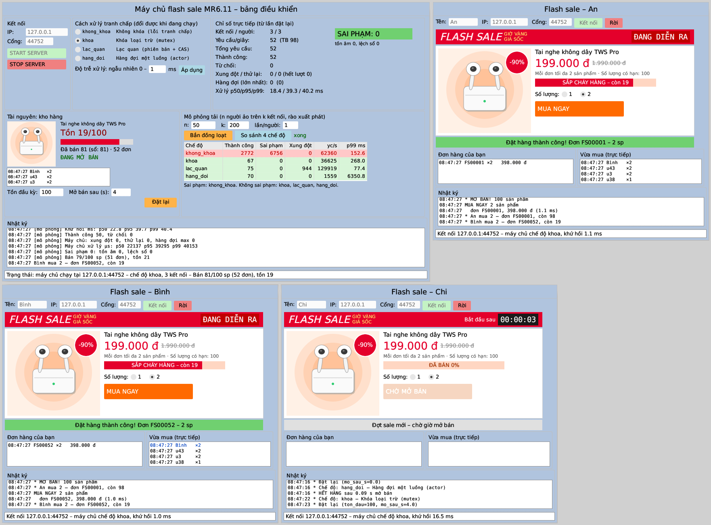
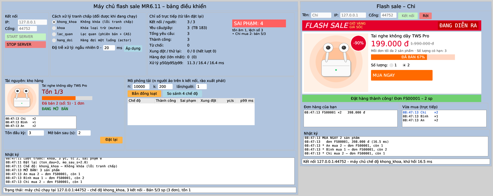
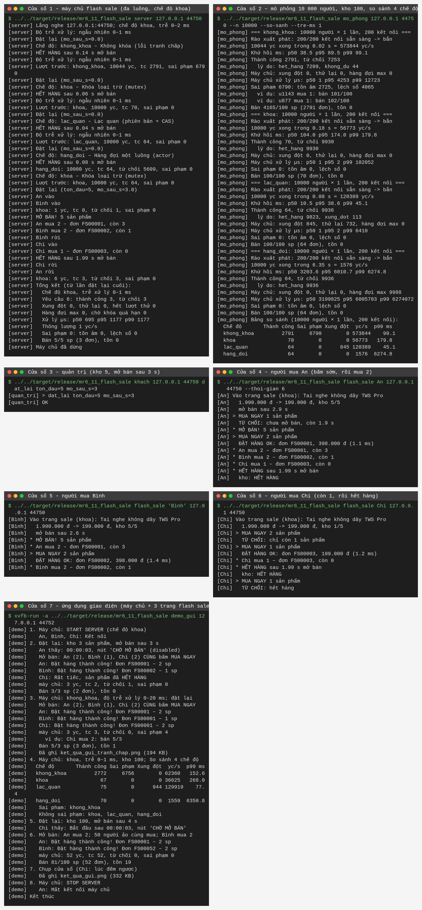

# Bài mở rộng MR6.11 – Flash sale: 10 000 người tranh kho 100 sản phẩm (Rust)

| Thông tin | Nội dung |
|---|---|
| Loại | **Bài mở rộng**, không có trong giáo trình và không có mã giả tương ứng. Thuộc nhóm "tranh chấp tài nguyên" MR6.6–MR6.13, dùng chung khung của [MR6.6](../BaiMR6.6_DauGia/) |
| Liên hệ với giáo trình | Chương 6: Bài 6.1 (server đa luồng, một luồng mỗi kết nối), Bài 6.7 (kiểm thử tải); Chương 3: Bài 3.2 (định khung thông điệp theo dòng); bài mở rộng MR5.4/MR5.5 (luồng, đồng bộ) |
| Thư viện | Thư viện chuẩn Rust: `std::net`, `std::thread`, `std::sync` (`Mutex`, `RwLock`, `Condvar`, `AtomicU64`, `AtomicBool`, `mpsc`); crate `serde_json` 1.0.154 (`preserve_order`), `socket2` 0.5.10, `ctrlc` 3.4.7, `chrono` 0.4.41, `miniz_oxide` 0.8.9; giao diện `eframe`/`egui` 0.29.1. Mọi crate ghim bằng `=` và `Cargo.lock` |
| Bản ngôn ngữ khác | [Python](../../../python/Chuong06/BaiMR6.11_FlashSale/), [C#](../../../csharp/Chuong06/BaiMR6.11_FlashSale/), [Java](../../../java/Chuong06/BaiMR6.11_FlashSale/), [Go](../../../go/Chuong06/BaiMR6.11_FlashSale/) |

## Mục tiêu
Bài mô phỏng một "giờ vàng" flash sale. Kho có **100 sản phẩm** (tai nghe 1.990.000 đ, giá sale 199.000 đ), **mở bán lúc T** sau một đồng hồ đếm ngược, và **10 000 người** cùng bấm "MUA NGAY" đúng lúc mở, mỗi người đặt một đơn 1–2 sản phẩm. Luật bán: chưa tới giờ thì từ chối `chua_mo`; còn 1 mà mua 2 thì `khong_du`; hết thì `het_hang`. Tồn kho là **một ô duy nhất** (`Kho { ton, da_ban, so_don }`), điểm nóng mà mọi đơn hàng cùng tranh. Máy chủ TCP đa luồng xử lý `mua` bằng thao tác "đọc tồn → kiểm tra (giả lập độ trễ cơ sở dữ liệu) → ghi" theo **bốn cách** đổi được khi đang chạy. **Sổ kiểm toán** đếm hai sai phạm: **tồn âm** (một đơn được chấp nhận làm tổng đã bán vượt tồn đầu kỳ) và **lệch sổ** (cuối buổi, tổng đã bán theo sổ khác tồn đầu kỳ − tồn hiện tại, tính theo số sản phẩm lệch).

Giao thức, câu chữ và định dạng dòng in giống hệt bản Python (đã thử chạy chéo, xem Ghi chú).

## Kiến thức chính
Số liệu dưới đây lấy từ `ket_qua.txt`, là một lần chạy thật trên máy cục bộ (127.0.0.1, Rust 1.97, 2 lõi). Lượt so sánh dùng **độ trễ xử lý 0–1 ms** (`--tre-ms 1`) như bản Python. Mỗi lần chạy, số liệu lệch đi đôi chút.

```
  Chế độ       Thành công Sai phạm Xung đột  yc/s  p99 ms
  khong_khoa         2791     6790        0 573844    99.1
  khoa                 70        0        0 56773   179.8
  lac_quan             64        0      845 120389    45.1
  hang_doi             64        0        0  1576  6274.8
```
(10 000 người × 1 đơn, mỗi đơn 1–2 sản phẩm, kho 100, 200 kết nối, mở bán ngay khi đặt lại, nên rào xuất phát chính là "giờ G". "Thành công" là số đơn được chấp nhận, "Sai phạm" do sổ kiểm toán đếm, "Xung đột" là số lần so sánh-và-đổi thất bại, "yc/s" và "p99" (khứ hồi) đo ở bộ mô phỏng.)

- **yc/s ở bài này phải đọc kỹ.** Sau khi cháy hàng (0,04–0,14 s), mọi yêu cầu còn lại được trả lời "hết hàng" gần như tức thì (xử lý p50 **1 µs**), nên phần lớn 10 000 yêu cầu xong trước cả khi luồng chính của bộ mô phỏng kịp ghi mốc t0 sau rào xuất phát (2 lõi phải chạy 200 luồng kết nối vừa được đánh thức). Khung tính yc/s = số yêu cầu / (t1 − t0), nên khi t0 bị ghi muộn, con số phình lên (573 844 yc/s ở `khong_khoa` – rộng 6 chữ số, làm lệch cột bảng), trong khi p99 khứ hồi (99 ms) vẫn đúng. Bộ mô phỏng Python chạy với máy chủ Rust (xem Ghi chú) và bản Java (lượt `lac_quan`) cũng thấy hiện tượng này. So sánh các chế độ ở bài này nên dựa vào cột p99 và cột sai phạm.
- **Tranh chấp (race condition): bán vượt kho.** Ở `khong_khoa`, trong vài chục ms đầu, 200 luồng cùng đọc "còn 100", cùng qua bước kiểm tra, cùng ghi "100 − 2". Bản ghi sau đè bản trước (mất cập nhật), nên tồn kho giảm chậm hơn nhiều so với số hàng thật đã bán: **2791 đơn, 4165 sản phẩm được bán từ kho 100**. Sổ kiểm toán đếm 2725 đơn bán vượt (ví dụ `u1143 mua 1: bán 101/100`) và lệch 4065 sản phẩm giữa sổ với tồn kho. Mã đơn cũng trùng: ở giao diện, An, Bình và Chi cùng nhận **đơn FS00001**, vì bộ đếm đơn nằm trong cùng ô và cũng bị mất cập nhật. Chế độ này chỉ dùng để minh họa lỗi trong phòng lab (loopback).
- **Vùng găng ngắn, việc chỉ đọc đặt ngoài vùng găng.** Hai kiểm tra không cần khóa: (1) **giờ mở bán**, chỉ đọc đồng hồ đơn điệu; (2) **"hết hàng nhanh"**, đọc tồn kho không khóa (`kho.doc("kho")`). Tồn kho chỉ giảm, nên một lần đọc thấy 0 thì chắc chắn là 0. Nhờ vậy, ở `khoa` chỉ những yêu cầu đến trước lúc cháy hàng phải xếp hàng chờ khóa; thời gian xử lý ở máy chủ có p50 **1 µs**, p95 2 µs và p99 102 ms (những người chờ khóa ở giây đầu).
- **Lạc quan (Kung & Robinson 1981).** `lac_quan` đọc (tồn, phiên bản), kiểm tra ngoài khóa rồi so sánh-và-đổi (`AtomicU64::compare_exchange`): 845 xung đột, 732 lần thử lại, 113 đơn hết lượt thử ("xung đột, thử lại sau"). Sai phạm 0, p99 khứ hồi thấp nhất (45 ms). Kho cháy hàng sau 0,04 s.
- **Hàng đợi một luồng (actor).** `hang_doi` đúng và công bằng theo thứ tự đến. Tuy vậy, mọi yêu cầu đến trước lúc cháy hàng, tức gần như cả 10 000 (hàng đợi dài tối đa 9988), đã vượt qua bước "hết hàng nhanh" và nằm trong kênh `mpsc`, nên một luồng phải xử lý lần lượt từng yêu cầu, kể cả những yêu cầu sẽ nhận "hết hàng": chỉ 1576 yc/s, p99 6,3 s. Đây là lý do các sàn thật đặt một **cờ "hết hàng" ở tầng trước hàng đợi**, hoặc dùng phòng chờ (MR6.13).
- **Đồng hồ mở bán, không tin client.** Máy chủ gửi `mo_con_ms` (số ms còn lại theo đồng hồ đơn điệu, không gửi giờ tuyệt đối). Client tự đếm ngược và khóa nút "MUA NGAY", nhưng máy chủ vẫn kiểm tra lại: ở cửa sổ 4, An gõ `mua 1` sớm và nhận "chưa mở bán, còn 1.9 s". Khi tới giờ, luồng nền 100 ms của máy chủ phát `su_kien` "MỞ BÁN!".
- **Sổ kiểm toán, đối soát cuối ngày.** Sổ cộng số lượng của mọi đơn được chấp nhận, ghi trong vùng găng (`khi_ghi`). Hai luật: tổng bán theo sổ không vượt tồn đầu kỳ (`kiem_tra`), và tổng bán theo sổ bằng tồn đầu kỳ − tồn hiện tại (`kiem_tra_cuoi`). Bảng điều khiển máy chủ hiện "Đã bán 2 (sổ: 5)" màu đỏ khi hai con số lệch nhau.

### Giao thức (giống hệt ở 5 ngôn ngữ)
TCP, mỗi dòng một JSON UTF-8 kết thúc `\n`, tối đa 64 KB một dòng. Phần chung (chào, quản trị, `thong_ke`, `lap_lai`) xem [README MR6.6](../BaiMR6.6_DauGia/README.md#giao-thức-giống-hệt-ở-5-ngôn-ngữ).

| Chiều | Thông điệp |
|---|---|
| người dùng → server | `{"loai":"mua","ma_yc":k,"so_luong":2}` (kết nối gộp thêm `"nguoi":"u17"`) |
| server → client | `{"loai":"kq","ma_yc":k,"ok":true,"ma_don":"FS00012","so_luong":2,"ton":61,"nguoi":"An","thanh_tien":398000}` hoặc `{"loai":"kq","ma_yc":k,"ok":false,"ma_loi":"chua_mo"\|"khong_du"\|"het_hang"\|"sai_du_lieu"\|"xung_dot"\|…,"ly_do":…,"con_ms"/"ton":…}` |
| server → tất cả | `{"loai":"cap_nhat","che_do":…,"sp":{"ten","gia_goc","gia_sale","toi_da"},"ton_dau":100,"ton":61,"da_ban":39,"so_don":25,"ban_theo_so":39,"mo_ban":true,"mo_con_ms":0,"don_gan":[{"nguoi","so_luong","gio"}…]}` (≤ 10 lần/s); `{"loai":"su_kien","noi_dung":"MỞ BÁN! 100 sản phẩm"}`, `"HẾT HÀNG sau 0.14 s mở bán"`, `"An mua 2 – đơn FS00001, còn 98"` (chỉ người dùng thật) |
| quản trị → server | `{"loai":"dat_lai","ma_yc":k,"ton_dau":100,"mo_sau_s":30,"toi_da":2,"gia_goc":…,"gia_sale":…,"ten_sp":…}` |

## Cấu trúc tệp
Gói Cargo `mr6_11_flash_sale` (một chương trình, chọn vai trò bằng lệnh con):
- **Khung chung**, chép từ MR6.6: `src/chung.rs`, `src/khach.rs`, `src/mo_phong.rs`, `src/server.rs`, `src/gui_chung.rs` (khác MR6.6 ba chỗ nhỏ giống nhau ở 5 bài MR6.9–MR6.13: `KhoTranhChap::dat_o`/`co_o`, `MayChu::dat_mot_tham_so`, `CuaSoServer::xong_mo_phong` là `pub`).
- **Nghiệp vụ:** `src/may_chu.rs` (`FlashSale: NghiepVu`, `LuatFlashSale: LuatKiemToan`, đồng hồ mở bán trong `dinh_ky`), `src/nguoi_ao.rs` (`NguoiAo`: 1–2 sản phẩm, "chỉ còn k" thì mua đúng k, hết hàng thì thôi; `tham_so_dat_lai` = `{"mo_sau_s": 0}`), `src/flash_sale.rs` (người mua dòng lệnh: `mua [n]`).
- **Giao diện:** `src/server_gui.rs` (ảnh sản phẩm, tồn, đã bán theo kho/sổ, đồng hồ mở bán), `src/flash_sale_gui.rs` (trang "giờ vàng": ảnh tai nghe vẽ bằng bút vẽ egui), `src/demo_gui.rs`, `src/main.rs`.
- `Cargo.toml`, `Cargo.lock`, `demo.json`, `ket_qua.txt`, `ket_qua.png`, `ket_qua_gui.png`, `ket_qua_gui_tranh_chap.png`: kịch bản và kết quả thực thi thật.

## Cách chạy
Trong thư mục bài (`cargo build -q --release` một lần; `B=../../target/release/mr6_11_flash_sale`, Windows: `..\..\target\release\mr6_11_flash_sale.exe`):
```bash
$B server 127.0.0.1 9000                                       # cửa sổ 1 (gõ lệnh ở đây)
$B mo_phong 127.0.0.1 9000 --n 10000 --so-sanh --tre-ms 1      # cửa sổ 2: bảng so sánh 4 chế độ
$B khach 127.0.0.1 9000 dat_lai ton_dau=5 mo_sau_s=10          # đợt mới: kho 5, mở sau 10 s
$B flash_sale An 127.0.0.1 9000                                # cửa sổ 3, 4…: gõ mua 2
```
- Lệnh của máy chủ: `che_do khong_khoa|khoa|lac_quan|hang_doi`, `tre <ms>`, `dat_lai [ton_dau=… mo_sau_s=… toi_da=…]`, `thong_ke`, `thoat`. Tùy chọn: `--che-do`, `--tre-ms`, `--ton`, `--mo-sau`.
- Lệnh của `flash_sale`: `mua [n]` (mặc định 1), `thoat`; dòng `@t lệnh` chờ tới giây thứ t rồi mới chạy lệnh.
- Trong demo (cửa sổ 3–6), kho có 5 sản phẩm, mở bán sau 3 s: An bấm sớm bị "chưa mở bán", sau đó mua 2; Bình mua 2; Chi (mua 2 khi còn 1) nhận "chỉ còn 1 sản phẩm", mua 1 thì được, lần sau nhận "hết hàng".

Tái lập kết quả từ thư mục gốc của kho: `python3 tools/demo.py rust/Chuong06/BaiMR6.11_FlashSale` (cổng 44750, giao diện 44752). Cổng 447x0 nằm trong dải cổng tạm của Linux: gặp "Address already in use" thì chạy lại.

## Ứng dụng giao diện


Ảnh trên là lần chạy thật của `demo_gui` (Linux, Xvfb + Mesa llvmpipe, egui 0.29.1): bảng điều khiển máy chủ (trên trái), An (trên phải), Bình (dưới trái) và Chi (dưới phải, chụp lúc đang đếm ngược "Bắt đầu sau 00:00:03", nút "CHỜ MỞ BÁN" bị khóa). Kịch bản đã chạy so sánh 4 chế độ (bảng ở giữa, dòng `khong_khoa` tô đỏ: 6756 sai phạm; ba chế độ còn lại 0). Sau đó mở đợt mới kho 100: An mua 2 (đơn FS00001), 50 người ảo cùng mua, Bình mua 2 (đơn FS00052); thanh tồn kho "ĐÃ BÁN 81%", danh sách "Vừa mua" cập nhật trực tiếp.



Ở bước trước đó (ảnh trên), máy chủ chạy `khong_khoa` với độ trễ xử lý 0–20 ms, kho 3 sản phẩm. Vừa mở bán, An (2), Bình (1), Chi (2) cùng bấm MUA NGAY: cả ba "Đặt hàng thành công! Đơn FS00001", tổng 5 sản phẩm từ kho 3, kho còn 1. Ô **SAI PHẠM** chuyển đỏ (4: tồn âm 1, lệch sổ 3), "Đã bán 2 (sổ: 5)" màu đỏ. Cùng thao tác đó ở `khoa`: An và Bình được, Chi nhận "Rất tiếc, sản phẩm đã HẾT HÀNG" (hoặc "Chỉ còn 1 sản phẩm", tùy thứ tự tới).

- **Máy chủ** (`server_gui`): phần chung như MR6.6; **tài nguyên**: ảnh sản phẩm, "Tồn x/100", thanh đã bán (cam, đỏ khi ≥ 80 %), "Đã bán … (sổ: …) · … đơn" (đỏ khi sổ lệch kho), đồng hồ "Mở bán sau 00:mm:ss" / "ĐANG MỞ BÁN" / "HẾT HÀNG", ba đơn gần nhất, ô tồn đầu kỳ và "Mở bán sau (s)".
- **Trang flash sale** (`flash_sale_gui`): dải **FLASH SALE – GIỜ VÀNG GIÁ SỐC** với đồng hồ đếm ngược (chạy cục bộ theo `mo_con_ms`, chuyển "ĐANG DIỄN RA" / "CHÁY HÀNG"); thẻ sản phẩm (ảnh hộp sạc và đôi tai nghe vẽ bằng đường cong B-spline của khung, nhãn "-90%", giá sale cỡ lớn, giá gốc gạch ngang, "Mỗi đơn tối đa 2 sản phẩm"); thanh tồn kho ("ĐÃ BÁN x%", "SẮP CHÁY HÀNG – còn n", "HẾT HÀNG"); chọn số lượng 1–2; nút **MUA NGAY** (khóa tới giờ mở bán, "ĐANG XỬ LÝ…" trong lúc chờ); dòng kết quả; "Đơn hàng của bạn" và "Vừa mua (trực tiếp)".

### Cách chạy
```bash
cargo build --release
$B server_gui 127.0.0.1 44752                  # bấm START SERVER (kho 100, mở bán sau 30 s)
$B flash_sale_gui An 127.0.0.1 44752
$B flash_sale_gui Bình 127.0.0.1 44752
```
- **Windows:** cần Rust bản MSVC như các bài Rust khác. **Linux:** thư viện OpenGL/X11 (hoặc Wayland). Kịch bản tự động (Linux, cần `xvfb`): `xvfb-run -a -s "-screen 0 2600x1700x24" $B demo_gui 127.0.0.1 44752`.
- Chạy riêng từng cửa sổ: mọi dòng nhật ký và cứ 5 giây một dòng số liệu cũng in ra dòng lệnh.
- Thử trên nhiều máy: máy chủ nghe trên IP card mạng (hoặc `0.0.0.0`) và mở tường lửa cho cổng; đặt kho bằng khoảng 1/3 số sinh viên, mở bán sau 20 s, rồi cả lớp cùng chờ giờ G. Khi đó **chỉ dùng `khoa`, `lac_quan`, `hang_doi`**.

## Kết quả thực thi


## Ghi chú
- **Chạy chéo với bản Python** (đã thử, 10 000 người, `--so-sanh --tre-ms 1`; số liệu ở `docs/_status/morong_mr611_rust.json`): cả hai chiều cho `khong_khoa` hàng nghìn sai phạm (bán vượt kho), ba chế độ còn lại 0; người mua Python (Bình) và Rust (Chi) cùng một đợt kho 3 trên máy chủ Rust: Bình mua 2, Chi mua 2 bị "chỉ còn 1 sản phẩm", mua 1 thì được, "HẾT HÀNG sau 1.05 s mở bán".
- `mo_sau_s` là số thực (mặc định 30.0), nên `dat_lai mo_sau_s=0` được ép thành `0.0` như `type(30.0)(0)` của Python và máy chủ in `Đặt lại (mo_sau_s=0.0)` dù yêu cầu đến từ ngôn ngữ nào.
- Trong kịch bản giao diện, máy chủ, bộ mô phỏng và 4 cửa sổ cùng chạy trong một tiến trình trên 2 lõi, nên yc/s khác bản dòng lệnh.
- Kiểm thử: Linux, Rust 1.97.0 (`cargo build` không cảnh báo), tools/demo.py; giao diện egui 0.29.1 dưới Xvfb + Mesa llvmpipe. Bản giao diện chưa thử trên Windows.

## Bài tập gợi ý
1. Bỏ bước "hết hàng nhanh" trong `may_chu.rs` rồi so sánh lại. Thời gian xử lý p50 của `khoa` và p99 khứ hồi thay đổi thế nào? Vì sao?
2. Thêm một `AtomicBool` "đã hết hàng" kiểm tra *trước* khi đưa việc vào hàng đợi của `hang_doi`. Thông lượng `hang_doi` thay đổi ra sao?
3. Sửa khung để mốc t0 của bộ mô phỏng là thời điểm *sớm nhất* một kết nối gửi lô yêu cầu đầu (thay vì lúc luồng chính qua rào). Cột yc/s của bài này có còn "phình" không?
4. Thêm giới hạn "mỗi người chỉ mua một đơn". Cần thêm ô nào (gợi ý: `kho.dat_o("ng:<tên>", …)` như MR6.9) và luật sổ kiểm toán nào?
5. Thêm "giữ hàng trong giỏ 5 phút" (như MR6.8): đặt hàng chỉ giữ, thanh toán mới trừ kho. Tranh chấp chuyển sang đâu?
6. Giao diện: hiện một biểu đồ "đơn/giây" trong 2 giây đầu mở bán trên bảng máy chủ.

## Đọc thêm
- H. T. Kung, J. T. Robinson (1981). *On Optimistic Methods for Concurrency Control*. ACM Transactions on Database Systems 6(2).
- E. G. Coffman, M. J. Elphick, A. Shoshani (1971). *System Deadlocks*. ACM Computing Surveys 3(2).
- Tài liệu Rust: [`std::sync`](https://doc.rust-lang.org/std/sync/index.html) (`Mutex`, `Condvar`, `mpsc`), [`std::sync::atomic`](https://doc.rust-lang.org/std/sync/atomic/index.html) (`AtomicU64::compare_exchange`, `AtomicBool`), [`std::time::Instant`](https://doc.rust-lang.org/std/time/struct.Instant.html) (đồng hồ đơn điệu); The Rust Programming Language, chương 16 "Fearless Concurrency".
- [egui](https://docs.rs/egui/0.29.1/egui/) 0.29.1.

Mã nguồn của bài được viết mới cho kho này.
