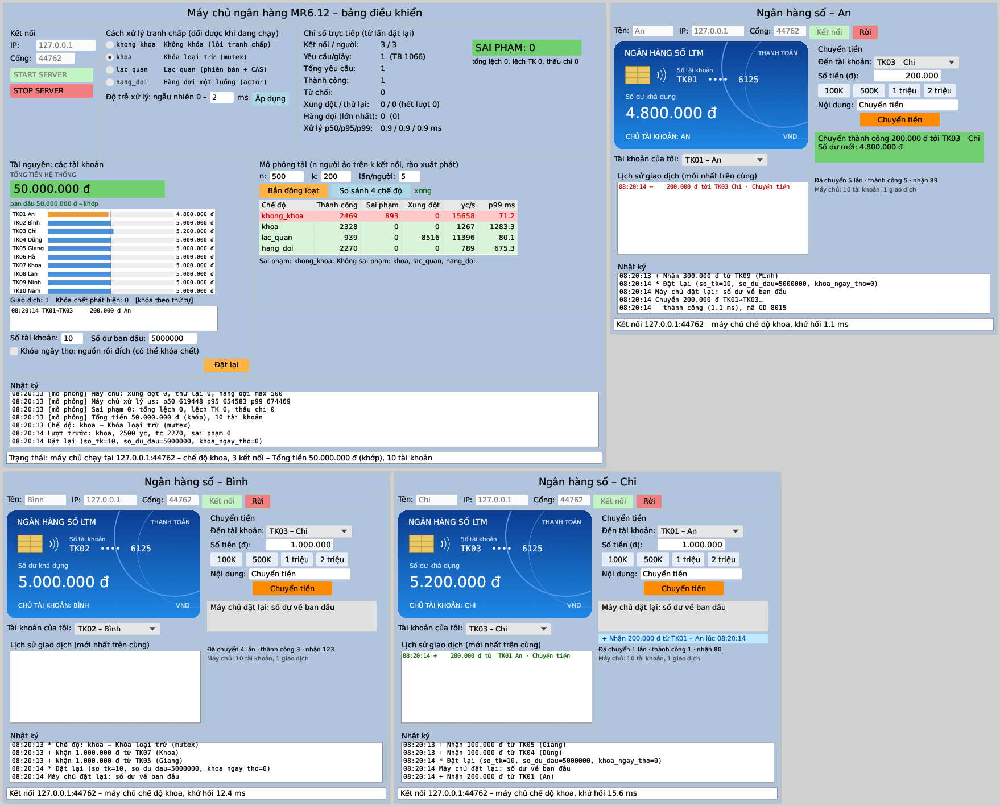
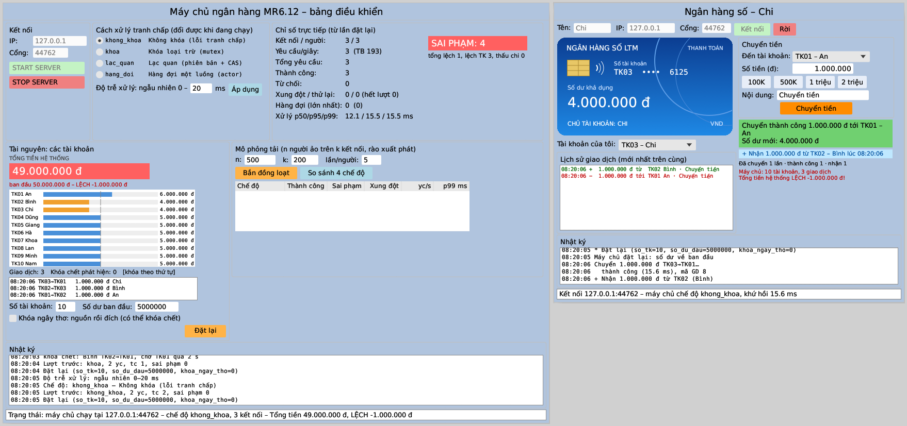
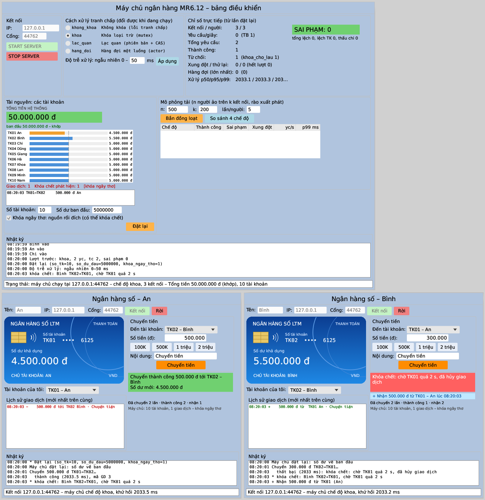
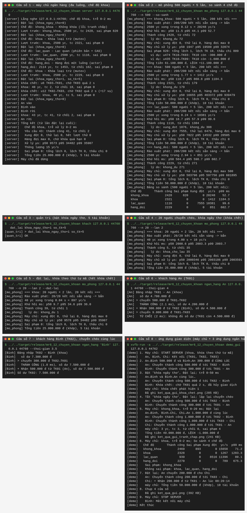

# Bài mở rộng MR6.12 – Chuyển khoản: chuyển chéo, mất cập nhật và khóa chết (Rust)

| Thông tin | Nội dung |
|---|---|
| Loại | **Bài mở rộng**, không có trong giáo trình và không có mã giả tương ứng. Thuộc nhóm "tranh chấp tài nguyên" MR6.6–MR6.14, dùng chung khung của [MR6.6](../BaiMR6.6_DauGia/) |
| Liên hệ với giáo trình | Chương 6: Bài 6.1 (server đa luồng, một luồng mỗi kết nối), Bài 6.7 (kiểm thử tải); Chương 3: Bài 3.2 (định khung thông điệp theo dòng); bài mở rộng MR5.4/MR5.5 (luồng, đồng bộ) |
| Thư viện | Thư viện chuẩn Rust: `std::net`, `std::thread`, `std::sync` (`Mutex`, `RwLock`, `Condvar`, `AtomicU64`, `AtomicBool`, `mpsc`); crate `serde_json` 1.0.154 (`preserve_order`), `socket2` 0.5.10, `ctrlc` 3.4.7, `chrono` 0.4.41, `miniz_oxide` 0.8.9; giao diện `eframe`/`egui` 0.29.1. Mọi crate ghim bằng `=` và `Cargo.lock` |
| Bản ngôn ngữ khác | [Python](../../../python/Chuong06/BaiMR6.12_ChuyenKhoan/), [C#](../../../csharp/Chuong06/BaiMR6.12_ChuyenKhoan/), [Java](../../../java/Chuong06/BaiMR6.12_ChuyenKhoan/), [Go](../../../go/Chuong06/BaiMR6.12_ChuyenKhoan/) |

## Mục tiêu
Bài mô phỏng một ngân hàng nhỏ có 5–20 tài khoản (mặc định 10 tài khoản, mỗi tài khoản 5.000.000 đ). Một lệnh **chuyển khoản** (`chuyen`: từ, đến, số tiền) phải trừ tài khoản nguồn và cộng tài khoản đích **trong cùng một thao tác**, và bị từ chối nếu số dư nguồn không đủ. Mỗi thao tác chạm **hai tài nguyên**; rất nhiều người chuyển chéo nhau cùng lúc (A→B và B→A), nên ngoài tranh chấp (mất cập nhật) còn xuất hiện **khóa chết** (deadlock) nếu khóa sai thứ tự.

Máy chủ TCP đa luồng giữ số dư (mỗi tài khoản một ô `i64`). Mỗi lần chuyển là "đọc hai số dư → kiểm tra (giả lập độ trễ cơ sở dữ liệu 0–2 ms) → ghi hai số dư", xử lý theo bốn cách chọn được lúc đang chạy: không khóa, khóa loại trừ (hai tài khoản), lạc quan (phiên bản + so sánh-và-đổi cả hai tài khoản), hàng đợi một luồng. Chế độ `khoa` có thêm tùy chọn **khóa ngây thơ** (khóa nguồn rồi mới khóa đích) để thấy khóa chết. **Sổ kiểm toán** tự cộng trừ từng giao dịch được chấp nhận và đối chiếu: tổng tiền toàn hệ thống có giữ nguyên không, số dư từng tài khoản có khớp sổ không, có giao dịch nào làm tài khoản âm (thấu chi) không.

Giao thức, câu chữ và định dạng dòng in giống hệt bản Python (đã thử chạy chéo, xem Ghi chú).

## Kiến thức chính
Số liệu dưới đây lấy từ `ket_qua.txt`, là một lần chạy thật trên máy cục bộ (127.0.0.1, Rust 1.97, 2 lõi, độ trễ xử lý ngẫu nhiên 0–2 ms). Mỗi lần chạy, số liệu lệch đi đôi chút.

```
  Chế độ       Thành công Sai phạm Xung đột  yc/s  p99 ms
  khong_khoa         2428      820        0 20248    52.7
  khoa               2321        0        0  1412  1184.3
  lac_quan           1116        0     7555 10381    99.6
  hang_doi           2229        0        0   851   602.7
```
(500 người × 5 lần chuyển = 2500 yêu cầu/chế độ, 200 kết nối, 10 tài khoản. Mỗi người chọn ngẫu nhiên một cặp tài khoản rồi chuyển qua lại A→B, B→A…, số tiền 100.000–2.000.000 đ.)

- **Tranh chấp trên hai tài nguyên, mất cập nhật.** Ở `khong_khoa`, hai luồng cùng đọc số dư của một tài khoản, cùng thấy "đủ tiền", cùng trừ và ghi, và bản ghi sau đè bản ghi trước. Kết quả có **820 sai phạm**: *thấu chi* 809 (ví dụ `u474 TK10→TK03: TK10 còn -300.000 đ`), *lệch TK* 10 (cả 10 tài khoản có số dư cuối khác sổ) và *tổng lệch* 1: tổng tiền toàn hệ thống thành **61.100.000 đ, lệch +11.100.000 đ** so với 50.000.000 đ ban đầu – tiền tự sinh ra vì một lần "cộng đích" bị ghi đè mất phần "trừ nguồn" của giao dịch khác. Trên giao diện, ba người chuyển vòng An→Bình, Bình→Chi, Chi→An mỗi người 1.000.000 đ cùng lúc (độ trễ 0–20 ms); cả ba đều "thành công", nhưng tổng tiền thành 49.000.000 đ và ô **TỔNG TIỀN HỆ THỐNG** chuyển đỏ (`ket_qua_gui_tranh_chap.png`). Chế độ này chỉ dùng để minh họa lỗi trong phòng lab (loopback).
- **Khóa theo từng tài nguyên, giữ cả hai khóa.** `khoa` cho mỗi tài khoản một khóa (khóa FIFO có hạn chờ của khung, dựng từ `Mutex` + `Condvar`) và giữ **cả hai** khóa suốt đọc – kiểm tra – ghi. Sai phạm bằng 0. Vì có 10 tài khoản, các cặp không chung tài khoản chạy song song, nên thông lượng (1412 yc/s) cao hơn `hang_doi` (851 yc/s). Đổi lại, tài khoản "nóng" tạo hàng chờ dài, p99 khứ hồi 1,2 s.
- **Khóa chết và thứ tự khóa (Coffman và cộng sự 1971).** Khóa chết cần đủ bốn điều kiện: loại trừ lẫn nhau, giữ và chờ, không tước đoạt, và **vòng chờ**. Với khóa ngây thơ (`khoa_ngay_tho=1`: khóa nguồn, nghỉ 0–2 ms, rồi khóa đích), A→B giữ A chờ B, B→A giữ B chờ A: vòng chờ. Lượt `kc` (20 người × 2 lần, 5 tài khoản): 40 yêu cầu mất **4,00 s**, 35 yêu cầu bị hủy `khoa_cho_lau`, p50 khứ hồi đúng 2001 ms (bằng thời gian chờ khóa tối đa). Máy chủ in `khóa chết: u6 TK03→TK01, chờ TK03 quá 2 s` rồi `… (+17 vụ)` (tối đa một dòng/giây). Khóa chết được **phát hiện bằng hết thời gian chờ** (`KhoaO::lay(han)` – `std::sync::Mutex` không có "lock có thời hạn", nên khung tự dựng khóa có hạn chờ): giao dịch "nạn nhân" bị hủy, nhả khóa đang giữ, giao dịch kia đi tiếp; các luồng xếp hàng sau khóa bị giữ cũng hết giờ theo (hiệu ứng dây chuyền). Cách phòng là **phá điều kiện vòng chờ**: mọi luồng khóa theo cùng một thứ tự (thứ tự mã tài khoản, TK01 trước TK02). Lượt `tt` cùng 20 người, cùng 5 tài khoản nhưng khóa có thứ tự: 39/40 thành công (1 "không đủ số dư") trong **0,04 s**, không còn vụ chờ khóa quá hạn nào. Trên giao diện, An→Bình và Bình→An cùng lúc ở chế độ khóa ngây thơ (trễ 0–50 ms): sau 2 s một người nhận "Khóa chết: chờ … quá 2 s, đã hủy giao dịch", giao dịch của người kia hoàn tất (`ket_qua_gui_khoa_chet.png`).
- **Lạc quan trên nhiều ô (Kung & Robinson 1981).** `lac_quan` đọc (số dư, **phiên bản**) của cả hai tài khoản dưới một khóa rất ngắn, tính ngoài khóa, rồi **so sánh-và-đổi nguyên tử cả hai**: chỉ ghi khi phiên bản của *cả hai* chưa đổi (phiên bản tăng bằng `AtomicU64::compare_exchange`). Sai phạm bằng 0, nhưng khi 200 luồng cùng đụng 10 tài khoản thì xung đột rất nhiều (7555 lần, 6479 lần thử lại), và 1076 yêu cầu hết 5 lượt thử nên bị từ chối "xung đột, thử lại sau". Vì vậy chỉ 1116 lệnh thành công, ít hơn hẳn `khoa`. Lạc quan hợp với tranh chấp *thưa*; tranh chấp *dày* thì tốn công làm lại.
- **Hàng đợi một luồng.** `hang_doi` không cần khóa, không thể khóa chết (chỉ một luồng chạm vào số dư), thứ tự đến trước phục vụ trước. Đổi lại, nó tuần tự hoàn toàn: 851 yc/s, hàng đợi dài tối đa 500.
- **Sổ kiểm toán = đối soát.** Sổ ghi mọi giao dịch được chấp nhận ngay trong vùng găng (`khi_ghi`) và tự tính số dư theo sổ. Bất biến của bài: tổng tiền không đổi; số dư từng tài khoản bằng số dư đầu cộng tiền vào trừ tiền ra theo sổ; không giao dịch nào làm số dư (theo sổ) âm.
- **Idempotency, pipelining, đẩy trạng thái có gộp** dùng chung khung với MR6.6. Mã giao dịch `ma_gd` (`AtomicU64`) tăng mãi, kể cả qua các lần đặt lại, nên ứng dụng không báo "tiền đến" hai lần.

### Giao thức (giống hệt ở 5 ngôn ngữ)
TCP, mỗi dòng một JSON UTF-8 kết thúc `\n`, tối đa 64 KB một dòng. Phần chung (chào, quản trị, `thong_ke`, `lap_lai`) xem [README MR6.6](../BaiMR6.6_DauGia/README.md#giao-thức-giống-hệt-ở-5-ngôn-ngữ).

| Chiều | Thông điệp |
|---|---|
| người dùng → server | `{"loai":"chuyen","ma_yc":k,"tu":"TK01","den":"TK02","so_tien":300000,"noi_dung":"trả tiền sách"}` (nội dung tối đa 40 ký tự; kết nối gộp thêm `"nguoi":"u17"`) |
| server → client | `{"loai":"kq","ma_yc":k,"ok":true,"tu":…,"den":…,"so_tien":…,"so_du":4700000,"nguoi":…,"noi_dung":…,"ma_gd":17}` hoặc `{"loai":"kq","ma_yc":k,"ok":false,"ma_loi":"khong_du"\|"khoa_cho_lau"\|"xung_dot"\|"khong_co"\|"sai_du_lieu","ly_do":…}` |
| server → tất cả | `{"loai":"cap_nhat","che_do":…,"tai_khoan":[{"ma","chu","so_du"}…],"tong","tong_dau","khoa_ngay_tho","khoa_chet","so_gd","lich_su":[{"ma","gio","nguoi","tu","den","so_tien","noi_dung"}…]}` (≤ 10 lần/s); `{"loai":"su_kien","noi_dung":"khóa chết: An TK01→TK02, chờ TK02 quá 2 s"}` |
| quản trị → server | `{"loai":"dat_lai","ma_yc":k,"so_tk":10,"so_du_dau":5000000,"khoa_ngay_tho":0}` |

## Cấu trúc tệp
Gói Cargo `mr6_12_chuyen_khoan` (một chương trình, chọn vai trò bằng lệnh con):
- **Khung chung**, chép từ MR6.6: `src/chung.rs`, `src/khach.rs`, `src/mo_phong.rs`, `src/server.rs`, `src/gui_chung.rs` (khác MR6.6 các chỗ nhỏ giống nhau ở 5 bài MR6.9–MR6.13: `KhoTranhChap::dat_o`/`co_o`, `MayChu::dat_mot_tham_so`, `CuaSoServer::xong_mo_phong` là `pub`; riêng `server.rs` của MR6.12, MR6.13 có ba chỗ nối với `may_chu.rs`: cờ không kèm giá trị `CO_DONG_LENH` (`--khoa-ngay-tho`), dòng báo sau khi lắng nghe `sau_khoi_dong`, lệnh bàn phím riêng `lenh_rieng`).
- **Nghiệp vụ:** `src/may_chu.rs` (`NganHang: NghiepVu`, `LuatNganHang: LuatKiemToan`, báo khóa chết tối đa 1 dòng/giây), `src/nguoi_ao.rs` (`NguoiAo`: một cặp tài khoản ngẫu nhiên, chuyển qua lại `lan` lần), `src/ngan_hang.rs` (khách hàng dòng lệnh: `chuyen <TK> <số tiền> [nội dung]`, `so_du`).
- **Giao diện:** `src/server_gui.rs` (tổng tiền, thanh số dư từng tài khoản, ô "Khóa ngây thơ"), `src/ngan_hang_gui.rs` (ứng dụng ngân hàng số: thẻ tài khoản nền chuyển màu), `src/demo_gui.rs`, `src/main.rs`.
- `Cargo.toml`, `Cargo.lock`, `demo.json`, `ket_qua.txt`, `ket_qua.png`, `ket_qua_gui.png`, `ket_qua_gui_tranh_chap.png`, `ket_qua_gui_khoa_chet.png`: kịch bản và kết quả thực thi thật.

## Cách chạy
Trong thư mục bài (`cargo build -q --release` một lần; `B=../../target/release/mr6_12_chuyen_khoan`, Windows: `..\..\target\release\mr6_12_chuyen_khoan.exe`):
```bash
$B server 127.0.0.1 9000                                       # cửa sổ 1 (gõ lệnh ở đây)
$B mo_phong 127.0.0.1 9000 --n 500 --so-sanh                   # cửa sổ 2: bảng so sánh 4 chế độ
$B khach 127.0.0.1 9000 dat_lai khoa_ngay_tho=1 so_tk=5        # bật khóa ngây thơ
$B mo_phong 127.0.0.1 9000 --n 20 --lan 2                      # -> khóa chết (chờ khóa quá 2 s)
$B mo_phong 127.0.0.1 9000 --n 20 --lan 2 --dat-lai            # đặt lại khoa_ngay_tho=0 -> hết
$B ngan_hang An 127.0.0.1 9000                                 # cửa sổ 3, 4…: chuyen TK02 500000 tra tien
```
- Lệnh của máy chủ: `che_do khong_khoa|khoa|lac_quan|hang_doi`, `tre <ms>`, `dat_lai [so_tk=… so_du_dau=… khoa_ngay_tho=0|1]`, `thong_ke`, `thoat`. Tùy chọn: `--che-do`, `--tre-ms`, `--so-tk`, `--so-du`, `--khoa-ngay-tho` (cờ).
- Lệnh của `ngan_hang`: `chuyen <TK> <số tiền> [nội dung]`, `so_du`, `thoat`; tùy chọn `--tk TK03` (mặc định: tài khoản mang tên mình, không có thì TK01).

Tái lập kết quả từ thư mục gốc của kho: `python3 tools/demo.py rust/Chuong06/BaiMR6.12_ChuyenKhoan` (cổng 44760, giao diện 44762). Cổng 447x0 nằm trong dải cổng tạm của Linux: gặp "Address already in use" thì chạy lại.

## Ứng dụng giao diện


Ảnh trên là lần chạy thật của `demo_gui` (Linux, Xvfb + Mesa llvmpipe, egui 0.29.1): bảng điều khiển máy chủ (trên trái), An (trên phải), Bình và Chi (dưới). Kịch bản đã chạy so sánh 4 chế độ (bảng ở giữa, dòng `khong_khoa` tô đỏ: 893 sai phạm; ba chế độ còn lại 0, `lac_quan` 8516 xung đột), rồi đặt lại và An chuyển 200.000 đ cho Chi: thẻ của An còn 4.800.000 đ, cửa sổ Chi hiện "+ Nhận 200.000 đ từ TK01 – An", lịch sử hai bên tô đỏ "−" và xanh "+", tổng tiền 50.000.000 đ (khớp).



Ở `khong_khoa` (trễ 0–20 ms), An→Bình, Bình→Chi, Chi→An mỗi người 1.000.000 đ cùng lúc: cả ba "Chuyển thành công", nhưng **TỔNG TIỀN HỆ THỐNG** thành 49.000.000 đ (đỏ, "LỆCH -1.000.000 đ"), **SAI PHẠM 4** (tổng lệch 1, lệch TK 3).



Khóa ngây thơ, trễ 0–50 ms: An→Bình và Bình→An cùng lúc; sau 2 s một giao dịch nhận "Khóa chết: chờ … quá 2 s, đã hủy giao dịch" (đỏ), giao dịch kia thành công; máy chủ đếm "Khóa chết phát hiện: 1". Tắt khóa ngây thơ rồi lặp lại: cả hai thành công ngay.

- **Máy chủ** (`server_gui`): phần chung như MR6.6; **tài nguyên**: TỔNG TIỀN HỆ THỐNG (xanh khi khớp tổng ban đầu, đỏ khi lệch), bảng tài khoản dạng thanh số dư (vạch xám là số dư ban đầu, thanh cam khi dưới ban đầu), số giao dịch, số vụ khóa chết, ba giao dịch gần nhất, ô số tài khoản, số dư ban đầu, ô chọn **Khóa ngây thơ** (có hiệu lực khi Đặt lại).
- **Ngân hàng số** (`ngan_hang_gui`): thẻ tài khoản (nền chuyển màu bo góc vẽ bằng lưới tam giác `egui::Mesh`, chip, biểu tượng không tiếp xúc, số tài khoản, chủ thẻ, **số dư khả dụng**), chọn tài khoản của tôi; **lịch sử giao dịch** (tiền ra đỏ "−", tiền vào xanh "+", kèm nội dung); khung **Chuyển tiền** (người nhận, số tiền + nút 100K/500K/1 triệu/2 triệu, nội dung, nút Chuyển tiền); dòng kết quả ("Chuyển thành công … Số dư mới", "Không đủ số dư", "Khóa chết: …"), dòng "+ Nhận … từ …" khi có tiền đến, tình trạng hệ thống ("Tổng tiền hệ thống LỆCH …!").

### Cách chạy
```bash
cargo build --release
$B server_gui 127.0.0.1 44762                  # bấm START SERVER (10 tài khoản × 5.000.000 đ)
$B ngan_hang_gui An 127.0.0.1 44762
$B ngan_hang_gui Bình 127.0.0.1 44762
```
- **Windows:** cần Rust bản MSVC như các bài Rust khác. **Linux:** thư viện OpenGL/X11 (hoặc Wayland). Kịch bản tự động (Linux, cần `xvfb`): `xvfb-run -a -s "-screen 0 2600x1700x24" $B demo_gui 127.0.0.1 44762`.
- Chạy riêng từng cửa sổ: mọi dòng nhật ký và cứ 5 giây một dòng số liệu cũng in ra dòng lệnh.
- Thử trên nhiều máy: máy chủ nghe trên IP card mạng (hoặc `0.0.0.0`) và mở tường lửa cho cổng; mỗi sinh viên đăng nhập một tài khoản mang tên mình (An, Bình, Chi, …). Khi đó **chỉ dùng `khoa`, `lac_quan`, `hang_doi`**.

## Kết quả thực thi


## Ghi chú
- **Chạy chéo với bản Python** (đã thử, 500 người × 5 lần, `--so-sanh`; số liệu ở `docs/_status/morong_mr612_rust.json`): cả hai chiều cho `khong_khoa` khoảng 720–780 sai phạm, ba chế độ còn lại 0; quản trị Python bật khóa ngây thơ trên máy chủ Rust, bộ mô phỏng Python 20 người × 2 lần gặp `khoa_cho_lau` và máy chủ Rust in "khóa chết: …"; khách hàng Python (An) và Rust (Bình) chuyển chéo trên cùng máy chủ Rust, mỗi bên báo "+ Nhận …" của bên kia.
- Cờ `--khoa-ngay-tho` không kèm giá trị: `server.rs` của bài truyền `CO_DONG_LENH` cho `Args::parse` (khung MR6.6 chưa có cờ nào), và in dòng "Khóa ngây thơ: nguồn rồi đích (có thể khóa chết)" sau dòng "Lắng nghe …" như bản Python.
- Trong kịch bản giao diện, máy chủ, bộ mô phỏng và 4 cửa sổ cùng chạy trong một tiến trình trên 2 lõi, nên yc/s thấp hơn bản dòng lệnh.
- Kiểm thử: Linux, Rust 1.97.0 (`cargo build` không cảnh báo), tools/demo.py; giao diện egui 0.29.1 dưới Xvfb + Mesa llvmpipe. Bản giao diện chưa thử trên Windows.

## Bài tập gợi ý
1. Tăng `so_tk` lên 20 rồi chạy lại `--so-sanh`. Xung đột của `lac_quan` và p99 của `khoa` thay đổi thế nào? Vì sao tranh chấp "thưa" hơn có lợi cho cả hai?
2. Với khóa ngây thơ, giảm số người xuống 2 (một cặp A→B, B→A). Bao lâu thì gặp khóa chết? Tăng độ trễ (`tre 20`) thì sao?
3. Thay "hết thời gian chờ 2 s" bằng **phát hiện vòng chờ** (đồ thị chờ – wait-for graph): ghi lại luồng nào giữ khóa nào, luồng nào đang chờ khóa nào, và hủy ngay khi có vòng. So sánh thời gian tổng của lượt `kc`.
4. Viết chế độ "khóa cả hai bằng `try_lock`, không được thì nhả hết và thử lại" (không chờ khi giữ khóa: phá điều kiện "giữ và chờ"). Có còn khóa chết không? Có "khóa sống" (livelock) không?
5. Thêm thao tác `chuyen_nhieu` (một nguồn, nhiều đích). Thứ tự khóa và sổ kiểm toán cần gì thêm?
6. Giao diện: vẽ biểu đồ tổng tiền hệ thống theo thời gian trên bảng máy chủ; ở `khong_khoa` đường đó dao động ra sao?

## Đọc thêm
- E. G. Coffman, M. J. Elphick, A. Shoshani (1971). *System Deadlocks*. ACM Computing Surveys 3(2): bốn điều kiện của khóa chết và các cách phòng/phát hiện.
- H. T. Kung, J. T. Robinson (1981). *On Optimistic Methods for Concurrency Control*. ACM Transactions on Database Systems 6(2).
- Tài liệu Rust: [`std::sync`](https://doc.rust-lang.org/std/sync/index.html) (`Mutex`, `Condvar::wait_timeout`, `mpsc`), [`std::sync::atomic`](https://doc.rust-lang.org/std/sync/atomic/index.html) (`AtomicU64::compare_exchange`); The Rust Programming Language, chương 16 "Fearless Concurrency" (phần nói về khóa chết với `Mutex`).
- [egui](https://docs.rs/egui/0.29.1/egui/) 0.29.1 (`Mesh`, `ComboBox`).

Mã nguồn của bài được viết mới cho kho này.
