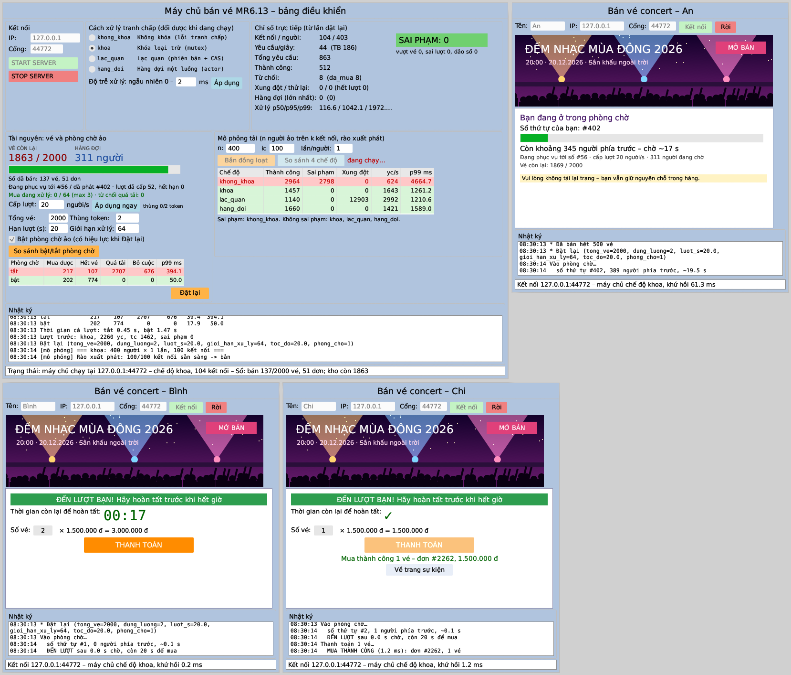
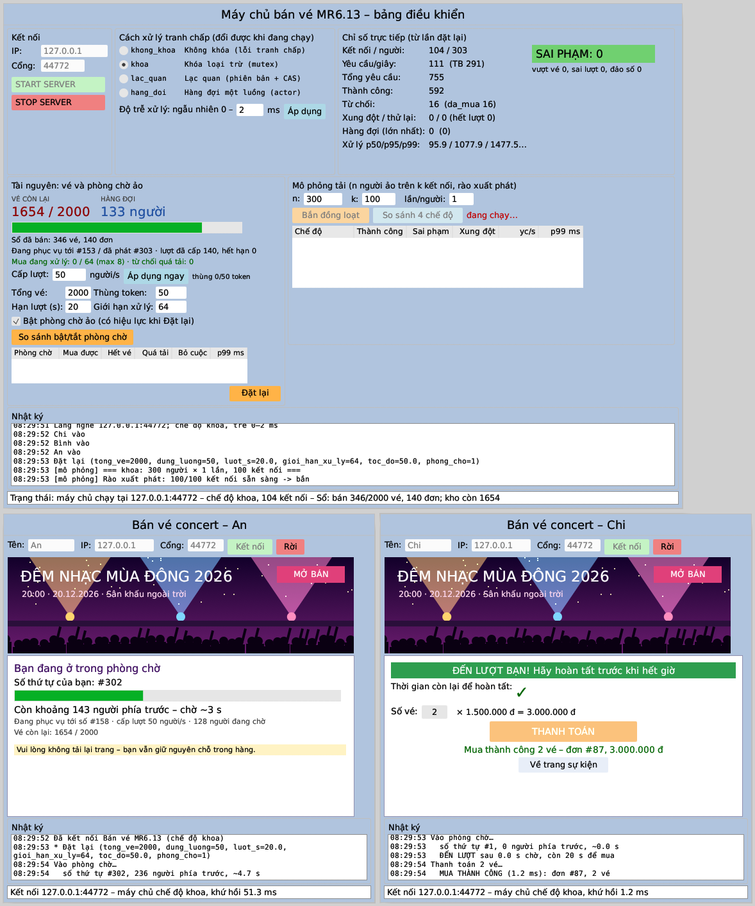
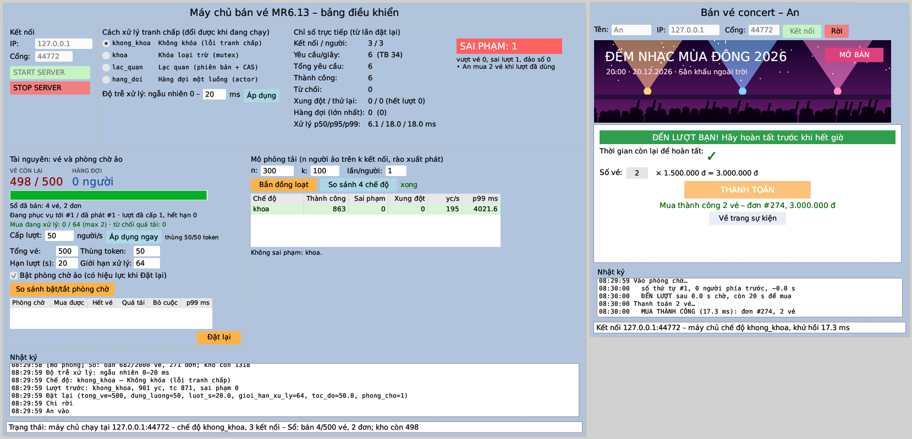
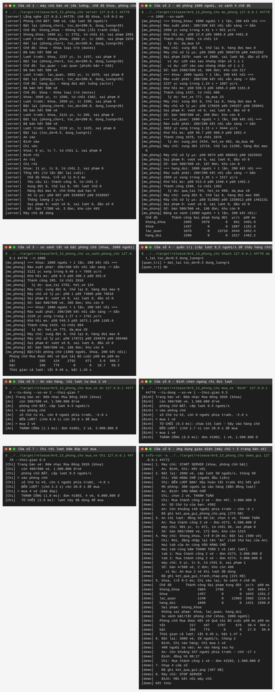

# Bài mở rộng MR6.13 – Phòng chờ ảo: bán 500 vé, cấp lượt theo thùng token (Rust)

| Thông tin | Nội dung |
|---|---|
| Loại | **Bài mở rộng**, không có trong giáo trình và không có mã giả tương ứng. Bài thứ tám của nhóm "tranh chấp tài nguyên" MR6.6–MR6.14, dùng chung khung của [MR6.6](../BaiMR6.6_DauGia/) |
| Liên hệ với giáo trình | Chương 6: Bài 6.1 (server đa luồng, một luồng mỗi kết nối), Bài 6.7 (kiểm thử tải); Chương 3: Bài 3.2 (định khung thông điệp theo dòng); bài mở rộng MR5.4/MR5.5 (luồng, đồng bộ) |
| Thư viện | Thư viện chuẩn Rust: `std::net`, `std::thread`, `std::sync` (`Mutex`, `RwLock`, `Condvar`, `AtomicU64`, `mpsc`, `LazyLock`), `std::collections::BinaryHeap`; crate `serde_json` 1.0.154 (`preserve_order`), `socket2` 0.5.10, `ctrlc` 3.4.7, `chrono` 0.4.41, `miniz_oxide` 0.8.9; giao diện `eframe`/`egui` 0.29.1. Mọi crate ghim bằng `=` và `Cargo.lock` |
| Bản ngôn ngữ khác | [Python](../../../python/Chuong06/BaiMR6.13_PhongCho/), [C#](../../../csharp/Chuong06/BaiMR6.13_PhongCho/), [Java](../../../java/Chuong06/BaiMR6.13_PhongCho/), [Go](../../../go/Chuong06/BaiMR6.13_PhongCho/) |

## Mục tiêu
Bài mô phỏng trang bán 500 vé concert vào lúc mở bán, khi hàng nghìn người cùng bấm "Mua". Máy chủ có **phòng chờ ảo** (virtual waiting room). Người dùng gửi `xep_hang` để nhận **số thứ tự**, số người phía trước và thời gian chờ ước tính. Máy chủ **cấp lượt** cho người đầu hàng theo **thùng token** (token bucket, mặc định 50 người/giây, chỉnh được ngay lúc chạy). Mỗi lượt có hạn **20 s** để `mua` 1–4 vé. Một **công tắc** bật/tắt phòng chờ cho phép so sánh: khi tắt, mọi người dồn thẳng vào `mua`, máy chủ chỉ nhận tối đa 64 yêu cầu mua đang xử lý cùng lúc, phần vượt bị từ chối ngay "hệ thống quá tải".

Ba chỗ tranh chấp đi qua bốn cách xử lý của khung (không khóa, khóa loại trừ, lạc quan, hàng đợi một luồng): **phát số thứ tự** (đọc – cộng 1 – ghi), **trừ kho vé** và **tiêu lượt** (một lượt chỉ được mua một lần, kể cả khi người dùng mở hai tab). **Sổ kiểm toán** đếm ba sai phạm: *vượt vé* (bán quá 500 vé, đếm theo số vé), *sai lượt* (một đơn được nhận khi lượt đã dùng) và *đảo số* (người vào hàng sau nhận số thứ tự không lớn hơn người vào trước, tức FIFO bị phá).

Giao thức, câu chữ và định dạng dòng in giống hệt bản Python (đã thử chạy chéo, xem Ghi chú).

## Kiến thức chính
Số liệu dưới đây lấy từ `ket_qua.txt`, là một lần chạy thật trên máy cục bộ (127.0.0.1, Rust 1.97, 2 lõi, độ trễ xử lý ngẫu nhiên 0–2 ms). Mỗi lần chạy, số liệu lệch đi đôi chút.

```
  Chế độ       Thành công Sai phạm Xung đột  yc/s  p99 ms
  khong_khoa         2985     2970        0   651  4481.9
  khoa               1437        0        0  1807  1161.8
  lac_quan           1076        0    13719  3444  1052.4
  hang_doi           1596        0        0  1517  1462.2
```
(1000 người, 200 kết nối, phòng chờ bật, cấp lượt 200 người/s, thùng 20 token, 500 vé. Mỗi người `xep_hang` → `cho_luot` → `mua` 1–4 vé; cứ 10 người thì có 1 người là "tab thứ hai" của người liền trước. "Thành công" đếm mọi yêu cầu được chấp nhận (xếp hàng, tới lượt, mua). Khứ hồi của `cho_luot` gồm cả thời gian đứng trong hàng.)

```
  Phòng chờ Mua được Hết vé Quá tải Bỏ cuộc p50 ms p99 ms
  tắt            205    124    2792     671    3.6  368.7
  bật            196    775       0       0   18.7   50.3
  Thời gian cả lượt: tắt 0.48 s, bật 1.29 s
```
(So sánh bật/tắt phòng chờ (`so_sanh_phong_cho`), chế độ `khoa`, 1000 người, giới hạn 64 yêu cầu mua đang xử lý. "Mua được", "Hết vé", "Bỏ cuộc" là số **người** theo kết quả cuối; "Quá tải" là số **lần** bị từ chối `qua_tai` (người dùng bấm lại ngay, tối đa 3 lần); p50/p99 là thời gian mua của từng người, từ lần bấm "Mua" đầu tiên tới kết quả cuối.)

- **Phòng chờ ảo và thùng token.** Thùng chứa tối đa `dung_luong` token, được rót đều `toc_do` token mỗi giây. Cứ 100 ms, luồng nền lấy người có số thứ tự nhỏ nhất ra khỏi hàng (`BinaryHeap<Reverse<(số, thứ tự ghi, tên)>>`), mỗi người tốn một token. Thùng cho phép một "loạt" ban đầu (bằng dung lượng thùng) rồi giữ đúng tốc độ trung bình. Nhờ vậy phía "mua" (kiểm tra, ghi kho, phần đắt) chỉ nhận đều đặn vài chục người mỗi nhịp, dù hàng có hàng nghìn người. **Khi tắt phòng chờ**, 1000 người dồn vào `mua` cùng lúc: 2792 lần bị từ chối vì quá tải, **671 người bỏ cuộc** sau 3 lần bấm lại, p99 thời gian mua 369 ms. **Khi bật**, không lần nào quá tải, không ai bỏ cuộc, p99 chỉ 50 ms. Đổi lại, cả lượt kéo dài hơn (1,29 s so với 0,48 s), vì người dùng chờ *trong hàng* chứ không chờ *trong máy chủ*. Số vé bán được như nhau (500), nhưng phòng chờ chia vé theo thứ tự đến, còn khi tắt thì ai bấm lại nhanh, may mắn thì người đó được.
- **Chờ dài (long polling).** `cho_luot` không trả lời ngay: máy chủ cất hàm trả lời (`TraLoi = Box<dyn FnOnce(Obj) + Send>`) của yêu cầu vào danh sách của người đó, và chỉ gọi nó khi cấp lượt (`"han_ms": 20000`), khi hết vé, hoặc khi đặt lại phiên. Client không phải hỏi đi hỏi lại. Vị trí trong hàng client tự tính từ `cap_nhat` (số đang phục vụ `dang_phuc_vu`, tốc độ `toc_do`): còn `so − dang_phuc_vu − 1` người phía trước, chờ khoảng `(số người + 1) / toc_do` giây.
- **Phát số thứ tự cũng là tranh chấp: FIFO.** Ở `khong_khoa`, nhiều luồng cùng đọc `cuoi = 1`, cùng ghi 2… nên nhiều người nhận **cùng một số**, hoặc người vào sau nhận số nhỏ hơn: sổ đếm **876 lần đảo số** (ví dụ `u26 vào sau nhưng nhận số 1 ≤ 1`). Ba chế độ còn lại phát số tăng ngặt trong vùng găng nên đảo số bằng 0.
- **Bán vượt (overselling).** Ở `khong_khoa`, hàng chục người vừa được cấp lượt cùng đọc "còn 500 vé", cùng trừ, cùng ghi; kho giảm chậm nên phòng chờ tưởng còn vé và cứ cấp lượt tiếp. Kết quả: sổ ghi **2508 vé đã bán trên 500 vé** (986 đơn, vượt vé 2008), trong khi kho vẫn báo "còn 217". Với `khoa`, `lac_quan`, `hang_doi`, sổ ghi đúng 500/500 vé (≈ 200 đơn), những người còn lại nhận "đã bán hết vé" ngay khi đang đứng trong hàng. "Vượt vé" đếm theo **số vé** (một đơn 4 vé làm vượt 4); trait `LuatKiemToan` của khung chỉ có `bao()` đếm 1 mỗi lần, nên phần cộng thêm được dồn lại và trả về trong `kiem_tra_cuoi` – tổng giống hệt bản Python.
- **Tiêu lượt nguyên tử với trừ kho (hai ô trong một thao tác).** Lượt của mỗi người là một ô `luot:<tên>`, luồng nền tạo bằng `kho.dat_o` lúc cấp lượt (thêm một ô, không chép lại bảng). `mua` đọc cả `kho` và ô lượt, rồi ghi cả hai trong **cùng một** thao tác: trừ vé và đánh dấu lượt đã dùng. Nếu một người mở **hai tab** (hai kết nối), cả hai tab cùng được lượt và cùng bấm "Thanh toán". Ở `khoa`, tab sau nhận "lượt này đã dùng để mua". Ở `khong_khoa`, cả hai đơn đều được nhận: sổ đếm **86 lần sai lượt** trong mô phỏng, và trên giao diện cả hai tab của An đều nhận "Mua thành công 2 vé" (`ket_qua_gui_tranh_chap.png`). Còn *bấm đúp* trên **cùng một** kết nối thì không có tranh chấp (một luồng mỗi kết nối xử lý tuần tự): Chi trong `ket_qua.txt` nhận một "THÀNH CÔNG" và một "TỪ CHỐI: lượt này đã dùng để mua".
- **Chen ngang bị chặn.** Gọi `mua` khi chưa có lượt thì ô lượt chưa tồn tại, khung trả `khong_co` và bài đổi thành "chưa tới lượt – hãy vào hàng chờ" ở mọi chế độ (Bình trong `ket_qua.txt`).
- **Bốn chế độ với ba điểm nóng.** `lac_quan` hợp với tranh chấp thưa. Ở đây 1000 người cùng xin số trên **một** ô `hang` nên có 13 719 xung đột, 2434 yêu cầu hết 5 lượt thử. `hang_doi` dồn cả xếp hàng lẫn mua vào **một** luồng (kênh `mpsc`): hàng đợi dài tối đa 995, các yêu cầu mua phải chờ sau hàng nghìn yêu cầu xếp hàng, nên vượt giới hạn 64 đang xử lý (744 lần quá tải) ngay cả khi phòng chờ bật. Bài học: tốc độ cấp lượt phải nhỏ hơn năng lực thật của phía mua, và phần "cửa vào hàng" nên rẻ, tách khỏi phần mua.
- **Giới hạn số yêu cầu đang xử lý (load shedding).** Một bộ đếm dưới khóa nhỏ: nếu đã có `gioi_han_xu_ly` yêu cầu mua đang xử lý thì từ chối ngay `qua_tai`, như HTTP 503. Từ chối sớm rẻ hơn nhiều so với để hàng nghìn yêu cầu xếp sau một khóa rồi hết giờ. Nhưng nếu người dùng bấm lại ngay, tải không giảm. Phòng chờ chữa đúng gốc của vấn đề, vì nó *định hình* luồng vào.

### Giao thức (giống hệt ở 5 ngôn ngữ)
TCP, mỗi dòng một JSON UTF-8 kết thúc `\n`, tối đa 64 KB một dòng. Phần chung (chào, quản trị, `thong_ke`, `lap_lai`) xem [README MR6.6](../BaiMR6.6_DauGia/README.md#giao-thức-giống-hệt-ở-5-ngôn-ngữ).

| Chiều | Thông điệp |
|---|---|
| người dùng → server | `{"loai":"xep_hang","ma_yc":k}`, `{"loai":"cho_luot","ma_yc":k}` (chờ dài), `{"loai":"mua","ma_yc":k,"so_ve":2}` (kết nối gộp thêm `"nguoi":"u17"`) |
| quản trị → server | `{"loai":"dat_lai","ma_yc":k,"phong_cho":0\|1,"tong_ve":500,"toc_do":50,"dung_luong":50,"luot_s":20,"gioi_han_xu_ly":64,"ve_toi_da":4,"gia_ve":…,"ten_su_kien":…}` |
| server → client | `xep_hang`: `{"loai":"kq","ma_yc":k,"ok":true,"so":291,"truoc":134,"cho_s":2.7,"trang_thai":"cho"[,"da_co":true]}`; `cho_luot` (khi tới lượt): `{"ok":true,"luot":true,"so":291,"han_ms":20000}`; `mua`: `{"ok":true,"so_ve":3,"thanh_tien":4500000,"con":…,"ma_don":272}`; từ chối: `"ma_loi":"het_ve"\|"qua_tai"\|"khong_luot"\|"da_mua"\|"het_luot"\|"pc_tat"\|"chua_xep_hang"\|"dat_lai"\|"xung_dot"\|"sai_du_lieu"` |
| server → tất cả | `{"loai":"cap_nhat","che_do":…,"su_kien":{"ten","gia_ve","tong_ve","ve_toi_da","luot_s"},"phong_cho","con_lai","da_ban","toc_do","dung_luong","token","dang_phuc_vu","so_cap","dang_cho","da_cap_luot","het_han","het_ve","dang_xu_ly","xu_ly_max","gioi_han","qua_tai","so_don","ban_so","lich_su":[…]}` (≤ 10 lần/s); `{"loai":"su_kien","noi_dung":"Đã bán hết 500 vé"}` |

## Cấu trúc tệp
Gói Cargo `mr6_13_phong_cho` (một chương trình, chọn vai trò bằng lệnh con):
- **Khung chung**, chép từ MR6.6: `src/chung.rs`, `src/khach.rs`, `src/mo_phong.rs`, `src/server.rs`, `src/gui_chung.rs` (khác MR6.6 các chỗ nhỏ giống nhau ở 5 bài MR6.9–MR6.13: `KhoTranhChap::dat_o`/`co_o`, `MayChu::dat_mot_tham_so` – bài này dùng để đổi tốc độ cấp lượt ngay, `CuaSoServer::xong_mo_phong` là `pub`; `server.rs` như MR6.12: cờ `--tat-phong-cho`, dòng "Phòng chờ BẬT: …" sau khi lắng nghe, lệnh bàn phím `toc_do <người/s>`).
- **Nghiệp vụ:** `src/may_chu.rs` (`PhongCho: NghiepVu` – phát số thứ tự, thùng token cấp lượt trong `dinh_ky`, chờ dài, mua có giới hạn đang xử lý, thu hồi lượt quá hạn, `dat_toc_do`; `LuatPhongCho: LuatKiemToan`; `enum OPhongCho { Kho, Hang, Luot }`), `src/nguoi_ao.rs` (`NguoiAo`: xếp hàng → chờ lượt → mua, tab thứ hai, bấm lại khi quá tải; `DO_MUA`; `so_sanh_phong_cho`, `bang_phong_cho`; lệnh con `so_sanh_phong_cho`), `src/mua_ve.rs` (người mua dòng lệnh).
- **Giao diện:** `src/server_gui.rs` (vé còn, hàng đợi, token, đang xử lý/giới hạn, ô "Bật phòng chờ", nút "So sánh bật/tắt phòng chờ" + bảng hai dòng), `src/phong_cho_gui.rs` (trang bán vé: áp phích concert, ba trang sự kiện / phòng chờ / chọn vé), `src/demo_gui.rs`, `src/main.rs`.
- `Cargo.toml`, `Cargo.lock`, `demo.json`, `ket_qua.txt`, `ket_qua.png`, `ket_qua_gui.png`, `ket_qua_gui_phong_cho.png`, `ket_qua_gui_tranh_chap.png`: kịch bản và kết quả thực thi thật.

## Cách chạy
Trong thư mục bài (`cargo build -q --release` một lần; `B=../../target/release/mr6_13_phong_cho`, Windows: `..\..\target\release\mr6_13_phong_cho.exe`):
```bash
$B server 127.0.0.1 9000                                       # cửa sổ 1 (gõ lệnh ở đây)
$B mo_phong 127.0.0.1 9000 --n 1000 --so-sanh                  # cửa sổ 2: bảng so sánh 4 chế độ
$B so_sanh_phong_cho 127.0.0.1 9000 --n 1000                   # tắt / bật phòng chờ
$B khach 127.0.0.1 9000 dat_lai toc_do=0.5 dung_luong=1        # cấp lượt chậm để thấy hàng chờ
$B mua_ve An 127.0.0.1 9000 --tu-dong --so-ve 2                # cửa sổ 3, 4…: hoặc gõ xep_hang / mua 2
```
- Lệnh của máy chủ: `che_do …`, `tre <ms>`, `toc_do <người/s>` (đổi tốc độ cấp lượt ngay, không đặt lại), `dat_lai [tong_ve=… toc_do=… dung_luong=… luot_s=… gioi_han_xu_ly=… phong_cho=0|1]`, `thong_ke`, `thoat`. Tùy chọn: `--che-do`, `--tre-ms`, `--tong-ve`, `--toc-do`, `--dung-luong`, `--luot-s`, `--gioi-han`, `--tat-phong-cho`.
- Lệnh của `mua_ve`: `xep_hang` (rồi tự chờ dài tới lượt), `mua <n>`, `mua2 <n>` (bấm đúp), `thoat`; `--tu-dong` vào hàng ngay và tới lượt thì tự mua `--so-ve` vé.

Tái lập kết quả từ thư mục gốc của kho: `python3 tools/demo.py rust/Chuong06/BaiMR6.13_PhongCho` (cổng 44770, giao diện 44772). Cổng 447x0 nằm trong dải cổng tạm của Linux: gặp "Address already in use" thì chạy lại.

## Ứng dụng giao diện


Ảnh trên là lần chạy thật của `demo_gui` (Linux, Xvfb + Mesa llvmpipe, egui 0.29.1): bảng điều khiển máy chủ (trên trái), An (trên phải, trong phòng chờ: "Còn khoảng 347 người phía trước – chờ ~17 s"), Bình (dưới trái, tới lượt, đồng hồ 00:17) và Chi (dưới phải, "Mua thành công 1 vé"). Bảng máy chủ có cả so sánh 4 chế độ (dòng `khong_khoa` tô đỏ) và bảng bật/tắt phòng chờ (dòng "tắt" đỏ: 2707 lần quá tải, 676 người bỏ cuộc, p99 394 ms; dòng "bật" xanh: 0 quá tải, p99 50 ms).



Bước 1–2 (ảnh trên): 2000 vé, cấp lượt 50 người/s. Chi vào hàng đầu tiên, tới lượt ngay và mua 2 vé; 300 người ảo ùa vào; An, Bình vào sau: trang phòng chờ của An hiện "Số thứ tự của bạn: #302", thanh tiến trình và "Còn khoảng 148 người phía trước – chờ ~3 s"; bảng máy chủ hiện hàng đợi, thùng token, số đang phục vụ. Vài giây sau An tới lượt và mua 3 vé.



Ở `khong_khoa` (trễ 0–20 ms), Chi đăng nhập lại bằng tên An (tab thứ hai của An): hai tab cùng vào hàng, cùng được lượt, cùng bấm THANH TOÁN 2 vé – cả hai "Mua thành công", **SAI PHẠM 1** (sai lượt: "An mua 2 vé khi lượt đã dùng"). Ở `khoa`, tab sau nhận "Lượt này đã được dùng để mua".

- **Máy chủ** (`server_gui`): phần chung như MR6.6; **tài nguyên**: VÉ CÒN LẠI (thanh), độ dài HÀNG ĐỢI ("TẮT" khi phòng chờ tắt), "Sổ đã bán … – VƯỢT … vé!" (đỏ), số đang phục vụ / đã phát, lượt đã cấp / hết hạn, "Mua đang xử lý: x / 64 (max …) · từ chối quá tải: …", ô **Cấp lượt** + nút **Áp dụng ngay** và mức token trong thùng, tham số đặt lại, ô **Bật phòng chờ ảo**, nút **So sánh bật/tắt phòng chờ** (chạy trên luồng nền, lấy n, k ở khung mô phỏng) và bảng hai dòng.
- **Trang bán vé** (`phong_cho_gui`): áp phích concert (nền chuyển màu bằng `egui::Mesh`, sao, đèn sân khấu nửa trong suốt, đám đông, tên sự kiện); ba trang: **Sự kiện** (giá vé, thanh vé còn lại, mô tả phòng chờ, nút **VÀO HÀNG CHỜ MUA VÉ** / **MUA VÉ NGAY**), **Phòng chờ** (số thứ tự, thanh tiến trình vị trí, số người phía trước và thời gian chờ ước tính, số đang phục vụ, tốc độ cấp lượt; cập nhật trực tiếp theo `cap_nhat`), **Chọn vé** ("ĐẾN LƯỢT BẠN!", đồng hồ đếm ngược hạn lượt – đỏ khi < 5 s, chọn số vé, thành tiền, nút **THANH TOÁN**, kết quả, "Về trang sự kiện").

### Cách chạy
```bash
cargo build --release
$B server_gui 127.0.0.1 44772                  # bấm START SERVER (500 vé, 50 người/s)
$B phong_cho_gui An 127.0.0.1 44772
$B phong_cho_gui Bình 127.0.0.1 44772
```
- **Windows:** cần Rust bản MSVC như các bài Rust khác. **Linux:** thư viện OpenGL/X11 (hoặc Wayland). Kịch bản tự động (Linux, cần `xvfb`): `xvfb-run -a -s "-screen 0 2600x1700x24" $B demo_gui 127.0.0.1 44772`.
- Chạy riêng từng cửa sổ: mọi dòng nhật ký và cứ 5 giây một dòng số liệu cũng in ra dòng lệnh.
- Thử trên nhiều máy: máy chủ nghe trên IP card mạng (hoặc `0.0.0.0`) và mở tường lửa cho cổng; đặt cấp lượt 1–2 người/s để cả lớp thấy hàng chờ chạy. Khi đó **chỉ dùng `khoa`, `lac_quan`, `hang_doi`**.

## Kết quả thực thi


## Ghi chú
- **Chạy chéo với bản Python** (đã thử, 1000 người, `--so-sanh`; số liệu ở `docs/_status/morong_mr613_rust.json`): cả hai chiều cho `khong_khoa` hàng nghìn sai phạm (vượt vé, sai lượt, đảo số), ba chế độ còn lại 0; `so_sanh_phong_cho.py` trên máy chủ Rust cho cùng kết luận (tắt: hàng nghìn lần quá tải, hàng trăm người bỏ cuộc; bật: 0); người mua Python (An, `--tu-dong`) và Rust (Chi, bấm đúp `mua2`) cùng phòng chờ trên máy chủ Rust.
- `so_sanh_phong_cho` đổi `tham_so_dat_lai()` của bộ mô phỏng tạm thời (phòng chờ tắt rồi bật) qua một biến toàn cục trong `nguoi_ao.rs`, như `THAM_SO_DAT_LAI` của bản Python; khung `mo_phong.rs` không phải sửa.
- Dòng 5 giây của máy chủ in chế độ *hiện tại*: sau lượt `hang_doi` của `--so-sanh`, chế độ được trả về `khoa` nên dòng số liệu của lượt đó in "khoa: …" (giống bản Python).
- Trong kịch bản giao diện, máy chủ, bộ mô phỏng và 4 cửa sổ cùng chạy trong một tiến trình trên 2 lõi, nên số liệu khác bản dòng lệnh.
- Kiểm thử: Linux, Rust 1.97.0 (`cargo build` không cảnh báo), tools/demo.py; giao diện egui 0.29.1 dưới Xvfb + Mesa llvmpipe. Bản giao diện chưa thử trên Windows.

## Bài tập gợi ý
1. Chạy `so_sanh_phong_cho` với `--n 3000`. Khoảng cách p99 giữa tắt và bật thay đổi thế nào? Tăng `gioi_han_xu_ly` lên 1000 khi tắt phòng chờ thì sao?
2. Đặt `toc_do` lớn hơn năng lực thật của phía mua (ví dụ 5000 người/s, `tre 10`). Phòng chờ còn giúp được không? Vì sao tốc độ cấp lượt phải nhỏ hơn thông lượng của `mua`?
3. Tách "cửa vào hàng" khỏi kho tranh chấp: phát số thứ tự bằng một `AtomicU64::fetch_add` (không đi qua `thuc_hien`). Còn đảo số ở `khong_khoa` không? Xung đột của `lac_quan` giảm bao nhiêu?
4. Thêm "lượt hết hạn thì trả về cuối hàng" (thay vì mất lượt). Cần sửa `dinh_ky` và luật sổ kiểm toán ra sao?
5. Dùng thùng token để giới hạn tốc độ `xep_hang` của mỗi địa chỉ IP (chống bot). Thùng nên đặt ở đâu?
6. Giao diện: vẽ trên trang phòng chờ một biểu đồ "vị trí theo thời gian" để người dùng thấy hàng chạy đều.

## Đọc thêm
- H. T. Kung, J. T. Robinson (1981). *On Optimistic Methods for Concurrency Control*. ACM Transactions on Database Systems 6(2).
- E. G. Coffman, M. J. Elphick, A. Shoshani (1971). *System Deadlocks*. ACM Computing Surveys 3(2).
- Tài liệu Rust: [`std::sync`](https://doc.rust-lang.org/std/sync/index.html) (`Mutex`, `Condvar`, `mpsc`, `LazyLock`), [`std::sync::atomic`](https://doc.rust-lang.org/std/sync/atomic/index.html), [`std::collections::BinaryHeap`](https://doc.rust-lang.org/std/collections/struct.BinaryHeap.html) và [`std::cmp::Reverse`](https://doc.rust-lang.org/std/cmp/struct.Reverse.html) (hàng ưu tiên nhỏ nhất trước); The Rust Programming Language, chương 16 "Fearless Concurrency".
- [egui](https://docs.rs/egui/0.29.1/egui/) 0.29.1 (`Mesh`, `DragValue`).

Mã nguồn của bài được viết mới cho kho này.
