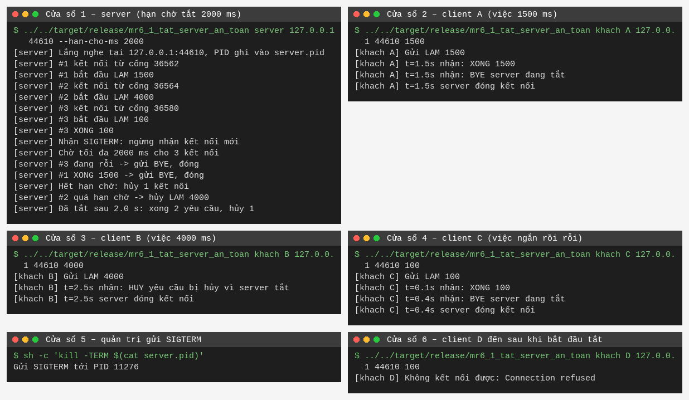

# Bài mở rộng MR6.1 – Tắt server an toàn (graceful shutdown) (Rust)

| Thông tin | Nội dung |
|---|---|
| Loại | **Bài mở rộng** – không có trong giáo trình, không có mã giả tương ứng |
| Liên hệ với giáo trình | Chương 6: Bài 6.2 (server bất đồng bộ), Bài 6.1 (server đa luồng); Chương 5: Bài 5.6 (hạn chót, hủy) |
| Thư viện | Crate `tokio` 1.54.1: `net::TcpListener`, `signal` (`unix::signal(SIGTERM)`, `ctrl_c`), `sync::watch`, `task::JoinSet`, `time::timeout`, `select!`; client dùng `std::net` |
| Bản ngôn ngữ khác | [C#](../../../csharp/Chuong06/BaiMR6.1_TatServerAnToan/), [Java](../../../java/Chuong06/BaiMR6.1_TatServerAnToan/), [Python](../../../python/Chuong06/BaiMR6.1_TatServerAnToan/), [Go](../../../go/Chuong06/BaiMR6.1_TatServerAnToan/) |

## Mục tiêu
Server thật không bị “rút điện”: hệ điều hành, systemd, Docker hay Kubernetes gửi tín hiệu SIGTERM và cho một khoảng thời gian trước khi buộc dừng (SIGKILL). Bài cài đặt quy trình tắt bốn bước: (1) đóng socket nghe – client mới bị từ chối; (2) kết nối đang rỗi nhận `BYE` rồi đóng ngay; (3) kết nối đang làm dở được làm xong yêu cầu hiện tại, nhận kết quả, rồi `BYE`; (4) quá hạn chờ thì hủy phần còn lại và báo `HUY`. Giao thức dòng văn bản: client gửi `LAM <ms>`, server mô phỏng công việc dài `<ms>` mili giây rồi trả `XONG <ms>`.

## Kiến thức chính
- **Hai tín hiệu nội bộ bằng `watch`:** `stop` (bắt đầu tắt) và `kill` (hết hạn chờ). Mỗi kết nối dùng `tokio::select!` để chờ **dòng lệnh hoặc `stop`** khi rỗi, và chờ **công việc hoặc `kill`** khi đang làm. Nhờ vậy bước (2), (3), (4) chỉ là các nhánh của `select!`.
- **`JoinSet`** giữ tác vụ của mọi kết nối: `try_join_next()` dọn tác vụ đã xong để đếm số kết nối còn mở; `time::timeout(hạn, chờ_hết)` cho biết có quá hạn hay không.
- **Đóng socket nghe** = `drop(listener)`: hệ điều hành từ chối kết nối mới (*Connection refused*).
- **Bắt tín hiệu:** thư viện chuẩn Rust không có; `tokio::signal::unix::signal(SignalKind::terminate())` cho SIGTERM (chỉ Unix), `tokio::signal::ctrl_c()` cho Ctrl+C trên mọi hệ điều hành.

## Tệp
- `Cargo.toml`, `Cargo.lock` – gói Cargo `mr6_1_tat_server_an_toan`.
- `src/main.rs` – phân nhánh vai trò `server` / `khach`.
- `src/server.rs` – server tokio: `handle` (một kết nối), `wait_signal`, quy trình tắt bốn bước trong `run`.
- `src/khach.rs` – client: gửi các yêu cầu, rồi giữ kết nối và in mọi thông báo của server.
- `demo.json` – kịch bản chạy minh họa (dùng với `tools/demo.py`).
- `ket_qua.txt`, `ket_qua.png` – kết quả thực thi thật.

## Cách chạy
Trong thư mục bài (`cargo build -q --release` một lần; `B=../../target/release/mr6_1_tat_server_an_toan`):
```bash
$B server 127.0.0.1 9000 --han-cho-ms 2000        # cửa sổ 1
$B khach A 127.0.0.1 9000 1500                    # cửa sổ 2
$B khach B 127.0.0.1 9000 4000                    # cửa sổ 3
kill -TERM $(cat server.pid)                      # cửa sổ 4 (hoặc Ctrl+C ở cửa sổ 1)
```
Server ghi PID vào `server.pid` khi khởi động và xóa tệp này khi tắt xong. Trên Windows chạy `..\..\target\release\mr6_1_tat_server_an_toan.exe` và dùng Ctrl+C.

Tái lập kết quả từ thư mục gốc của kho: `python3 tools/demo.py rust/Chuong06/BaiMR6.1_TatServerAnToan` (cổng 44610).

## Kết quả thực thi


Ba client A, B, C kết nối; C làm xong việc ngắn và đang rỗi. Khi quản trị gửi SIGTERM (t ≈ 0,4 s), server ngừng nhận kết nối mới – client D đến sau bị từ chối ngay (*Connection refused*). C nhận `BYE` tức thì; A làm nốt việc 1500 ms, nhận `XONG 1500` rồi `BYE`; việc 4000 ms của B vượt hạn chờ 2000 ms nên bị hủy đúng lúc t ≈ 2,5 s và B nhận `HUY`. Server tắt sau 2,0 s với 2 yêu cầu xong (C và A), 1 yêu cầu bị hủy. Bản Rust cho cùng trình tự sự kiện và cùng thông điệp với bản Python và Go (trừ cổng, PID).

## Ghi chú
- Hạn chờ của server phải nhỏ hơn thời gian mà trình quản lý tiến trình chờ trước khi gửi SIGKILL (ví dụ `docker stop` mặc định 10 s).
- Với server HTTP, `axum`/`hyper` có `with_graceful_shutdown`; Go có sẵn `http.Server.Shutdown(ctx)` (từ Go 1.8) thực hiện các bước 1–3; sách *Go in Practice* (2016) còn dùng gói ngoài `manners` cho việc này, nay không cần nữa.
- Trên Windows không có lệnh `kill -TERM`; dùng Ctrl+C (SIGINT) – server xử lý SIGINT giống SIGTERM.
- `tokio::signal::unix` chỉ có trên Unix (Linux, macOS); mã dùng `#[cfg(unix)]` để trên Windows chỉ chờ Ctrl+C.
- Hủy ở bước (4) là **hủy hợp tác**: tác vụ tự thấy `kill` và gửi `HUY` trước khi đóng. Nếu dùng `JoinHandle::abort()` thì tác vụ bị bỏ ngay tại điểm `.await` mà không kịp báo cho client.
- `watch::Receiver::wait_for` trả về một khóa đọc (`Ref`) không gửi được giữa các luồng (`!Send`); bài bọc nó trong hàm `doi` để khóa được nhả ngay, nếu không trình biên dịch báo tác vụ không `Send` khi `spawn`.
- Kiểm thử: Linux, Rust 1.97.0.

## Đọc thêm
- Matt Butcher, Matt Farina, *Go in Practice*, Manning, 2016, Chương 2 (Technique 5 *Graceful shutdowns using manners*) và Chương 3 (Techniques 10–15: goroutine, `WaitGroup`, kênh).
- Claus Töpke, *Network Programming and Automation Essentials*, Packt, 2023, Chương 8 *Scaling Your Code* (đa luồng, coroutine).

Mã nguồn của bài được viết mới cho kho này; sách trên chỉ là tài liệu tham khảo ý tưởng.
