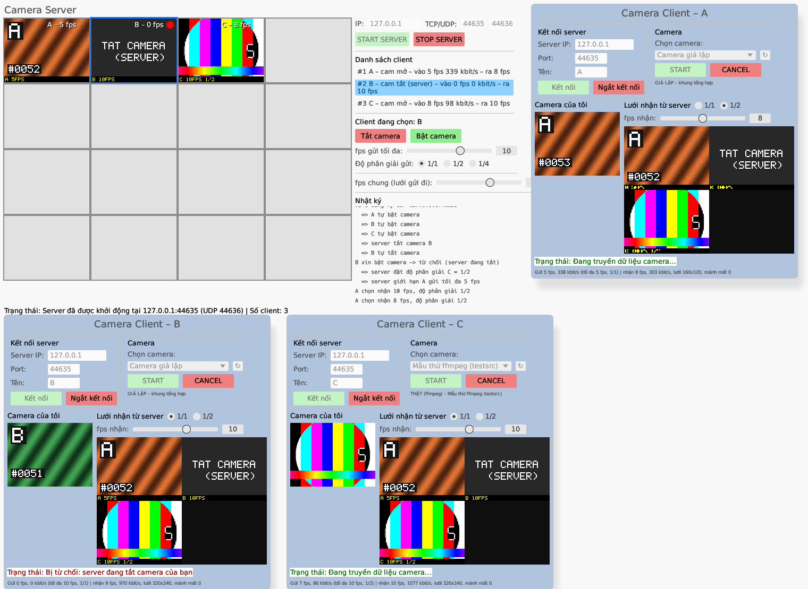
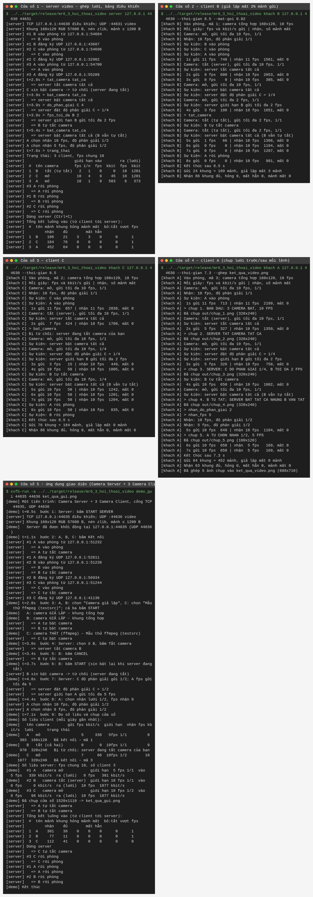
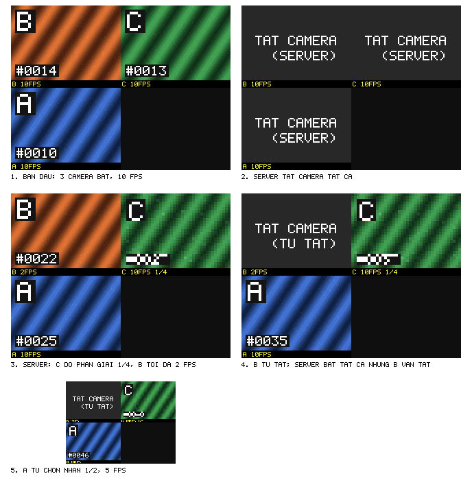

# Bài mở rộng MR6.3 – Phòng hội thoại video nhiều client (Rust)

| Thông tin | Nội dung |
|---|---|
| Loại | **Bài mở rộng** – không có trong giáo trình, không có mã giả tương ứng |
| Liên hệ với giáo trình | Bài mở rộng MR6.2 (hội thoại âm thanh); Chương 6: Bài 6.1 (server đa luồng), Bài 6.4 (server chat); Chương 4: Bài 4.1 (UDP); Chương 3: Bài 3.2 (định khung thông điệp) |
| Thư viện | Thư viện chuẩn Rust: `std::net`, `std::thread`, `Mutex`; crate `miniz_oxide` 0.8.9 (zlib), `socket2` 0.5.10 (đặt `SO_RCVBUF`), `serde_json` 1.0.154, `ctrlc` 3.4.7. PNG và CRC-32 tự viết. Ứng dụng giao diện: `eframe`/`egui` 0.29.1 (OpenGL qua `glow`); camera thật qua tiến trình `ffmpeg` (không thêm thư viện) |
| Bản ngôn ngữ khác | [C#](../../../csharp/Chuong06/BaiMR6.3_HoiThoaiVideo/), [Java](../../../java/Chuong06/BaiMR6.3_HoiThoaiVideo/), [Python](../../../python/Chuong06/BaiMR6.3_HoiThoaiVideo/), [Go](../../../go/Chuong06/BaiMR6.3_HoiThoaiVideo/) |

## Mục tiêu
Cùng ý tưởng với MR6.2 nhưng cho hình ảnh: n client gửi khung hình camera qua UDP; server ghép khung của mọi người thành một **lưới** và gửi cho từng người theo tốc độ khung (fps) và độ phân giải mà người đó chọn. Server điều khiển được: tắt/bật camera của tất cả hoặc từng người, giới hạn fps gửi và độ phân giải gửi của từng người (tương tự độ lợi đầu vào ở MR6.2), giới hạn fps chung (tương tự âm lượng chung). Client tự tắt/bật camera, tự chọn fps và độ phân giải nhận. Client chụp lưới đang xem thành PNG trước/sau mỗi lệnh và ghép thành `ket_qua_video.png` – bằng chứng trực quan rằng lệnh có hiệu lực.

## Kiến thức chính
- **Kích thước khung và tốc độ bit.** Khung 160×120 điểm RGB = 160 × 120 × 3 = 57 600 byte; 10 fps không nén cần 57 600 × 8 × 10 ≈ 4,6 Mbit/s. Nén zlib (không mất dữ liệu) còn khoảng 8 KB/khung → ≈ 650 kbit/s. Giảm độ phân giải 1/4 mỗi chiều → 40×30 điểm = 1/16 số điểm ảnh, client C trong kết quả chỉ còn ≈ 50 kbit/s. Khung tổng hợp có "hạt nhiễu" thưa như cảm biến thật; không có nhiễu, ảnh nhân tạo nén quá tốt (≈ 1 KB) và không phản ánh được thực tế.
- **Chia mảnh và ghép khung.** Một khung nén (vài KB) lớn hơn một datagram an toàn. Mỗi datagram ≤ 1200 byte – mức QUIC (RFC 9000 mục 14) yêu cầu mọi đường truyền phải chở được, nhỏ hơn MTU 1500 của Ethernet sau khi trừ header IP/UDP và phần bọc của VPN, nên không bị phân mảnh IP. Header 20 byte: phiên bản, loại, mã nguồn, **số khung**, **chỉ số mảnh**, **tổng số mảnh**, rộng, cao, nhãn thời gian. Bên nhận gom đủ mảnh mới giải nén; **mất một mảnh là hỏng cả khung** – lý do codec thực tế có cơ chế chống lỗi (FEC, khung tham chiếu, yêu cầu khung khóa).
- **Video trực tiếp chỉ cần khung mới nhất.** Khi một khung đủ mảnh, mọi khung cũ hơn còn dở bị bỏ; không chờ, không truyền lại. Số khung tăng dần cho phép đếm khung hỏng (thiếu mảnh) và khung mất hẳn.
- **MCU và SFU (RFC 7667).** Bài dùng kiến trúc *ghép* (MCU/Topo-Mixer): server giải nén, ghép lưới, nén lại riêng cho từng người nhận – nên điều chỉnh được fps/độ phân giải *nhận* của từng người, nhưng tốn CPU server. Kiến trúc *chuyển tiếp chọn lọc* (SFU) chỉ chuyển tiếp luồng của từng người, client tự ghép; server nhẹ hơn nhiều nhưng muốn đổi độ phân giải cho từng người nhận thì người gửi phải gửi nhiều lớp (simulcast). Khác với âm thanh (mix-minus), lưới video có cả hình của chính mình (self-view) – không gây vọng, chỉ tốn băng thông.
- **Giới hạn hai phía.** Phía gửi: server báo `fps` tối đa và `chia` (1, 2, 4) qua TCP; client tuân thủ, và server **tự thực thi** – bỏ khung đến nhanh hơn 0,8/fps giây (cột "vượt fps": vài khung bị bỏ khi đồng hồ của client nhích sớm) và bỏ khung của camera đang tắt. Phía nhận: `fps nhận = min(fps client chọn, fps chung)`.
- **Phóng to và thu nhỏ ảnh.** Thu nhỏ: lấy 1 điểm trong mỗi khối d×d (điểm `(x·d, y·d)`). Phóng to: lặp điểm gần nhất (nearest neighbour), nên ô của C ở độ phân giải 1/4 hiện thành các ô vuông 4×4.
- **PNG viết tay.** Chữ ký 8 byte + các khối `IHDR`, `IDAT` (zlib của các hàng ảnh, mỗi hàng mở đầu bằng 1 byte bộ lọc), `IEND`; mỗi khối có CRC-32 (bản Rust tự viết hàm `crc32` theo đa thức 0xEDB88320, có `cargo test` với khối `IEND`).
- **Phòng vệ.** Giới hạn 256 mảnh/khung, giải nén có giới hạn kích thước (`decompress_to_vec_zlib_with_limit(dữ_liệu, 4 MB)`) chống "bom nén", kiểm tra rộng × cao × 3 khớp dữ liệu, chỉ nhận UDP từ địa chỉ đã đăng ký.

### Quy tắc quyền điều khiển (giống mic ở MR6.2)

| # | Quy tắc |
|---|---|
| 1 | Camera của X mở **khi và chỉ khi** X không tự tắt **và** server không tắt camera của X |
| 2 | Server tắt thắng client: đang bị server tắt, client xin bật bị **từ chối** |
| 3 | Server bật = gỡ lệnh tắt của server, **không bật hộ** camera mà người dùng tự tắt |
| 4 | Giới hạn gửi (fps tối đa, độ phân giải 1/1, 1/2, 1/4) của từng người và fps chung do server đặt |
| 5 | Tham số nhận (fps, độ phân giải lưới 1/1 hoặc 1/2) do từng client tự chọn; fps nhận không vượt fps chung |
| 6 | Tự tắt camera có hiệu lực ngay tại client; tự bật phải chờ server xác nhận |

## Cấu trúc tệp
- `Cargo.toml`, `Cargo.lock` – gói Cargo `mr6_3_hoi_thoai_video`.
- `src/main.rs` – chọn vai trò `server` / `khach` (dòng lệnh) và `server_gui` / `khach_gui` / `demo_gui` (giao diện).
- `src/chung.rs` – header datagram, `chia_manh`, `GhepKhung`, phông chữ bitmap 5×7, tô/vẽ chữ, thu nhỏ/phóng to, `CameraTongHop`, nén/giải nén zlib, `ghi_png` + `crc32` (PNG viết tay), socket UDP có bộ đệm lớn; có `cargo test`.
- `src/server.rs` – lõi server `MayChu` (dùng chung cho dòng lệnh và giao diện): kênh TCP, luồng nhận UDP (ghép mảnh, kiểm tra quyền, vẽ ô), luồng ghép lưới và gửi theo hạn của từng người nhận, các hàm điều khiển `tat_camera`, `dat_fps_toi_da`, `dat_do_phan_giai`, `dat_fps_chung`, `dung_lai`; bảng điều khiển stdin.
- `src/khach.rs` – client: vòng gửi theo fps cho phép, luồng nhận lưới, lệnh `chup`, ghép ảnh chụp (`--ghep`).
- `src/camera_ffmpeg.rs` – camera thật qua tiến trình `ffmpeg`: liệt kê thiết bị (Windows dshow, Linux `/dev/video*`, macOS avfoundation), thu khung rgb24 160×120 từ stdout; mục "Mẫu thử ffmpeg (testsrc)".
- `src/gui_chung.rs` – phông chữ tiếng Việt, nút màu, khung nhóm, chuyển khung RGB thành ảnh egui, ghi ảnh chụp cửa sổ (dùng `ghi_png` của `chung.rs`).
- `src/server_gui.rs` – cửa sổ "Camera Server" (lưới 4×4).
- `src/khach_gui.rs` – cửa sổ "Camera Client".
- `src/demo_gui.rs` – kịch bản tự thao tác: server + 3 client trong một cửa sổ, in số liệu, chụp `ket_qua_gui.png`.
- `demo.json`, `ket_qua.txt`, `ket_qua.png` – kịch bản và kết quả thực thi thật (dòng lệnh + giao diện); `ket_qua_video.png` – 5 ảnh lưới do client A chụp trong lần chạy đó; `ket_qua_gui.png` – ảnh chụp cửa sổ giao diện.

## Cách chạy
Trong thư mục bài (`cargo build -q --release` một lần; `B=../../target/release/mr6_3_hoi_thoai_video`):
```bash
$B server 127.0.0.1 9000 9001                                   # cửa sổ 1 (gõ lệnh điều khiển ở đây)
$B khach B 127.0.0.1 9000                                       # cửa sổ 2
$B khach C 127.0.0.1 9000                                       # cửa sổ 3
$B khach A 127.0.0.1 9000 --thoi-gian 60 --ghep ket_qua_video.png   # cửa sổ 4
```
Lệnh server: `tat_camera tat_ca`, `tat_camera B`, `bat_camera tat_ca`, `fps_toi_da B 2`, `do_phan_giai C 4`, `fps_chung 5`, `trang_thai`, `thoat`. Lệnh client: `tat_camera`, `bat_camera`, `nhan_fps 5`, `nhan_do_phan_giai 2`, `chup <nhãn>` (lưu `out/chup_N.png`), `thoat`. Dòng `@t lệnh` chờ tới giây thứ t. Nhãn ảnh chụp chỉ vẽ được chữ in hoa không dấu, số và vài ký hiệu (phông 5×7 tự định nghĩa).

Tùy chọn client: `--fps 10` (tốc độ khung camera), `--mat-goi 0.02` (giả lập mất 2 % mảnh gửi), `--thoi-gian`.

**Camera thật:** client *dòng lệnh* chỉ có camera tổng hợp (truyền `--camera` thì client báo và dùng camera tổng hợp). Camera thật có trong **ứng dụng giao diện** bên dưới (qua `ffmpeg`).

Tái lập kết quả từ thư mục gốc của kho: `python3 tools/demo.py rust/Chuong06/BaiMR6.3_HoiThoaiVideo` (cổng 44630/44631; thư mục `out/` sinh ra khi chạy, không đưa vào kho).

## Ứng dụng giao diện


Ba vai trò giao diện (egui) dùng đúng giao thức và lõi server của bản dòng lệnh – không thêm thông điệp nào.

- **Server – "Camera Server"** (`server_gui`): lưới 4×4 ô, mỗi client một ô (đúng ô 160×120 mà lõi server ghép vào lưới gửi đi, có dải vàng ghi giới hạn), góc phải ghi tên và fps nhận được, **chấm đỏ** khi camera tắt; bấm ô hoặc hàng trong danh sách để chọn client. Khung phải: IP/cổng, START SERVER / STOP SERVER, danh sách client (trạng thái camera, fps và kbit/s vào/ra), với client đang chọn: Tắt camera / Bật camera (khóa của server), fps gửi tối đa 1–15, độ phân giải gửi 1/1, 1/2, 1/4; fps chung của lưới; nhật ký; thanh trạng thái.
- **Client – "Camera Client"** (`khach_gui`): *Kết nối server* (IP, cổng, tên, Kết nối/Ngắt kết nối); *Camera* (danh sách camera thật + "Camera giả lập", START/CANCEL = tự bật/tắt camera); khung "Camera của tôi" (xem trước); khung "Lưới nhận từ server" (fps nhận 1–15, độ phân giải nhận 1/1, 1/2); thanh trạng thái ("Đang truyền dữ liệu camera…", "Bị từ chối…", fps và kbit/s gửi/nhận, kích thước lưới, mảnh mất).
- **Camera thật qua ffmpeg:** Windows liệt kê bằng `ffmpeg -hide_banner -list_devices true -f dshow -i dummy` (đọc stderr, dòng `"Tên" (video)`) và thu bằng `-f dshow -i video="Tên"`; Linux dùng `/dev/video*` với `-f v4l2`; macOS `-f avfoundation`. Lệnh thu thêm `-vf scale=160:120,fps=15 -pix_fmt rgb24 -f rawvideo pipe:1`; một luồng đọc đủ 57 600 byte là một khung rồi đưa vào đúng đường gửi hiện có (thu nhỏ theo server, nén zlib, chia mảnh). Không có ffmpeg/camera, hoặc ffmpeg lỗi → "Camera giả lập" (khung tổng hợp của bản dòng lệnh). Mục **"Mẫu thử ffmpeg (testsrc)"** (`-f lavfi -i testsrc`) đi trọn đường ffmpeg mà không cần camera. Camera **không tự bật**: kết nối xong client gửi ngay `tu_tat_camera`; chỉ khi bấm START mới chạy ffmpeg và gửi `tu_bat_camera`; CANCEL dừng tiến trình ffmpeg (đèn camera tắt). Dòng dưới nút ghi "THẬT (ffmpeg) – …" hoặc "GIẢ LẬP – …".
- Camera 15 fps còn server giới hạn 10 fps: client chỉ gửi khi đã cách lần gửi trước ≥ 0,9/fps (server bỏ khung đến sớm hơn 0,8/fps – quy tắc 6), nên khung camera được "tỉa" còn khoảng 7–8 fps thay vì bị server bỏ.

**Cài ffmpeg trên Windows:** `winget install -e --id Gyan.FFmpeg` (mở lại cửa sổ dòng lệnh để PATH có `ffmpeg`). Chạy (cần Rust bản MSVC như các bài khác):
```powershell
cargo build --release
..\..\target\release\mr6_3_hoi_thoai_video.exe server_gui 127.0.0.1 9000 9001
..\..\target\release\mr6_3_hoi_thoai_video.exe khach_gui A 127.0.0.1 9000
```
**Linux:** `sudo apt-get install -y ffmpeg`, rồi cùng các lệnh với `../../target/release/mr6_3_hoi_thoai_video`; camera USB là `/dev/video0` (người dùng cần thuộc nhóm `video`). Kịch bản tự động: `xvfb-run -a ../../target/release/mr6_3_hoi_thoai_video demo_gui 44635 44636 ket_qua_gui.png`. Mặc định server chỉ nghe `127.0.0.1`.

**Luồng và quy tắc chạm điều khiển:**
```
 luồng giao diện (egui update ~10–15 lần/s) ── đọc/sửa ──► ChiaSe / Phong (Mutex) ◄── sửa ── luồng nền
   │  vẽ, nhận thao tác, đổi khung RGB thành texture                                │
   │                                                                                 ├─ luồng kết nối (connect, vao, chao)
   ├─ tiến trình ffmpeg ── stdout rgb24 ──► luồng đọc khung ──► luồng gửi (5 ms) ──► UDP mảnh ──► server
   │                                                                                 ├─ luồng đọc TCP (camera, nhan, tu_choi)
   └─ texture "Lưới nhận" ◄── khung mới nhất ◄── luồng nhận UDP (ghép mảnh, giải nén) ┘
 server: luồng nhận kết nối, mỗi client một luồng TCP, luồng nhận UDP (vẽ ô), luồng ghép lưới và gửi
```
Chỉ luồng giao diện chạm vào điều khiển: luồng nền đặt "khung mới" vào trạng thái chung rồi gọi `ctx.request_repaint()`; giao diện lấy khung ra và cập nhật texture (`TextureHandle::set`).

## Kết quả thực thi


Ảnh lưới do client A chụp trong lần chạy trên (ô theo thứ tự vào phòng: B, C, A; dải vàng dưới mỗi ô là giới hạn gửi server đặt cho người đó):



1. Ba camera bật, 10 fps; số khung (`#0014`…) do camera của từng client vẽ.
2. Server `tat_camera tat_ca`: cả ba ô "TAT CAMERA (SERVER)"; C xin bật camera và **bị từ chối**.
3. Server bật lại, `do_phan_giai C 4`, `fps_toi_da B 2`: ô C thành các ô vuông 4×4 (40×30 điểm được phóng to), luồng của C giảm từ ≈ 660 xuống ≈ 50 kbit/s; B chỉ còn gửi 2 fps.
4. B tự tắt camera; server `bat_camera tat_ca` nhưng ô B vẫn "TAT CAMERA (TU TAT)" (quy tắc 3).
5. A tự chọn nhận độ phân giải 1/2 và 5 fps: lưới A nhận còn 160×120, luồng nhận giảm từ ≈ 1180 xuống ≈ 170 kbit/s (1/4 số điểm ảnh × 1/2 số khung).

Luồng của B giả lập mất 2 % mảnh: server đếm được khung hỏng và mảnh mất (bảng tổng kết), các khung đó bị bỏ, lưới vẫn hiện khung đủ gần nhất của B.

**Kết quả ứng dụng giao diện** (cửa sổ 5 trong `ket_qua.txt`, ảnh `ket_qua_gui.png`): chạy trong container Linux không có camera, cửa sổ vẽ bằng OpenGL phần mềm (Mesa llvmpipe) dưới `xvfb-run`. A, B dùng **camera giả lập**; C dùng "Mẫu thử ffmpeg (testsrc)" – đường ffmpeg thật (tiến trình ffmpeg → rgb24 → nén → chia mảnh), chỉ khác nguồn hình. Kịch bản: START SERVER → Kết nối → START → server Tắt camera B (ô B có chấm đỏ) → B CANCEL rồi START, **bị từ chối** → server đặt C gửi 1/2, A tối đa 5 fps → A chọn nhận 1/2, 8 fps. Số liệu giây cuối: A gửi 5 fps ≈ 335 kbit/s; C (1/2, testsrc) server nhận 8 fps ≈ 98 kbit/s; B 0 fps; lưới gửi cho B, C 320×240 ở 10 fps ≈ 1 070 kbit/s, cho A 160×120 ở 8 fps ≈ 300 kbit/s. Camera thật (dshow/v4l2/avfoundation) chưa chạy được trong container; cần thử trên máy có webcam.

## Ghi chú
- Số fps/kbit/s đo theo cửa sổ 1 giây không thẳng hàng với thời điểm lệnh, nên giây chuyển tiếp có giá trị trung gian; ở 5 fps một cửa sổ có thể đếm được 5 hoặc 6 khung.
- Nén zlib không mất dữ liệu kém xa codec video thật: H.264/VP8/AV1 nén có mất dữ liệu và chỉ gửi phần thay đổi giữa các khung (nén liên khung), đạt chất lượng tương đương ở vài chục kbit/s cho khung nhỏ như thế này. Video thật còn cần SRTP để mã hóa, điều khiển tắc nghẽn để tự giảm tốc khi mạng nghẽn, và đồng bộ hình–tiếng theo nhãn thời gian.
- Server ghép lưới và nén lại cho từng người nhận mỗi khung; với nhiều client hơn, CPU server sẽ là nút thắt – đó chính là lý do hệ thống lớn dùng SFU.
- Mức nén: mức 1 của `miniz_oxide` dùng đường nén “siêu nhanh” kém hơn mức 1 của zlib C (khung thử 12,2 KB so với 7,3 KB), nên bản Rust dùng mức 2 (≈ 8,1 KB) cho gần với bản Python; số kbit/s vì thế cao hơn bản Python khoảng 10 %.
- Hạt nhiễu của camera tổng hợp và giả lập mất mảnh dùng bộ sinh xorshift riêng (không trùng `random.Random` của Python), nên hình nền và số mảnh rơi khác chút ít; quy tắc vẽ và giao thức giống hệt.
- `GhepKhung::them` bỏ mảnh có chỉ số vượt tổng số mảnh đã ghi nhận cho khung đó, và server kiểm tra `w > 0`. Bản Python thiếu hai kiểm tra này: một mảnh giả có `tổng` lớn hơn mảnh đầu làm `GhepKhung.them` ném `KeyError` (đã thử), datagram có rộng 0 làm `RONG % w` ném `ZeroDivisionError` – cả hai làm chết luồng nhận UDP của server Python.
- Giao thức (header, JSON, zlib) giống hệt bản Python/Go: đã thử client Rust nối vào server Python và client Python nối vào server Rust (30/30 khung, không mất mảnh).
- Kiểm thử: Linux, Rust 1.97.0; giao diện dưới Xvfb + Mesa llvmpipe, ffmpeg testsrc.
- Tách lõi `MayChu` cho bản giao diện (luồng nền có cờ dừng) không đổi đầu ra dòng lệnh: chạy lại `tools/demo.py`, phần dòng lệnh của `ket_qua.txt` chỉ khác ở cổng ngẫu nhiên và số đo fps/kbit/s.

## Bài tập gợi ý
1. Thêm `fps_chung 3` vào kịch bản server và quan sát fps nhận của mọi client; giải thích vì sao `nhan_fps 30` của client vẫn không vượt được giới hạn này.
2. Chạy client với `--mat-goi 0.1`: tính xác suất một khung 6 mảnh đến đủ (0,9⁶ ≈ 53 %) và so sánh với số khung hỏng server đếm được. Vì sao khung lớn chịu mất gói kém hơn?
3. Bỏ ô của chính người nhận khỏi lưới (giống mix-minus) và đo băng thông tiết kiệm được.
4. Giao diện: cho server phóng to một ô khi bấm đúp (hiện khung 160×120 ×4) và thêm nút "Chụp lưới" lưu PNG bằng `ghi_png`.
5. Giao diện: thêm danh sách độ phân giải camera ở client (160×120, 320×240) – sửa bộ lọc `scale=` của ffmpeg và hằng `RONG`/`CAO` thành tham số; đo kbit/s thay đổi thế nào.
6. Nâng cao: chuyển server sang kiến trúc SFU – chuyển tiếp nguyên mảnh của từng người, client tự ghép lưới; giới hạn fps nhận bằng cách server bỏ cả khung (mọi mảnh có cùng số khung). So sánh CPU server và độ trễ với bản MCU.

## Đọc thêm
- RFC 9000 – *QUIC: A UDP-Based Multiplexed and Secure Transport*, mục 14 (kích thước datagram 1200 byte).
- RFC 7667 – *RTP Topologies* (Topo-Mixer/MCU, Topo-SFU).
- RFC 8085 – *UDP Usage Guidelines* (mục 3.2: tránh phân mảnh IP, kích thước thông điệp).
- RFC 1950, RFC 1951 – định dạng zlib và DEFLATE.
- W3C, *Portable Network Graphics (PNG) Specification* (Second Edition), 2003 (cấu trúc khối, CRC, bộ lọc hàng).
- Tài liệu [egui](https://docs.rs/egui/0.29.1) / [eframe](https://docs.rs/eframe/0.29.1); FFmpeg Devices Documentation (dshow, v4l2, avfoundation, lavfi).
- Tài liệu crate [`miniz_oxide`](https://docs.rs/miniz_oxide) (`compress_to_vec_zlib`, `decompress_to_vec_zlib_with_limit`), [`socket2`](https://docs.rs/socket2).

Mã nguồn của bài được viết mới cho kho này.
