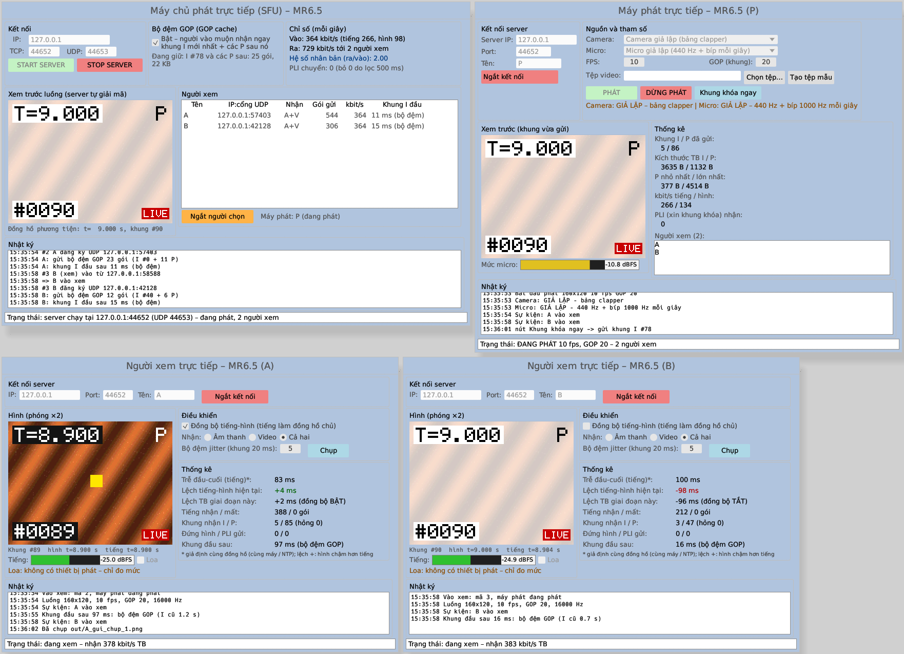
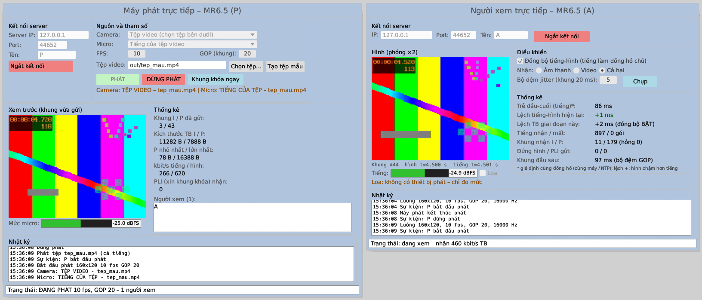
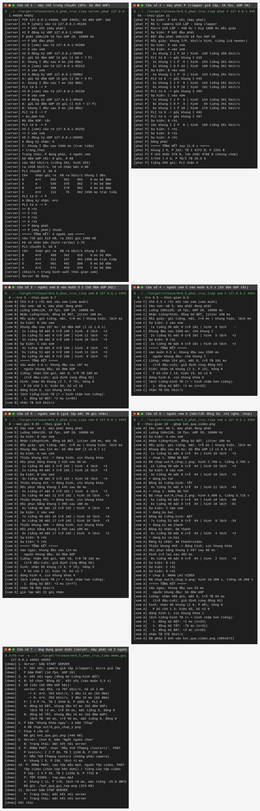
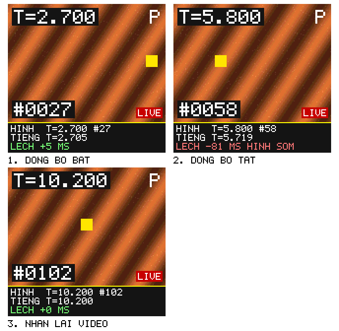

# Bài mở rộng MR6.5 – Phát trực tiếp âm thanh + video 1→n (Rust)

| Thông tin | Nội dung |
|---|---|
| Loại | **Bài mở rộng** – không có trong giáo trình, không có mã giả tương ứng |
| Liên hệ với giáo trình | Bài mở rộng MR6.2 (âm thanh RTP, bộ đệm jitter), MR6.3 (video chia mảnh); Chương 6: Bài 6.1 (server đa luồng), Bài 6.6 (một nguồn – nhiều người nhận); Chương 4: Bài 4.1 (UDP); Chương 3: Bài 3.2 (định khung thông điệp) |
| Thư viện | Thư viện chuẩn Rust: `std::net` (TCP, UDP), `std::thread`, `Mutex`, `mpsc`, `std::process` (ffmpeg); crate `miniz_oxide` 0.8.9 (zlib, mức 6), `serde_json` 1.0.154, `socket2` 0.5.10 (`SO_RCVBUF`/`SO_SNDBUF` 1 MB), `ctrlc` 3.4.7, `chrono` 0.4.41 (giờ địa phương trong nhật ký). PNG, CRC-32, phông chữ tự viết. Ứng dụng giao diện: `eframe`/`egui` 0.29.1 (OpenGL qua `glow`). Thiết bị thật (tùy chọn): công cụ `ffmpeg` (camera, tệp video), micro/loa qua crate `cpal` 0.15.3 (WASAPI/ALSA/CoreAudio) |
| Bản ngôn ngữ khác | [C#](../../../csharp/Chuong06/BaiMR6.5_PhatTrucTiep/), [Java](../../../java/Chuong06/BaiMR6.5_PhatTrucTiep/), [Python](../../../python/Chuong06/BaiMR6.5_PhatTrucTiep/), [Go](../../../go/Chuong06/BaiMR6.5_PhatTrucTiep/) |

## Mục tiêu
Mô hình của livestream thật (YouTube Live, Facebook Live, Twitch; máy chủ RTMP/SRS, WebRTC SFU): **một máy phát** (camera + micro) gửi lên **máy chủ trung chuyển**; máy chủ **không giải nén, không trộn** mà chỉ **nhân bản gói** (fan-out) tới **n người xem**. Khác MR6.2/MR6.3 (hội thoại n↔n, server MCU trộn/ghép lưới). Bài cho thấy bằng số liệu thật: băng thông ra = n × vào; khung khóa I và khung sai khác P; mất một khung P thì **đứng hình** cho tới khi **xin khung khóa** (PLI); **bộ đệm GOP** giúp người vào muộn thấy hình gần như tức thì; **đồng bộ tiếng-hình** (lip-sync) với âm thanh làm đồng hồ chủ; đăng ký theo lớp (chỉ nghe). Nguồn phát: **camera thật**, **tệp video** (mp4, mkv… – phát lại như OBS "Media Source"), mẫu thử ffmpeg hoặc nguồn giả lập; micro thật, tiếng của tệp hoặc giả lập.

## Kiến thức chính
Số liệu dưới đây lấy từ `ket_qua.txt` (một lần chạy thật trên máy cục bộ; mỗi lần chạy lệch vài phần trăm).

- **Fan-out 1→n và SFU (RFC 7667 mục 3.7).** Máy chủ chỉ đọc header (byte đầu, loại khung, số khung) rồi `send_to()` nguyên byte cho từng người xem. Lúc `trang_thai` (4 người xem, A đang "chỉ nghe"): vào 362 kbit/s, ra 1450 kbit/s, hệ số nhân bản 4,00. Cả buổi: vào 513 KB, ra 1408 KB, hệ số 2,75 (người xem vào/ra ở các thời điểm khác nhau). CPU máy chủ gần như chỉ dành cho gửi gói – khác MCU ở MR6.3 phải giải nén, ghép và nén lại cho từng người.
- **Khung I, khung P, nhóm GOP.** I = `zlib(rgb thô 160×120×3)`; P = `zlib(XOR(khung này, khung trước))` (`miniz_oxide::deflate::compress_to_vec_zlib(…, 6)`). Cảnh gần như tĩnh (nền tĩnh, một ô vuông chạy, đồng hồ đổi số) nên P nhỏ nhất chỉ 370 B so với I trung bình 4272 B (7,4 % ảnh thô 57 600 B). Khung chớp trắng mỗi giây tròn đổi gần như toàn ảnh nên P lúc đó lên tới 4706 B – "đổi cảnh" thì P lớn như I. Video tốn 65–170 kbit/s (giây có thêm khung I do PLI thì cao hơn), tiếng L16 261 kbit/s (đều tính cả header RTP/bài).
- **Mất tham chiếu và xin khung khóa (PLI – RFC 4585 mục 6.3.1).** P số k chỉ giải được khi đã có khung k−1. D giả lập mất 3 % gói nhận (mất 18 gói tiếng): "Thiếu khung #11 → đứng hình", gửi `xin_khung_khoa`; máy chủ lọc 500 ms rồi chuyển cho máy phát; máy phát gửi I ngay ở khung kế tiếp ("PLI từ D -> gửi khung I #15"). Có PLI thì hình về sau 96–100 ms (cộng 200 ms chờ khung thiếu trước khi kết luận mất tham chiếu ⇒ đứng ≈ 0,3 s); lần chạy này D đứng hình 4 lần. Khi chính khung I trả lời bị mất (khung I 4 mảnh, xác suất mất ≈ 11 %), người xem xin lại sau giới hạn 1 s ("Chưa có khung I: xin khung khóa").
- **Bộ đệm GOP ở máy chủ (GOP cache của SRS, nginx-rtmp).** Máy chủ giữ khung I mới nhất và mọi P sau nó (≤ 4 MB). B vào muộn 3 s khi bộ đệm bật: máy chủ gửi ngay 33 gói (I #15 + 17 P), khung I tới sau 9 ms; B hiện khung đầu sau **107 ms** (chờ bộ đệm jitter nạp tiếng để khung đầu cũng đúng tiếng). C vào lúc bộ đệm đã tắt: phải chờ khung I kế tiếp, khung đầu sau **1596 ms** (tối đa một GOP = 2 s ở 10 fps, GOP 20). Người vào **trước** khi máy phát bấm Phát thì thời gian tới khung đầu tính từ lúc bắt đầu phát (dòng in có "(từ lúc phát)"), không tính thời gian chờ người phát.
- **Đồng bộ tiếng-hình, âm thanh là đồng hồ chủ.** Nhãn thời gian tiếng (RTP ts, 16 kHz) và hình (ms) cùng một gốc: t = 0 lúc bấm Phát. Máy phát gửi `thong_tin` qua TCP rồi chờ 20 ms mới bắt đầu gửi phương tiện (để máy chủ kịp chuyển sang "đang phát", khung I #0 không bị bỏ), và gửi `dong_ho` mỗi giây (như RTCP Sender Report – RFC 3550 mục 6.4.1). Người xem chỉ hiện khung có nhãn ≤ đồng hồ phát tiếng: A **+2 ms** khi BẬT (sai số do nhịp hiển thị 5 ms), **−78 ms** khi TẮT (hình đi trước tiếng đúng bằng thời gian tiếng nằm trong bộ đệm jitter, ≈ 4 khung × 20 ms). Ảnh chụp `ket_qua_video.png` ghi nhãn hình và đồng hồ tiếng ngay lúc khung được hiện.
- **Độ trễ đầu-cuối (tiếng).** `giờ thực khi phát − (gio + (ts_ms − ts))` theo báo cáo đồng hồ mới nhất: 84–102 ms (bộ đệm jitter 5 khung). Chỉ đúng khi máy phát và người xem **cùng đồng hồ** (cùng máy hoặc đồng bộ NTP) – điều RTCP SR thật cũng phải giả định.
- **Đăng ký theo lớp.** `dang_ky am_thanh` – A "chỉ nghe": máy chủ ngừng gửi hình cho A (cột "nhận" = `A`). Bật lại video khi bộ đệm đã tắt: khung tham chiếu cũ của A đã lỗi thời → mất tham chiếu → PLI → khung I #97 → hình trở lại sau 402 ms.
- **Phát từ tệp video (đồng bộ ở phía phát).** Hai tiến trình ffmpeg cùng đọc tệp với `-re` (theo tốc độ thật) và `-stream_loop -1` (lặp lại): một ra khung rgb24 160×120 (`scale…,pad…,fps=10` – khung thứ i ứng với giây i/10 của tệp), một ra tiếng s16le 16 kHz mono. Hai tiến trình khởi động lệch nhau, nên nếu cứ gửi "khung mới nhất" thì hình và tiếng của tệp đã lệch ngay từ máy phát. `tep_video.rs` làm như bộ ghép kênh (muxer) của bộ mã hóa thật: tiếng là đồng hồ chủ – thiếu mẫu thì chèn 20 ms im lặng, dồn quá 300 ms thì bỏ 20 ms, và ghi lại `lech_ms` = thời điểm phương tiện − thời điểm trong tệp của tiếng đang gửi; khi chụp khung ở thời điểm T, máy phát chọn khung hình của tệp có thời điểm ≤ T − `lech_ms`. Tệp mẫu (`--tao-tep-mau` hoặc nút "Tạo tệp mẫu") có chớp trắng và bíp 1000 Hz cùng lúc ở đầu mỗi giây. Ảnh động nhiều (testsrc2: vạch màu, đường chéo chạy) cho P gần bằng I (lượt giao diện: P TB 7732 B so với I TB 11 282 B; lần chạy thử khác P còn lớn hơn I): XOR chỉ có lợi khi phần lớn điểm ảnh đứng yên – codec thật dùng bù chuyển động (motion compensation) để P vẫn nhỏ khi cảnh chuyển động.
- **Đa luồng.** Máy chủ: luồng nhận kết nối, mỗi client một luồng TCP, **một** luồng UDP nhận và chuyển tiếp ngay (mọi gói phương tiện đi ra từ luồng này nên thứ tự được giữ – bộ đệm GOP luôn đi trước gói trực tiếp). Người xem: luồng TCP, luồng nhận UDP, luồng phát 20 ms (đồng hồ chủ) và luồng hiển thị 5 ms; trạng thái chung trong một `Mutex`. Luồng nền dùng chung lõi qua `Arc<…>`; `cpal::Stream` (không `Send`) do luồng chính/giao diện giữ, lõi chỉ thấy hàng đợi mẫu.

### Giao thức (giống hệt ở 5 ngôn ngữ)
Máy chủ: TCP cổng P (điều khiển, mỗi dòng một JSON UTF-8 kết thúc `\n`, ≤ 64 KB), UDP cổng P+1 (phương tiện). Mỗi client mở **một** socket UDP cho cả tiếng và hình.

| Chiều | Thông điệp TCP |
|---|---|
| client → server | `{"loai":"chao","vai_tro":"phat"\|"xem","ten":"A"}` (đầu tiên, tên 1–16 ký tự) |
| xem → server | `{"loai":"dang_ky","am_thanh":true,"video":true}`, `{"loai":"xin_khung_khoa"}` |
| phát → server | `{"loai":"thong_tin","rong":160,"cao":120,"fps":10,"gop":20,"tan_so_mau":16000}`, `{"loai":"dong_ho","ts":<ms phương tiện>,"gio":<ms Unix>}` mỗi 1 s, `{"loai":"dung_phat"}` |
| server → client | `{"loai":"chao","ma":k,"cong_udp":P+1,"phat":bool}`; `{"loai":"loi","ly_do":"đã có máy phát"\|"tên không hợp lệ"}` rồi đóng |
| server → xem | `thong_tin`, `dong_ho` (chuyển tiếp; bản đã lưu cho người vào sau); `{"loai":"bi_ngat","ly_do":"server ngắt"}` rồi đóng |
| server → phát | `{"loai":"xin_khung_khoa","tu":"A"}` (lọc 500 ms), `{"loai":"nguoi_xem","so":n,"ds":[…]}` |
| server → tất cả | `{"loai":"su_kien","noi_dung":"B vào xem"}`, `{"loai":"ket_thuc"}` |

| Datagram UDP | Byte đầu | Cấu trúc |
|---|---|---|
| Tiếng | `0x80` | RTP v2 `!BBHII` (0x80, PT 96, seq, ts 16 kHz từ 0, SSRC = mã máy phát) + 320 mẫu L16 big-endian (640 B) |
| Hình | `0x01` | `!BBHIHHHHI` (phiên bản 1, loại, mã nguồn, số khung, chỉ số mảnh, tổng mảnh, rộng, cao, nhãn ms) + ≤ 1180 B dữ liệu; loại 2 = giữ kết nối (`goi_giu`), **3 = mảnh I**, **4 = mảnh P**; ≤ 256 mảnh/khung |

Client gửi `goi_giu(mã)` ngay sau chào và mỗi 1 s; máy chủ ghi nhận địa chỉ UDP khi IP trùng IP TCP của mã đó và chỉ nhận phương tiện từ địa chỉ đã đăng ký của máy phát. Khung 0 luôn là I; I lặp lại mỗi `gop` khung hoặc ngay sau khi có `xin_khung_khoa` (đếm GOP lại từ đó). Header ghép từng byte bằng `to_be_bytes()`/`from_be_bytes()` (thứ tự byte mạng), JSON bằng `serde_json` (không thoát chữ có dấu, như `ensure_ascii=False`).

## Cấu trúc tệp
- `Cargo.toml`, `Cargo.lock` – gói Cargo `mr6_5_phat_truc_tiep` (phiên bản crate ghim bằng `=`).
- `src/main.rs` – chọn vai trò `server_phat` / `phat` / `xem` (dòng lệnh) và `server_gui` / `phat_gui` / `xem_gui` / `demo_gui` (giao diện); bộ đọc tham số `--khóa giá_trị`.
- `src/chung.rs` – hằng số; RTP; header video, `chia_manh`, `goi_giu`, `tach_header`; `GhepKhung` (không bỏ khung cũ còn dở, chờ 0,5 s); `BoDemJitter` (trả về nhãn thời gian, đổi độ sâu khi chạy); `xor_khung`, `ma_hoa_i/p`, `GiaiMaVideo` (chờ khung thiếu 200 ms, mất tham chiếu); phông 5×7, `ghi_png` (chọn bộ lọc hàng PNG), `ghep_anh`; nguồn giả lập `NguonClapper` (hình) và `NguonAmClapper` (tiếng); `gui_json`, `doc_dong` (giới hạn 64 KB), đọc lệnh `@t`; có `cargo test`.
- `src/camera.rs`, `src/thiet_bi.rs` – chép từ MR6.3/MR6.2: camera thật/testsrc qua ffmpeg (trait `Camera`), micro/loa thật qua `cpal` (trait `Mic`, hàng đợi mẫu, đổi tần số lấy mẫu); giả lập là clapper.
- `src/tep_video.rs` – nguồn "tệp video": `TepVideo` (hai tiến trình ffmpeg `-re -stream_loop -1`, bộ đệm tiếng, vòng khung hình 3 s có thời điểm trong tệp, `lech_ms`), `CameraTep`, `MicTep`, `mo_tep`, `tao_tep_mau` (mp4 có chớp + bíp mỗi giây).
- `src/may_chu.rs` – lõi máy chủ `MayChuPhat` (Start/Stop nhiều lần, bộ đệm GOP, lọc PLI, thống kê, `bang_trang_thai`, `bang_tong_ket`); `src/server_phat.rs` – bản dòng lệnh.
- `src/may_phat.rs` – lõi máy phát `MayPhat`; `src/phat.rs` – bản dòng lệnh.
- `src/nguoi_xem.rs` – lõi người xem `NguoiXem` (đồng hồ chủ, lip-sync, PLI, thống kê), `anh_chup`; `src/xem.rs` – bản dòng lệnh.
- `src/gui_chung.rs`, `src/server_gui.rs`, `src/phat_gui.rs`, `src/xem_gui.rs` – bản giao diện egui; `src/demo_gui.rs` – kịch bản tự bấm nút.
- `demo.json`, `ket_qua.txt`, `ket_qua.png`, `ket_qua_video.png`, `ket_qua_gui.png`, `ket_qua_gui_tep.png` – kịch bản và kết quả thực thi thật.

## Cách chạy
Trong thư mục bài (`cargo build -q --release` một lần; `B=../../target/release/mr6_5_phat_truc_tiep`, Windows: `..\..\target\release\mr6_5_phat_truc_tiep.exe`):
```bash
$B server_phat 127.0.0.1 9000 9001                              # cửa sổ 1 (gõ lệnh ở đây)
$B phat P 127.0.0.1 9000 --thoi-gian 120                        # cửa sổ 2: máy phát
$B xem A 127.0.0.1 9000 --thoi-gian 60                          # cửa sổ 3, 4…: người xem
$B xem B 127.0.0.1 9000 --tre 5 --khong-dong-bo                 # vào muộn 5 s, không đồng bộ
$B xem D 127.0.0.1 9000 --mat-goi 0.03                          # giả lập mất 3 % gói nhận
$B phat P 127.0.0.1 9000 --tep phim.mp4                         # phát tệp video (hình + tiếng của tệp)
$B phat P 127.0.0.1 9000 --tep out/mau.mp4 --tao-tep-mau        # tạo tệp mẫu 10 s rồi phát
```
- Lệnh máy chủ: `trang_thai`, `bo_dem bat|tat`, `ngat <tên>`, `thoat`. Lệnh máy phát: `khung_khoa`, `dung`. Lệnh người xem: `chup <nhãn>` (lưu `out/<tên>_chup_N.png`), `dong_bo bat|tat`, `dang_ky am_thanh|video|ca_hai`, `thoat`. Dòng `@t lệnh` chờ tới giây thứ t kể từ khi chương trình chạy. Ctrl+C: máy chủ in bảng tổng kết rồi dừng.
- Tùy chọn máy phát: `--camera gia_lap|testsrc|<thiết bị>`, `--mic gia_lap|<chỉ số>`, `--fps 10`, `--gop 20`, `--thoi-gian`, `--mat-goi`. Người xem: `--thoi-gian` (tính cả `--tre`), `--tre`, `--dem 5` (độ sâu bộ đệm jitter, 1–25 khung), `--khong-dong-bo`, `--chi-am-thanh`, `--chi-video`, `--mat-goi`, `--ghep tệp.png`.
- **Thiết bị thật:** camera `--camera /dev/video0` (Linux), `--camera "Tên camera"` (Windows, dshow), `--camera 0` (macOS) – cần `ffmpeg` trong PATH; micro `--mic <chỉ số>` (thứ tự trong danh sách micro của `cpal`, từ 0; ô Micro của `phat_gui` hiện đúng danh sách này). Không có ffmpeg/micro, hoặc ffmpeg không mở được camera, chương trình báo và **tự lùi về nguồn giả lập** (máy kiểm thử không có webcam: `Camera lỗi, dùng giả lập: …`).
- **Tệp video:** `--tep <tệp>` (cần ffmpeg) lấy cả hình lẫn tiếng của tệp, hết tệp thì phát lại từ đầu; thêm `--mic gia_lap` hoặc `--mic <chỉ số>` để thay tiếng của tệp bằng micro. Tệp không có tiếng: hình vẫn phát, tiếng im lặng.

Tái lập kết quả từ thư mục gốc của kho: `python3 tools/demo.py rust/Chuong06/BaiMR6.5_PhatTrucTiep` (cổng 44650/44651, giao diện 44652/44653; thư mục `out/` sinh ra khi chạy, không đưa vào kho).

## Ứng dụng giao diện


Ảnh trên là lần chạy thật của `demo_gui` (Linux, Xvfb + Mesa llvmpipe; không có webcam, không có thiết bị âm thanh): bốn cửa sổ con trong một cửa sổ egui – máy chủ (trên trái), máy phát P (trên phải), người xem A (đồng bộ BẬT, dưới trái) và B (đồng bộ TẮT, vào muộn 3,5 s, dưới phải). A: lệch TB +2 ms; B: lệch TB −96 ms – cùng một luồng, B thấy hình sớm hơn tiếng ≈ 90 ms. B vào muộn nhưng khung đầu sau 16 ms nhờ bộ đệm GOP (B tắt đồng bộ nên không chờ tiếng).

- **Máy chủ** (`server_gui`): IP, cổng TCP/UDP, START/STOP SERVER; công tắc **Bộ đệm GOP** và số gói/KB đang giữ; chỉ số mỗi giây: vào kbit/s (tiếng, hình), ra kbit/s, **hệ số nhân bản**, PLI chuyển/bỏ; **xem trước luồng** (máy chủ tự giải mã một bản chỉ để hiện ảnh, kèm đồng hồ phương tiện); bảng người xem (tên, IP:cổng UDP, nhận A/V, gói gửi, kbit/s, khung I đầu sau … ms và nguồn); nút **Ngắt người chọn** (bấm tên để chọn); nhật ký; thanh trạng thái.
- **Máy phát** (`phat_gui`): kết nối; chọn camera (thật qua ffmpeg / "Tệp video (chọn tệp bên dưới)" / "Mẫu thử ffmpeg (testsrc)" / "Camera giả lập (bảng clapper)"), micro (thật qua cpal / "Tiếng của tệp video" / giả lập); ô **Tệp video** với nút **Chọn tệp…** (hộp thoại chọn tệp vẽ bằng egui: ô thư mục, Lên, danh sách thư mục con và tệp mp4/mkv/avi/mov/webm/flv/ts/m4v hoặc mọi tệp, Mở/Hủy) và **Tạo tệp mẫu** (tạo `out/tep_mau.mp4` 10 s ở luồng nền); chọn tệp thì camera và micro tự chuyển sang tệp, bỏ "Tệp video" mà micro còn là "Tiếng của tệp" thì micro về mục đầu danh sách; FPS, GOP; PHÁT, DỪNG PHÁT, **Khung khóa ngay**; dòng chỉ báo "Camera: … | Micro: …" (THẬT/GIẢ LẬP/TỆP VIDEO); xem trước khung vừa gửi; thanh mức micro (dBFS); thống kê khung I/P, kích thước TB I/P, P nhỏ nhất/lớn nhất, kbit/s tiếng/hình, PLI nhận; danh sách người xem; nhật ký.
- **Người xem** (`xem_gui`): kết nối; ô hình phóng ×2 kèm nhãn hình và đồng hồ tiếng lúc hiện; thanh mức tiếng, ô **Loa** (thật nếu `cpal` mở được thiết bị phát, không thì "chỉ đo mức"); công tắc **Đồng bộ tiếng-hình**; chọn nhận **Âm thanh / Video / Cả hai**; độ sâu bộ đệm jitter (đổi khi đang xem); **Chụp**; thống kê trễ đầu-cuối, lệch hiện tại và TB của giai đoạn, tiếng nhận/mất, khung I/P, đứng hình/PLI gửi, khung đầu sau … ms; nhật ký.

Kịch bản còn bấm "Khung khóa ngay", máy chủ ngắt B (B báo "mất kết nối server"), và – vì máy có ffmpeg – thêm một lượt "Mẫu thử ffmpeg (testsrc)": ảnh mẫu ít chi tiết nên I chỉ ≈ 1130 B, P ≈ 299 B.

Lượt cuối của kịch bản phát **tệp video** (tệp mẫu mp4 tạo bằng `tao_tep_mau`, cả hình và tiếng của tệp) – máy phát (trái) và người xem A (phải; lệch +0 ms, mức tiếng −25,0 dBFS):



### Cách chạy
```bash
cargo build --release
$B server_gui 127.0.0.1 44652 44653
$B phat_gui P 127.0.0.1 44652
$B xem_gui A 127.0.0.1 44652
$B xem_gui B 127.0.0.1 44652
```
- **Windows:** cần Rust bản MSVC (`rustup`, Visual Studio Build Tools – "Desktop development with C++") như các bài Rust khác; ffmpeg: `winget install -e --id Gyan.FFmpeg` (mở lại cửa sổ dòng lệnh để PATH có `ffmpeg`); micro/loa dùng WASAPI qua `cpal`, không cài thêm gì. Cho phép ứng dụng desktop dùng camera/micro trong *Settings → Privacy & security*.
- **Linux:** `sudo apt install ffmpeg libasound2-dev pkg-config` (ALSA cho `cpal`), thư viện OpenGL/X11 của máy. **macOS:** `brew install ffmpeg`.
- Chạy riêng từng cửa sổ (không qua `demo_gui`): mọi dòng nhật ký (kèm giờ và tiền tố `[server]`, `[phat P]`, `[xem A]`) và cứ 5 giây một dòng số liệu (tiếng nhận/mất, mức dBFS, loa; khung I/P, đứng hình, lệch, trễ; kbit/s vào/ra) cũng in ra dòng lệnh, chuyển hướng được vào tệp (`$B xem_gui A … > xem_A.txt`) để kiểm tra khi thử thiết bị thật. Máy phát ghi "Camera: …", "Micro: …" (nguồn đang dùng) khi bấm PHÁT.
- Thiết bị thật chỉ được mở khi bấm PHÁT. Muốn máy khác nối vào: máy chủ nghe IP card mạng (hoặc `0.0.0.0`) và mở tường lửa cho hai cổng.
- Kịch bản tự động (Linux): `xvfb-run -a -s "-screen 0 2000x1400x24" $B demo_gui 127.0.0.1 44652 44653`.

### Sơ đồ luồng
```
 máy phát                         máy chủ (SFU)                              người xem (mỗi người)
 ────────                         ─────────────                              ─────────────────────
 luồng 20 ms: mic -> RTP ──UDP──▶ luồng UDP: kiểm tra nguồn ─nhân bản──▶ luồng UDP: RTP -> bộ đệm jitter
 luồng fps: camera -> I/P ─UDP──▶   + bộ đệm GOP (I + các P)  ─n gói──▶   mảnh -> ghép -> giải mã I/P -> hàng
 TCP: thong_tin, dong_ho ──────▶  luồng TCP mỗi client ─chuyển tiếp──▶ luồng 20 ms: phát tiếng = ĐỒNG HỒ CHỦ
 TCP ◀── xin_khung_khoa (lọc 500 ms) ◀──────────────── xin_khung_khoa ◀─ luồng 5 ms: mất tham chiếu? chọn khung
                                                                        (nhãn ≤ đồng hồ tiếng) -> hiện
```
Giao diện: chỉ luồng giao diện (egui `update`) chạm điều khiển; lõi ghi nhật ký vào `NhatKy` (Mutex) và gọi `request_repaint()`, giao diện đọc trạng thái mỗi 50–200 ms (`request_repaint_after`), khung mới đổi thành texture (`TextureHandle::set`).

## Kết quả thực thi


Ảnh do người xem A chụp trong lần chạy trên (nhãn hình, đồng hồ tiếng lúc khung được hiện, lệch):



1. Đồng bộ BẬT: hình 2,700 s – tiếng 2,705 s, lệch +5 ms.
2. Đồng bộ TẮT: hình 5,800 s nhưng tiếng mới ở 5,719 s – hình sớm 81 ms.
3. Chỉ nghe 1 s rồi nhận lại video: mất tham chiếu → PLI → khung I #97 → hình trở lại, lệch +0 ms.

**Chạy chéo với bản Python** (cùng máy, Linux): (a) máy phát Python + máy chủ Rust + người xem Rust và người xem Python (vào muộn 2 s, tắt đồng bộ): cả hai nhận bộ đệm GOP (khung I đầu sau 5 ms và 17 ms), giải mã I/P không hỏng khung; người xem Rust lệch +3 ms (đồng bộ BẬT), người xem Python −89 ms (TẮT); hệ số nhân bản 2,00. (b) máy phát Rust + máy chủ Python + 2 người xem Python (một người mất 3 % gói): khung đầu 100 ms từ bộ đệm GOP; 4 lần đứng hình, PLI qua máy chủ Python tới máy phát Rust ("PLI từ X -> gửi khung I #10"), hồi phục sau 96–99 ms; lệch +2/+3 ms khi đồng bộ.

## Ghi chú
- Lệch tiếng-hình đo ở đây là lệch giữa thời điểm **hiện khung** và thời điểm **đưa khung tiếng ra loa** trong chương trình; loa thật còn bộ đệm riêng của hệ điều hành (vài chục ms) mà chương trình không thấy. Tai người khó nhận ra lệch dưới khoảng ±40 ms (ngưỡng tô màu xanh/đỏ trong bài).
- Giá trị "trung bình" theo giai đoạn gồm cả các khung chuyển tiếp ngay sau khi bật/tắt, nên giai đoạn TẮT ra −78 ms dù ảnh chụp ở trạng thái ổn định ghi −81 ms.
- Nén mức 6 của `miniz_oxide` cho dòng byte khác zlib C (bản Python) nhưng cùng định dạng RFC 1950 – hai bên giải nén được của nhau (đã chạy chéo); khung I của bản Rust lớn hơn khoảng 5 % (4272 B so với 4052 B).
- Hạt nhiễu của camera giả lập và giả lập mất gói dùng bộ sinh xorshift riêng (không trùng `random.Random` của Python), nên hình nền và gói rơi khác chút ít; quy tắc vẽ (chớp `v → 255 − (255 − v)/4`, ô vuông x = 6 + (ts/10) mod 136, đồng hồ `T=8.600`) và âm giả lập (440 Hz + bíp 1000 Hz 100 ms mỗi giây tròn, làm tròn nửa về số chẵn) giống hệt.
- Người xem đọc xong các dòng `thong_tin`, `dong_ho` máy chủ gửi kèm lời chào (chờ tối đa 50 ms) rồi mới gửi `goi_giu` đăng ký UDP: bộ đệm GOP chỉ tới sau đó, nên người xem đã biết đồng hồ phương tiện và luôn phân loại đúng "khung đầu từ bộ đệm GOP" (không phụ thuộc thứ tự chạy của hai luồng).
- Nhãn thời gian 32 bit (ms và mẫu) quay vòng sau ≈ 49,7 ngày và ≈ 3 ngày; bài không xử lý quay vòng của nhãn hình.
- zlib + XOR kém xa codec thật (H.264/VP8/AV1 có bù chuyển động, nén có mất dữ liệu); khung IDR của H.264 (RFC 6184 mục 8) chính là khung I mà người xem xin bằng PLI. Livestream thật còn cần mã hóa (SRTP/TLS), điều khiển tắc nghẽn và simulcast/SVC để mỗi người xem nhận chất lượng hợp với đường truyền.
- Kiểm thử: Linux, Rust 1.97.0 (dòng lệnh và giao diện dưới Xvfb + Mesa llvmpipe), ffmpeg 6.1.1; máy không có webcam/thiết bị âm thanh – đã thử nhánh lùi về giả lập và nhánh "chỉ đo mức" của loa. Hộp thoại "Chọn tệp…" và thiết bị thật (camera, micro, loa qua cpal) chưa thử trên máy có thiết bị.

## Bài tập gợi ý
1. Chạy `xem --dem 15` với đồng bộ tắt rồi bật: lệch TB thay đổi thế nào? Giải thích bằng công thức lệch ≈ −(độ sâu − 1) × 20 ms.
2. Chạy máy phát `--gop 5` và `--gop 100`, cho một người vào muộn khi bộ đệm GOP tắt: so sánh thời gian tới khung hình đầu tiên và kbit/s hình. Vì sao dịch vụ livestream thường chọn GOP 1–2 s?
3. Người xem mới vào (chưa có tham chiếu) hiện chỉ chờ I. Sửa để gửi `xin_khung_khoa` ngay khi vào nếu không nhận được khung I trong 300 ms; đo lại C. Điều gì xảy ra với máy phát khi 1000 người cùng vào?
4. Tăng `--mat-goi` của D lên 0,1: đếm số lần đứng hình và tính xác suất một khung I 4 mảnh tới đủ (0,9⁴ ≈ 66 %). Đề xuất cách giảm (chia khung I nhỏ hơn, FEC, gửi I hai lần).
5. Giao diện: thêm vào cửa sổ máy chủ biểu đồ kbit/s vào/ra 30 s gần nhất (vẽ bằng `ui.painter()`, cập nhật mỗi giây); thêm/bớt người xem và quan sát hệ số nhân bản.
6. Nâng cao: cho máy phát gửi hai lớp video (160×120 và 80×60 – simulcast) và cho người xem đăng ký chọn lớp; máy chủ chỉ chuyển tiếp lớp đã chọn.

## Đọc thêm
- RFC 3550 – *RTP: A Transport Protocol for Real-Time Applications*, mục 6.4.1 (Sender Report: ánh xạ nhãn thời gian RTP ↔ giờ NTP).
- RFC 3551 – *RTP Profile for Audio and Video Conferences with Minimal Control* (L16, payload type động).
- RFC 4585 – *Extended RTP Profile for RTCP-Based Feedback (RTP/AVPF)*, mục 6.3.1 (Picture Loss Indication).
- RFC 7667 – *RTP Topologies* (Topo-Mixer/MCU, Topo-SFU, fan-out).
- RFC 6184 – *RTP Payload Format for H.264 Video*, mục 8 (khái niệm khung IDR – khung khóa).
- RFC 8085 – *UDP Usage Guidelines* (kích thước datagram, điều khiển tắc nghẽn).
- Tài liệu Rust: [`std::net`](https://doc.rust-lang.org/std/net/), [`std::sync::Mutex`](https://doc.rust-lang.org/std/sync/struct.Mutex.html), [`std::process::Command`](https://doc.rust-lang.org/std/process/struct.Command.html); crate [`miniz_oxide`](https://docs.rs/miniz_oxide) (`compress_to_vec_zlib`, `decompress_to_vec_zlib_with_limit`), [`socket2`](https://docs.rs/socket2), [`serde_json`](https://docs.rs/serde_json), [`cpal`](https://docs.rs/cpal); [egui](https://docs.rs/egui/0.29.1) / [eframe](https://docs.rs/eframe/0.29.1) (`ViewportCommand::Screenshot`).
- FFmpeg Documentation, *ffmpeg* (`-re`, `-stream_loop`), *ffmpeg-filters* (`scale`, `pad`, `fps`, `testsrc2`, `drawbox`, `aevalsrc`), *ffmpeg-devices* (`dshow`, `v4l2`, `avfoundation`), *ffmpeg-formats* (`rawvideo`, `s16le`).

Mã nguồn của bài được viết mới cho kho này.
