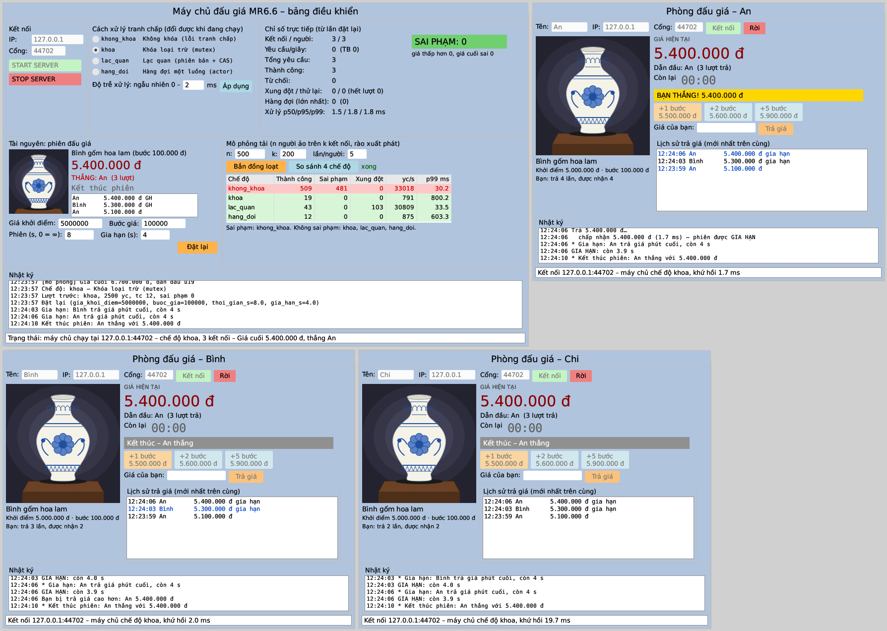
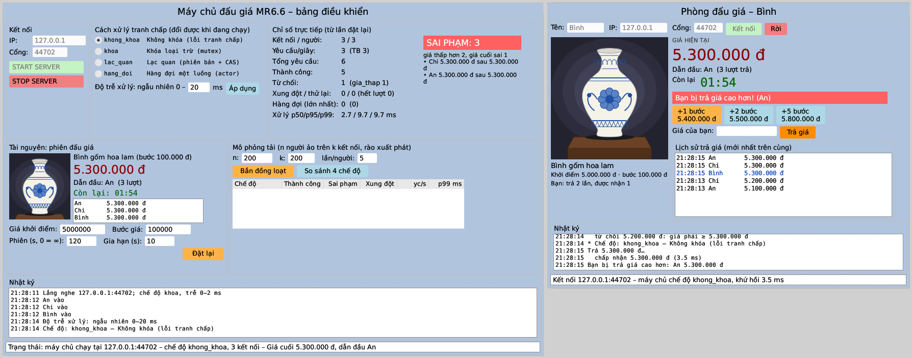
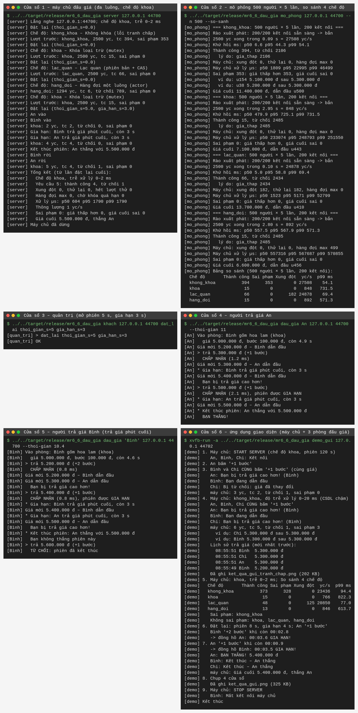

# Bài mở rộng MR6.6 – Đấu giá trực tuyến: n người cùng tranh một món hàng (Rust)

| Thông tin | Nội dung |
|---|---|
| Loại | **Bài mở rộng**, không có trong giáo trình và không có mã giả tương ứng. Đây là bài đầu của nhóm "tranh chấp tài nguyên" MR6.6–MR6.14 |
| Liên hệ với giáo trình | Chương 6: Bài 6.1 (server đa luồng, một luồng mỗi kết nối), Bài 6.7 (kiểm thử tải); Chương 3: Bài 3.2 (định khung thông điệp theo dòng); bài mở rộng MR5.4/MR5.5 (luồng, đồng bộ) |
| Thư viện | Thư viện chuẩn Rust: `std::net` (TCP), `std::thread`, `std::sync` (`Mutex`, `RwLock`, `Condvar`, `AtomicU64`, `AtomicBool`, `mpsc`); crate `serde_json` 1.0.154 (bật `preserve_order` để giữ thứ tự khóa như `dict` của Python), `socket2` 0.5.10 (socket nghe với backlog 1024), `ctrlc` 3.4.7, `chrono` 0.4.41 (giờ địa phương), `miniz_oxide` 0.8.9 (nén zlib cho bộ ghi PNG viết tay). Ứng dụng giao diện: `eframe`/`egui` 0.29.1 (OpenGL qua `glow`). Mọi crate ghim bằng `=` và `Cargo.lock` |
| Bản ngôn ngữ khác | [Python](../../../python/Chuong06/BaiMR6.6_DauGia/), [C#](../../../csharp/Chuong06/BaiMR6.6_DauGia/), [Java](../../../java/Chuong06/BaiMR6.6_DauGia/), [Go](../../../go/Chuong06/BaiMR6.6_DauGia/) |

## Mục tiêu
Bài mô phỏng một phòng đấu giá trực tuyến. Một món hàng có giá khởi điểm và bước giá. **n người cùng trả giá**, và giá chỉ được nhận khi **≥ giá hiện tại + bước giá**. Đồng hồ đếm ngược đóng phiên; ai trả giá trong 10 giây cuối thì phiên được **gia hạn 10 giây** (đóng mềm, chống "bắn tỉa" phút cuối). Hết giờ, máy chủ công bố người thắng. Máy chủ TCP đa luồng (một luồng `std::thread` mỗi kết nối) giữ trạng thái. Mỗi lần trả giá là một thao tác "đọc → kiểm tra (giả lập độ trễ cơ sở dữ liệu 0–2 ms) → ghi", và thao tác này được xử lý theo **bốn cách** chọn được ngay lúc đang chạy: không khóa, khóa loại trừ, điều khiển đồng thời lạc quan, hàng đợi một luồng. **Sổ kiểm toán** độc lập đếm sai phạm, còn **bộ mô phỏng tải** (500 người × 5 lần trên 200 kết nối, có rào xuất phát và pipelining) cho thấy bằng số liệu thật: chỉ chế độ không khóa sinh sai phạm, ba chế độ còn lại cho 0 sai phạm nhưng khác nhau về thông lượng và độ trễ.

Giao thức, câu chữ và định dạng dòng in giống hệt bản Python, nên máy chủ, bộ mô phỏng và người dùng viết bằng các ngôn ngữ khác nhau chạy chung được (đã thử chạy chéo với bản Python, xem Ghi chú). Phần khung (`chung.rs`, `khach.rs`, `mo_phong.rs`, `server.rs`, `gui_chung.rs`) dùng chung cho cả 9 bài MR6.6–MR6.14 và được chép nguyên (chỉ khác dòng đầu). Bài sau chỉ viết thêm nghiệp vụ.

## Kiến thức chính
Số liệu dưới đây lấy từ `ket_qua.txt`, là một lần chạy thật trên máy cục bộ (127.0.0.1, Rust 1.97, 2 lõi, độ trễ xử lý ngẫu nhiên 0–2 ms). Mỗi lần chạy, số liệu lệch đi đôi chút.

```
  Chế độ       Thành công Sai phạm Xung đột  yc/s  p99 ms
  khong_khoa          415      366        0 19481    69.5
  khoa                 18        0        0   825   732.9
  lac_quan             50        0      130 25362    48.9
  hang_doi             14        0        0   861   594.4
```
(500 người × 5 lần trả giá = 2500 yêu cầu/chế độ, 200 kết nối. "Thành công" là số giá được chấp nhận, "Sai phạm" do sổ kiểm toán đếm, "Xung đột" là số lần so sánh-và-đổi thất bại, "yc/s" và "p99" (khứ hồi) đo ở bộ mô phỏng.)

- **Tranh chấp (race condition) và mất cập nhật.** Chế độ `khong_khoa` làm "đọc giá → chờ 0–2 ms → kiểm tra → ghi" mà không đồng bộ. Hàng trăm luồng cùng đọc một giá cũ, ai cũng qua được kiểm tra, ai cũng nhận "CHẤP NHẬN", và bản ghi sau đè bản ghi trước: 415 giá được chấp nhận, trong đó **366** giá thấp hơn (giá đã chấp nhận trước + bước giá), ví dụ `u48 5.300.000 đ sau 5.300.000 đ`. Rust chạy đa lõi thật (không có GIL như Python), nên lượt `khong_khoa` xong trong 0,13 s mà vẫn sai hàng trăm lần. Giao diện cho thấy rõ chuyện này: khi đặt độ trễ 0–20 ms và ba người cùng bấm "+1 bước", cả ba cùng được chấp nhận ở **cùng một giá** 5.300.000 đ (sai phạm 3, xem `ket_qua_gui_tranh_chap.png`). Chế độ này chỉ dùng để minh họa lỗi trong phòng lab (loopback).
- **An toàn bộ nhớ khi cố tình "không đồng bộ".** Trong Rust, hai luồng không thể cùng ghi một biến nếu không đồng bộ (trình biên dịch không cho). Vì vậy giá trị mỗi ô nằm trong `Mutex<Arc<V>>` chỉ giữ trong lúc chép hoặc thay con trỏ `Arc` (vài chục nano giây), và phiên bản là `AtomicU64`. Từng lần đọc, từng lần ghi đều trọn vẹn (không có data race, không có `unsafe`), nhưng chuỗi "đọc – nghỉ – xử lý – ghi" thì không, nên mất cập nhật vẫn xảy ra đúng như bài muốn minh họa. Hàm nghiệp vụ `xu_ly(&Doc<V>) -> (kq, ghi)` nhận giá trị chỉ đọc và trả về giá trị mới (hàm thuần), nên cả 4 chế độ dùng chung đúng một hàm.
- **Vùng găng (critical section) và khóa theo tài nguyên.** Chế độ `khoa` cho mỗi ô tài nguyên một khóa riêng và giữ khóa suốt đọc – kiểm tra – ghi; sai phạm bằng 0. `std::sync::Mutex` không có "lock có thời hạn", mà khung cần "chờ khóa tối đa 2 s rồi báo nghi khóa chết", nên khóa ô được dựng từ `Mutex` + `Condvar` và **trao thẳng cho người chờ lâu nhất** (FIFO). Bản đầu dùng `notify_one` không xếp hàng: luồng mới tới hay "chen ngang", một số yêu cầu chờ quá 2 s (`khoa_cho_lau 3`, p99 1984 ms); khóa FIFO đưa p99 về 733 ms và không còn yêu cầu nào quá hạn. Đổi lại, mọi yêu cầu (kể cả yêu cầu sẽ bị từ chối) xếp hàng qua một khóa, nên thông lượng chỉ còn ≈ 1 / (thời gian xử lý trung bình) ≈ 825 yc/s; thời gian xử lý ở máy chủ, tính cả lúc chờ khóa, có p50 là 236 ms. (`thread::sleep` ngắn của Linux ngủ dư khoảng 0,05–0,1 ms, nên một thao tác "0–2 ms" trung bình tốn ≈ 1,1 ms.) Một món hàng là "điểm nóng" (hot spot); khóa theo từng tài nguyên chỉ có lợi khi có nhiều tài nguyên (ghế, tài khoản, xem MR6.8, MR6.12). Khung khóa nhiều ô **theo thứ tự khóa đã sắp xếp** để không khóa chết.
- **Điều khiển đồng thời lạc quan (optimistic concurrency, Kung & Robinson 1981).** Chế độ `lac_quan` đọc (giá trị, **phiên bản**) dưới một `Mutex` rất ngắn, xử lý *ngoài* khóa, rồi **so sánh-và-đổi** (compare-and-swap): chỉ ghi khi phiên bản chưa đổi, phiên bản tăng bằng `AtomicU64::compare_exchange(cũ, cũ + 1)`. Nếu đã đổi thì đó là xung đột, và thao tác thử lại (tối đa 5 lần, nghỉ ngẫu nhiên 0–1 ms). Sai phạm bằng 0 và thông lượng **cao nhất** (25362 yc/s), vì phần lớn yêu cầu bị từ chối ngay sau lần đọc ("giá thấp") mà không phải chờ ai; có 130 xung đột, 130 lần thử lại, không yêu cầu nào hết lượt thử. Vì một thao tác của khung có thể chạm nhiều ô (MR6.7, MR6.8, MR6.12), bước so sánh kiểm mọi phiên bản dưới khóa ngắn thay vì một lệnh CAS đơn lẻ (xem bài tập 3).
- **Hàng đợi một luồng (mô hình actor, vòng lặp sự kiện).** Chế độ `hang_doi` cho luồng kết nối gửi việc vào một **kênh `mpsc`** rồi đọc tiếp ngay. **Một** luồng nhận lần lượt từ kênh, đến trước phục vụ trước, không cần khóa vì chỉ luồng này chạm vào trạng thái. Sai phạm bằng 0, thông lượng 861 yc/s (tuần tự như `khoa`), hàng đợi dài tối đa **499** (`mpsc` không cho biết độ dài, nên khung đếm bằng một `AtomicUsize`), và độ trễ khứ hồi phản ánh đúng thời gian xếp hàng.
- **Sổ kiểm toán.** Sổ ghi mọi giao dịch được chấp nhận dưới `Mutex` riêng, ngay trong vùng găng của chế độ (hàm `khi_ghi`), nên thứ tự trong sổ đúng là thứ tự ghi. Luật của bài (trait `LuatKiemToan`): một giá chấp nhận phải ≥ (giá cao nhất đã chấp nhận + bước giá), và giá/người dẫn đầu cuối cùng phải đúng là giá cao nhất trong sổ. Sổ không ngăn lỗi, chỉ *phát hiện* lỗi sau buổi chạy, giống đối soát cuối ngày.
- **Cổng tạm dừng.** Đổi chế độ hoặc đặt lại đi qua `tam_dung` (`Mutex` + `Condvar`): đóng cổng, chờ mọi thao tác đang chạy và đang xếp trong kênh xong, rồi mới đổi – hai chế độ không bao giờ chạy lẫn vào nhau.
- **Rào xuất phát, pipelining, idempotency.** Bộ mô phỏng mở 200 kết nối, mỗi kết nối chở 2–3 người ảo (`"so_nguoi"` trong lời chào, tên người ở trường `"nguoi"`). Mọi luồng chờ ở rào xuất phát (`std::sync::Barrier` không có hạn chờ và không "phá" được khi một kết nối lỗi, nên khung tự dựng `Rao` từ `Mutex` + `Condvar`) rồi cùng bắn. Mỗi kết nối gửi yêu cầu của mọi người mình chở trong một lần `write_all`, và nhận được trả lời nào (ghép theo `ma_yc`) thì gửi ngay lần trả giá kế tiếp của người đó. Nếu một `ma_yc` đã xử lý bị gửi lại, máy chủ gửi lại kết quả cũ kèm `"lap_lai": true` (nhớ 1024 `ma_yc` gần nhất mỗi kết nối).
- **Đẩy trạng thái có gộp.** Mỗi khi trạng thái đổi, máy chủ chỉ đặt một cờ (`AtomicBool`). Luồng nền cứ 100 ms gửi **một** `cap_nhat` cho mọi client, nên dù có hơn 20000 yc/s thì mỗi client cũng chỉ nhận tối đa 10 cập nhật mỗi giây. Đồng hồ đếm ngược chạy cục bộ ở client theo `con_lai_ms`; hạn phiên ở máy chủ tính theo đồng hồ đơn điệu (`Instant`).
- **Đóng mềm (soft close).** Trong lượt chạy dòng lệnh (phiên 5 s, gia hạn 3 s), Bình trả giá phút cuối nên phiên được gia hạn, An trả giá phút cuối nên phiên được gia hạn lần nữa, rồi "Kết thúc phiên: An thắng với 5.500.000 đ"; lần trả giá sau đó của Bình nhận "TỪ CHỐI: phiên đã kết thúc". Việc đóng phiên cũng là một thao tác ghi đi qua cùng chế độ xử lý tranh chấp.

### Giao thức (giống hệt ở 5 ngôn ngữ)
TCP, mỗi dòng một JSON UTF-8 kết thúc `\n`, tối đa 64 KB một dòng. Mọi yêu cầu có `ma_yc` (số nguyên do client đánh), và trả lời mang lại đúng `ma_yc` đó.

| Chiều | Thông điệp |
|---|---|
| client → server | `{"loai":"chao","ten":"An","vai_tro":"nguoi_dung"\|"quan_tri"}` (đầu tiên, tên 1–16 ký tự); kết nối gộp của bộ mô phỏng thêm `"so_nguoi":m` |
| người dùng → server | `{"loai":"tra_gia","ma_yc":k,"gia":5300000}` (kết nối gộp thêm `"nguoi":"u17"`) |
| quản trị → server | `{"loai":"che_do","ma_yc":k,"gia_tri":"khoa"}`, `{"loai":"tre","ma_yc":k,"ms":2}`, `{"loai":"dat_lai","ma_yc":k,"thoi_gian_s":120,"gia_han_s":10,"gia_khoi_diem":…,"buoc_gia":…,"ten_mon":…}`, `{"loai":"thong_ke","ma_yc":k}` |
| server → client | `{"loai":"chao","ma":id,"che_do":"khoa","may_chu":"Đấu giá MR6.6"}`, ngay sau đó là một `cap_nhat`; `{"loai":"loi","ly_do":…}` khi sai giao thức |
| server → client | `{"loai":"kq","ma_yc":k,"ok":true,"gia":…,"nguoi_dan_dau":…,"gia_han":bool}` hoặc `{"loai":"kq","ma_yc":k,"ok":false,"ma_loi":"gia_thap"\|"het_phien"\|"xung_dot"\|"sai_du_lieu"\|…,"ly_do":…,"gia":…}` |
| server → tất cả | `{"loai":"cap_nhat","che_do":…,"mon":{"ten","gia_khoi_diem","buoc_gia","gia_han_s"},"gia","nguoi_dan_dau","so_lan","con_lai_ms"(null = không giới hạn),"ket_thuc","lich_su":[{"nguoi","gia","gio","gia_han"}…]}` (≤ 10 lần/s); `{"loai":"su_kien","noi_dung":"Kết thúc phiên: An thắng với …"}` |
| server → quản trị | `{"loai":"thong_ke","ma_yc":k,"so_yc","thanh_cong","tu_choi","xung_dot","thu_lai","het_lan_thu","khoa_cho_lau","hang_doi_max","yc_s","thong_luong","p50_us","p95_us","p99_us","sai_pham":[{"ma","ten","so"}],"sai_pham_tong","tom_tat",…}` |

Mã lỗi chung: `khong_co`, `loi`, `khoa_cho_lau`, `xung_dot`, `sai_du_lieu`, `khong_quyen`, `khong_ho_tro`. Bản Rust phân biệt số nguyên và số thực JSON như Python (`5` là `int`, `5.0` là `float`), ép tham số `dat_lai` theo kiểu của giá trị mặc định như `type(mặc_định)(v)`, in số thực như `repr` của Python (`5.0`) và giữ thứ tự khóa (`serde_json` với `preserve_order`), nên dòng `Đặt lại (thoi_gian_s=5.0, gia_han_s=3.0)` giống hệt nhau dù yêu cầu đến từ ngôn ngữ nào.

## Cấu trúc tệp
Gói Cargo `mr6_6_dau_gia` (một chương trình, chọn vai trò bằng lệnh con):
- **Khung chung (chép nguyên ở 9 bài):** `src/chung.rs` (giao thức, `Args`, `ThongKe`, `KhoTranhChap` 4 chế độ + cổng `tam_dung`, `SoKiemToan` + trait `LuatKiemToan`, `MayChu<N>` + trait `NghiepVu`, định dạng in `dong_thong_ke`, `bang_so_sanh`, `tien`), `src/khach.rs` (`KetNoiKhach` pipelining, `QuanTri`, lệnh `khach`), `src/mo_phong.rs` (`chay_luot`, `so_sanh`, rào xuất phát `Rao`), `src/server.rs` (vòng lệnh máy chủ), `src/gui_chung.rs` (`CuaSoServer<N, T>` + trait `TaiNguyen`, `CuaSoNguoiDung<U>` + trait `UngDung`, `NhatKy`, `KichBan`, `MayChup`, `ghep_anh`, PNG viết tay, bút vẽ đa giác/đường cong).
- **Nghiệp vụ:** `src/may_chu.rs` (`DauGia: NghiepVu`, `LuatDauGia: LuatKiemToan`, tùy chọn dòng lệnh, cổng mặc định), `src/nguoi_ao.rs` (`NguCanh`, `NguoiAo`, `SO_LAN_MAC_DINH`, `tham_so_dat_lai`), `src/dau_gia.rs` (người trả giá dòng lệnh).
- **Giao diện:** `src/server_gui.rs` (khung "Tài nguyên"), `src/dau_gia_gui.rs` (phòng đấu giá, bình gốm vẽ bằng bút vẽ egui), `src/demo_gui.rs` (kịch bản tự thao tác + chụp), `src/main.rs`.
- `Cargo.toml`, `Cargo.lock`, `demo.json`, `ket_qua.txt`, `ket_qua.png`, `ket_qua_gui.png`, `ket_qua_gui_tranh_chap.png` – kịch bản và kết quả thực thi thật.

## Cách chạy
Trong thư mục bài (`cargo build -q --release` một lần; `B=../../target/release/mr6_6_dau_gia`, Windows: `..\..\target\release\mr6_6_dau_gia.exe`):
```bash
$B server 127.0.0.1 9000                                       # cửa sổ 1 (gõ lệnh ở đây)
$B mo_phong 127.0.0.1 9000 --n 500 --so-sanh                   # cửa sổ 2: bảng so sánh 4 chế độ
$B mo_phong 127.0.0.1 9000 --n 2000 --k 200 --che-do lac_quan --dat-lai
$B khach 127.0.0.1 9000 dat_lai thoi_gian_s=60 gia_han_s=10    # mở phiên 60 s
$B dau_gia An 127.0.0.1 9000                                   # cửa sổ 3, 4…: gõ tang 1 / tra 5300000
```
- Lệnh của máy chủ: `che_do khong_khoa|khoa|lac_quan|hang_doi`, `tre <ms>`, `dat_lai [khoa=giá_trị …]`, `thong_ke`, `thoat` (Ctrl+C cũng in tổng kết rồi dừng). Tùy chọn: `--che-do`, `--tre-ms`, `--thoi-gian` (0 = không giới hạn), `--gia`, `--buoc`, `--gia-han`. Cứ 5 giây, nếu có yêu cầu mới, máy chủ in một dòng số liệu.
- Lệnh của `dau_gia`: `tang [n]`, `tra <giá>`, `thoat`; dòng `@t lệnh` chờ tới giây thứ t rồi mới chạy lệnh.
- `$B khach <host> <cổng> che_do x | tre ms | dat_lai k=v … | thong_ke` gửi lệnh quản trị.

Tái lập kết quả từ thư mục gốc của kho: `python3 tools/demo.py rust/Chuong06/BaiMR6.6_DauGia` (cổng 44700, giao diện 44702; bước chuẩn bị tự biên dịch).

## Ứng dụng giao diện


Ảnh trên là lần chạy thật của `demo_gui` (Linux, Xvfb + Mesa llvmpipe, egui 0.29.1): bảng điều khiển máy chủ (trên trái), An (trên phải, "BẠN THẮNG!"), Bình và Chi (dưới). Kịch bản đã chạy so sánh 4 chế độ ngay trong giao diện (bảng ở giữa, dòng `khong_khoa` tô đỏ: 432 thành công, 399 sai phạm; `khoa` 20 / 0, `lac_quan` 48 / 0 với 123 xung đột, `hang_doi` 16 / 0) rồi mở phiên 8 s, gia hạn 4 s: Bình trả giá khi còn 2,9 s, An trả giá khi còn 0,8 s, phiên được gia hạn hai lần và An thắng với 5.400.000 đ.



Ở bước trước đó, máy chủ đang ở `khong_khoa` với độ trễ xử lý 0–20 ms. An, Bình và Chi cùng bấm "+1 bước" ở cùng một giá, và cả ba đều được chấp nhận 5.300.000 đ. Ô **SAI PHẠM** chuyển đỏ (3), lịch sử của máy chủ và của Bình có ba dòng cùng giá. Cùng thao tác đó ở chế độ `khoa` thì người thứ hai nhận "Bị từ chối: giá đã thay đổi".

- **Máy chủ** (`server_gui`): IP, cổng, START/STOP; **4 nút chọn chế độ** (đổi được khi đang chạy, chạy trên luồng riêng vì có thể chờ hàng đợi cạn); độ trễ xử lý; **chỉ số trực tiếp** (kết nối/người, yêu cầu/giây, tổng, thành công, từ chối theo mã lỗi, xung đột/thử lại, hàng đợi, xử lý p50/p95/p99, **SAI PHẠM** xanh/đỏ kèm ví dụ); **tài nguyên**: ảnh món hàng, giá hiện tại, người dẫn đầu/thắng, đồng hồ phiên, ba giá gần nhất, tham số đặt lại và nút **Đặt lại**; **mô phỏng tải**: n, k, số lần/người, **Bắn đồng loạt**, **So sánh 4 chế độ** (bảng kết quả tô màu; mô phỏng chạy trên luồng nền, nối TCP tới chính máy chủ này như client bên ngoài); nhật ký.
- **Phòng đấu giá** (`dau_gia_gui`): ảnh "Bình gốm hoa lam" vẽ bằng bút vẽ egui (thân bình là đường cong B-spline bậc hai, tô bằng các dải ngang vì egui chỉ tô sẵn đa giác lồi); **giá hiện tại** cỡ lớn; người dẫn đầu và số lượt; **đồng hồ đếm ngược** (đỏ khi còn dưới 10 s, chớp "GIA HẠN!"); dòng thông báo có màu ("Bạn đang dẫn đầu", "Bạn bị trả giá cao hơn!", "Bị từ chối: giá đã thay đổi", "BẠN THẮNG!", "Kết thúc – … thắng"); nút **+1/+2/+5 bước** ghi sẵn giá sẽ trả; ô nhập giá; lịch sử trả giá (giá của mình tô xanh); thanh trạng thái hiện chế độ của máy chủ và thời gian khứ hồi.

### Cách chạy
```bash
cargo build --release
$B server_gui 127.0.0.1 44702                    # bấm START SERVER (phiên mặc định 120 s)
$B dau_gia_gui An 127.0.0.1 44702
$B dau_gia_gui Bình 127.0.0.1 44702
```
- **Windows:** cần Rust bản MSVC (`rustup`, Visual Studio Build Tools – "Desktop development with C++") như các bài Rust khác; giao diện không cần cài thêm gì. **Linux:** thư viện OpenGL/X11 (hoặc Wayland) của máy. Kịch bản tự động (Linux, cần `xvfb`): `xvfb-run -a -s "-screen 0 2600x1700x24" $B demo_gui 127.0.0.1 44702`.
- Chạy riêng từng cửa sổ (không qua `demo_gui`): mọi dòng nhật ký (kèm giờ và tiền tố `[server]`, `[An]`) và cứ 5 giây một dòng số liệu cũng in ra dòng lệnh, chuyển hướng được vào tệp (`$B server_gui > server.txt`).
- Cửa sổ người dùng nối được với máy chủ dòng lệnh của mọi ngôn ngữ (và ngược lại: phòng đấu giá Python/Java… nối vào `server_gui`).
- Thử trên nhiều máy: máy chủ nghe trên IP card mạng (hoặc `0.0.0.0`) và mở tường lửa cho cổng; mỗi sinh viên chạy `dau_gia_gui` với IP của máy thầy. Khi đó **chỉ dùng `khoa`, `lac_quan`, `hang_doi`**, còn `khong_khoa` để dành cho phần minh họa lỗi.

## Kết quả thực thi


## Ghi chú
- **Chạy chéo với bản Python** (đã thử): (a) bộ mô phỏng Rust `mo_phong --n 500 --so-sanh` → máy chủ Python: `khong_khoa` 639 thành công / 613 sai phạm, `khoa` 18 / 0, `lac_quan` 31 / 0 (94 xung đột), `hang_doi` 12 / 0; (b) `mo_phong.py --n 500 --so-sanh` → máy chủ Rust: `khong_khoa` 137 / 76, `khoa` 19 / 0, `lac_quan` 57 / 0 (43 xung đột), `hang_doi` 14 / 0; quản trị Python `dat_lai thoi_gian_s=5 gia_han_s=3` → máy chủ Rust in `Đặt lại (thoi_gian_s=5.0, gia_han_s=3.0)`; người trả giá Python (Bình) và Rust (An) cùng một phiên 5 s trên máy chủ Rust: gia hạn đúng hai lần ở cả hai bên. Bộ mô phỏng Python chậm hơn nên các yêu cầu tới rải hơn và `khong_khoa` ít sai phạm hơn.
- Máy chủ nhận kết nối bằng socket nghe không chặn (kiểm tra 5 ms/lần) để `STOP` dừng được luồng nhận; mỗi kết nối được chuyển lại chế độ chặn và có luồng riêng.
- Trong kịch bản giao diện, máy chủ, bộ mô phỏng và 4 cửa sổ cùng chạy trong một tiến trình trên 2 lõi, và Mesa llvmpipe vẽ bằng CPU. Lần thử đầu vẽ lại 25 khung/giây và mỗi `cap_nhat` đều đòi vẽ ngay, nên các luồng máy chủ ít được chạy đồng thời và `khong_khoa` có lúc ra 0 sai phạm (MR6.7, MR6.8). Khung giao diện vì vậy gộp các lần đòi vẽ (tối đa ~10 lần/giây) và `demo_gui` vẽ thưa (300 ms) trong lúc mô phỏng tải; yc/s trong giao diện vẫn thấp hơn bản dòng lệnh.
- Giao diện egui là "immediate mode": mỗi lần vẽ, `ui()` dựng lại cửa sổ từ trạng thái; luồng mạng chỉ đưa việc vào hàng sự kiện (`Mutex<VecDeque>`) hoặc ghi `NhatKy`, luồng giao diện lấy ra ở đầu lần vẽ kế tiếp; bảng máy chủ đọc `thong_ke_day_du()` 250 ms/lần. `demo_gui` gộp 4 "cửa sổ con" (`egui::Window`) trong một cửa sổ, chụp bằng `ViewportCommand::Screenshot`, cắt từng cửa sổ con và ghép như `convert … +append … -append` của bản Python.
- Kiểm thử: Linux, Rust 1.97.0 (`cargo build` không cảnh báo, `cargo test`), tools/demo.py; giao diện egui 0.29.1 dưới Xvfb + Mesa llvmpipe. Bản giao diện chưa thử trên Windows.

## Bài tập gợi ý
1. Chạy `$B mo_phong --so-sanh` với `--tre-ms 0`, `2`, `10`. Sai phạm của `khong_khoa` và thông lượng của `khoa` thay đổi thế nào? Giải thích bằng độ rộng của khe "đọc → ghi". Với `--tre-ms 0`, Rust đa lõi có còn sai phạm không? So sánh với bản Python.
2. Tăng `--n` lên 5000 với `--k 200` rồi `--k 20`. Hàng đợi lớn nhất của `hang_doi` và p99 thay đổi ra sao? Vì sao pipelining giúp vài trăm kết nối "chở" được hàng nghìn người?
3. Với thao tác chỉ chạm **một** ô, viết lại `lac_quan` không dùng `khoa_cas`: giữ giá trị trong một `AtomicPtr` (hoặc dùng phiên bản làm "con trỏ"), xử lý, rồi `compare_exchange(cũ, mới)`. Đo lại thông lượng. Vì sao cách này không dùng được khi một thao tác chạm nhiều ô (MR6.7, MR6.8)?
4. Thay `KhoaO` (FIFO, có hạn chờ) bằng `std::sync::Mutex<()>` (mất chức năng chờ tối đa 2 s và không còn FIFO). Đo lại `khoa`: p99 và số lần một yêu cầu chờ rất lâu thay đổi thế nào? Khi nào thời hạn chờ khóa thật sự cần (xem MR6.12)?
5. Thêm nhiều món hàng (ô `mon_1`, `mon_2`, …) và cho mô phỏng chia người ra các món. So sánh `khoa` (khóa theo từng món) với `hang_doi` (một luồng cho tất cả) khi số món tăng.
6. Giao diện: vẽ trên cửa sổ máy chủ biểu đồ giá theo thời gian (`egui::Shape::line`). Ở `khong_khoa`, đường giá có "tụt xuống" không?

## Đọc thêm
- H. T. Kung, J. T. Robinson (1981). *On Optimistic Methods for Concurrency Control*. ACM Transactions on Database Systems 6(2).
- E. G. Coffman, M. J. Elphick, A. Shoshani (1971). *System Deadlocks*. ACM Computing Surveys 3(2): điều kiện khóa chết và cách phòng bằng thứ tự khóa (khung dùng cho chế độ `khoa`).
- Tài liệu Rust: [`std::sync`](https://doc.rust-lang.org/std/sync/index.html) (`Mutex`, `RwLock`, `Condvar`, `Barrier`, `mpsc`), [`std::sync::atomic`](https://doc.rust-lang.org/std/sync/atomic/index.html) (`AtomicU64::compare_exchange`), [`std::thread`](https://doc.rust-lang.org/std/thread/index.html), [`std::net`](https://doc.rust-lang.org/std/net/index.html); The Rust Programming Language, chương 16 "Fearless Concurrency".
- [egui](https://docs.rs/egui/0.29.1/egui/) và [eframe](https://docs.rs/eframe/0.29.1/eframe/) 0.29.1; [serde_json](https://docs.rs/serde_json/1.0.154/serde_json/).

Mã nguồn của bài được viết mới cho kho này.
