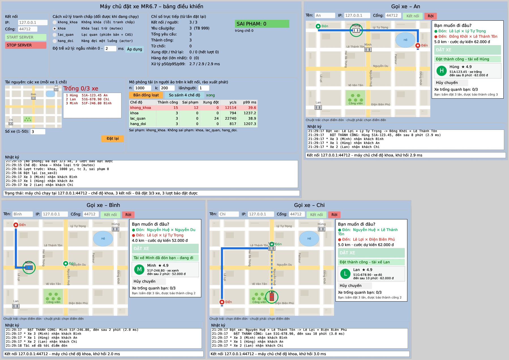
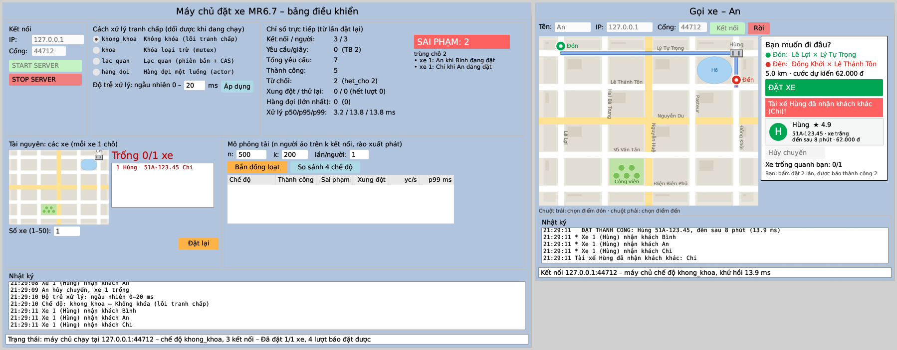
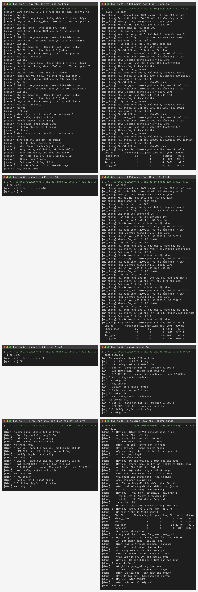

# Bài mở rộng MR6.7 – Đặt xe: n người cùng tranh một chỗ trên xe (Rust)

| Thông tin | Nội dung |
|---|---|
| Loại | **Bài mở rộng**, không có trong giáo trình và không có mã giả tương ứng. Thuộc nhóm "tranh chấp tài nguyên" MR6.6–MR6.13, dùng chung khung của [MR6.6](../BaiMR6.6_DauGia/) |
| Liên hệ với giáo trình | Chương 6: Bài 6.1 (server đa luồng, một luồng mỗi kết nối), Bài 6.7 (kiểm thử tải); Chương 3: Bài 3.2 (định khung thông điệp theo dòng); bài mở rộng MR5.4/MR5.5 (luồng, đồng bộ) |
| Thư viện | Thư viện chuẩn Rust: `std::net`, `std::thread`, `std::sync` (`Mutex`, `RwLock`, `Condvar`, `AtomicU64`, `mpsc`); crate `serde_json` 1.0.154 (`preserve_order`), `socket2` 0.5.10, `ctrlc` 3.4.7, `chrono` 0.4.41, `miniz_oxide` 0.8.9 (PNG). Ứng dụng giao diện: `eframe`/`egui` 0.29.1. Mọi crate ghim bằng `=` và `Cargo.lock` |
| Bản ngôn ngữ khác | [Python](../../../python/Chuong06/BaiMR6.7_DatXe/), [C#](../../../csharp/Chuong06/BaiMR6.7_DatXe/), [Java](../../../java/Chuong06/BaiMR6.7_DatXe/), [Go](../../../go/Chuong06/BaiMR6.7_DatXe/) |

## Mục tiêu
Bài mô phỏng một ứng dụng gọi xe. Có **m chiếc xe** (mặc định 1), mỗi xe **một chỗ**. **n người cùng bấm "Đặt xe"**: máy chủ giao xe trống gần điểm đón nhất, hết xe thì báo "Hết chỗ". Người đặt được có thể hủy chuyến để trả xe. Mỗi lần đặt là một thao tác "đọc trạng thái các xe → chọn xe (giả lập độ trễ cơ sở dữ liệu 0–2 ms) → ghi", xử lý theo **bốn cách** chọn được ngay lúc đang chạy: không khóa, khóa loại trừ, lạc quan, hàng đợi một luồng. **Sổ kiểm toán** đếm số lần một chỗ đã có người lại được giao cho người thứ hai. **Bộ mô phỏng tải** (1000 người cùng đặt 1 xe; 2000 người cùng đặt 10 xe; 200 kết nối, rào xuất phát, pipelining) cho thấy bằng số liệu thật: chỉ chế độ không khóa "bán" một chỗ cho nhiều người.

Phần khung (`chung.rs`, `khach.rs`, `mo_phong.rs`, `server.rs`, `gui_chung.rs`) chép nguyên từ MR6.6 (chỉ khác dòng đầu). Bài này chỉ viết nghiệp vụ (`may_chu.rs`, `nguoi_ao.rs`), người gọi xe dòng lệnh, ứng dụng giao diện, bảng tài nguyên của máy chủ và kịch bản demo.

## Kiến thức chính
Số liệu dưới đây lấy từ `ket_qua.txt`, là một lần chạy thật trên máy cục bộ (127.0.0.1, Rust 1.97, 2 lõi, độ trễ xử lý ngẫu nhiên 0–2 ms). Mỗi lần chạy, số liệu lệch đi đôi chút.

```
1000 người cùng đặt 1 xe:
  Chế độ       Thành công Sai phạm Xung đột  yc/s  p99 ms
  khong_khoa           10        9        0 21855    35.3
  khoa                  1        0        0   823  1198.0
  lac_quan              1        0        4 18072    37.5
  hang_doi              1        0        0   857  1144.7
2000 người cùng đặt 10 xe:
  Chế độ       Thành công Sai phạm Xung đột  yc/s  p99 ms
  khong_khoa           35       25        0 42226    52.6
  khoa                 10        0        0   815  2420.4
  lac_quan             10        0       65 20647    45.1
  hang_doi             10        0        0   839  2357.5
```
(Mỗi người bấm một lần, 200 kết nối. "Thành công" là số người được báo "Đặt thành công", "Sai phạm" do sổ kiểm toán đếm, "Xung đột" là số lần so sánh-và-đổi thất bại, "yc/s" và "p99" (khứ hồi) đo ở bộ mô phỏng.)

- **Tranh chấp (race condition): một chỗ, nhiều người.** Ở `khong_khoa`, thao tác đặt xe làm "đọc các xe → chờ 0–2 ms → chọn xe trống → ghi" mà không đồng bộ. Mọi luồng đọc được trước lần ghi đầu tiên đều thấy "xe 1 trống", đều được báo "Đặt thành công – tài xế Hùng", và bản ghi sau đè bản ghi trước. Với 1 xe, **10 người** cùng được báo thành công cho **một** chỗ, sổ kiểm toán đếm **9** lần "trùng chỗ" (ví dụ `xe 1: u140 khi u158 đang đặt`). Với 10 xe, 35 người được báo thành công cho 10 chỗ (25 sai phạm). Người bị đè không hề biết: trên giao diện, họ thấy "Tài xế Hùng đã nhận khách khác!" khi bản cập nhật kế tiếp tới, tức là sau khi đã được báo thành công. Chế độ này chỉ dùng để minh họa lỗi trong phòng lab (loopback).
- **Vì sao 1 xe cho ít sai phạm hơn 10 xe.** Khe tranh chấp chỉ mở từ lúc luồng đầu tiên đọc tới lúc nó ghi xong (vài phần mười mili giây tới 2 ms). Mọi người đọc sau lần ghi đó đều thấy "Hết chỗ" và bị từ chối đúng. Một xe là một khe, còn mười xe là mười khe, nên con số sai phạm tăng theo số chỗ chứ không theo số người. Ở MR6.6 (đấu giá) mỗi lần trả giá lại mở khe mới, nên sai phạm lên tới hàng trăm.
- **Vùng găng nhiều ô.** Để biết người đặt đã có chuyến chưa và xe trống nào gần nhất, mỗi lần đặt đọc **cả m ô** `xe1…xem` (`thuc_hien(cac_o, …)`). Chế độ `khoa` giữ khóa của mọi ô (theo thứ tự tên ô đã sắp xếp, nên không khóa chết) suốt đọc – chọn – ghi, và sai phạm bằng 0. Đổi lại, mọi yêu cầu đi qua cùng một bộ khóa, nên thông lượng chỉ còn ≈ 1 / (thời gian xử lý trung bình) ≈ 820 yc/s, như `hang_doi`. Khóa ô của khung là khóa FIFO có hạn chờ dựng từ `Mutex` + `Condvar` (xem README MR6.6), nên 1000 yêu cầu xếp hàng lần lượt và không yêu cầu nào chờ quá 2 s. Khóa theo từng tài nguyên chỉ có lợi khi mỗi thao tác chạm vào ít ô, như ghế rạp ở [MR6.8](../BaiMR6.8_DatVePhim/).
- **Lạc quan (Kung & Robinson 1981).** Chế độ `lac_quan` đọc (giá trị, phiên bản) của các ô, chọn xe *ngoài* khóa, rồi so sánh-và-đổi: chỉ ghi nếu không ô nào đổi phiên bản (`AtomicU64`, tăng bằng `compare_exchange`). Chỉ vài yêu cầu đầu thật sự ghi, nên xung đột ít (4 với 1 xe, 65 với 10 xe), và mọi người đến sau bị từ chối "hết chỗ" ngay sau lần đọc mà không phải chờ ai. Vì vậy thông lượng cao (18072 và 20647 yc/s).
- **Hàng đợi một luồng (actor).** Chế độ `hang_doi` cho một luồng nhận việc từ kênh `mpsc` và xử lý lần lượt, đến trước phục vụ trước. Sai phạm bằng 0, nhưng hàng đợi dài tối đa **991** (1000 người) và **1987** (2000 người), và khứ hồi p99 ≈ 1,1–2,4 s chính là thời gian xếp hàng.
- **Ảnh chụp trạng thái có số thứ tự.** Máy chủ đẩy `cap_nhat` gộp 10 lần/giây, nên một bản cập nhật chụp *trước* lần ghi của mình có thể tới *sau* trả lời `kq`. Nếu client tin bản đó, nó sẽ báo sai "đã mất xe". Vì vậy mỗi lần ghi được đánh số (`kq["phien"]`, một `AtomicU64` tăng mãi kể cả qua các lần đặt lại) và mỗi `cap_nhat` mang `"phien"` đọc *trước* khi chụp các ô. Client chỉ kết luận "xe đã nhận khách khác" từ một bản cập nhật có `phien` ≥ số của lần đặt của mình. Đây là cùng ý tưởng với phiên bản trong điều khiển đồng thời lạc quan, nhưng dùng ở phía client.
- **Idempotency và pipelining.** Bộ mô phỏng gửi mọi yêu cầu của 5–10 người trên một kết nối trong một lần `write_all` (`"so_nguoi"`, `"nguoi"`), sau rào xuất phát. Một `ma_yc` gửi lại không bị đặt lần hai; máy chủ gửi lại kết quả cũ kèm `"lap_lai": true`.
- **Lượt chạy dòng lệnh (1 xe).** An đặt được xe Hùng (cước 62.000 đ, xe đến sau 8 phút); Bình đặt lúc đó nhận "HẾT CHỖ"; An hủy, Bình đặt lại thì được; An đặt lần hai nhận "HẾT CHỖ". Máy chủ in "Xe 1 (Hùng) nhận khách An", "An hủy chuyến, xe 1 trống"… và tổng kết `Sai phạm 0: trùng chỗ 0`.

### Giao thức (giống hệt ở 5 ngôn ngữ)
Khung chung (chào, quản trị, `kq`, `cap_nhat`, `su_kien`, `thong_ke`) xem [README MR6.6](../BaiMR6.6_DauGia/README.md#giao-thức-giống-hệt-ở-5-ngôn-ngữ). Phần riêng của bài:

| Chiều | Thông điệp |
|---|---|
| người dùng → server | `{"loai":"dat_xe","ma_yc":k,"don":[x,y],"den":[x,y]}` (ngã tư trên lưới 5 × 5, tọa độ 0.1/0.3/0.5/0.7/0.9; bỏ trống thì đón ở [0.5,0.5]); `{"loai":"huy","ma_yc":k}`. Kết nối gộp thêm `"nguoi":"u17"` |
| quản trị → server | `{"loai":"dat_lai","ma_yc":k,"so_xe":10}` (1–50) |
| server → client | `{"loai":"kq","ma_yc":k,"ok":true,"xe":1,"khach","tai_xe","bien_so","mau","phut","cuoc","phien"}`; từ chối: `"ma_loi":"het_cho"\|"da_dat"\|"chua_dat"\|"xung_dot"\|"sai_du_lieu"\|…` |
| server → tất cả | `{"loai":"cap_nhat","che_do","phien","so_xe","trong","xe":[{"ma","tai_xe","bien_so","mau","vi_tri","khach","don","den","gio","cuoc","phut"}…],"lich_su":[…]}`; `{"loai":"su_kien","noi_dung":"Xe 1 (Hùng) nhận khách An"}` (chỉ cho người dùng thật) |

Sai phạm trong `thong_ke`: `[{"ma":"trung_cho","ten":"trùng chỗ","so":n}]`; `tom_tat`: `Đã đặt 1/1 xe, 10 lượt báo đặt được`. Giá cước và thời gian xe tới tính bằng `round()` của Python (làm tròn nửa về số chẵn – `round_py` của khung), nên mọi ngôn ngữ báo cùng một số tiền.

## Cấu trúc tệp
Gói Cargo `mr6_7_dat_xe` (một chương trình, chọn vai trò bằng lệnh con):
- **Khung chung (chép nguyên từ MR6.6):** `src/chung.rs`, `src/khach.rs`, `src/mo_phong.rs`, `src/server.rs`, `src/gui_chung.rs`.
- **Nghiệp vụ:** `src/may_chu.rs` (`DatXe: NghiepVu`, ô `Xe`, `LuatDatXe: LuatKiemToan`, bản đồ: `nga_tu`, `ten_diem`, `km`, `cuoc`, `phut_den`), `src/nguoi_ao.rs` (`NguCanh`, `NguoiAo`: ngã tư đón/đến ngẫu nhiên, bấm lại khi bị từ chối vì xung đột), `src/dat_xe.rs` (người gọi xe dòng lệnh, điểm đón/đến mặc định theo tên).
- **Giao diện:** `src/dat_xe_gui.rs` (bản đồ phố `BanDo` dùng chung với máy chủ, ứng dụng gọi xe), `src/server_gui.rs` (khung "Tài nguyên"), `src/demo_gui.rs`, `src/main.rs`.
- `Cargo.toml`, `Cargo.lock`, `demo.json`, `ket_qua.txt`, `ket_qua.png`, `ket_qua_gui.png`, `ket_qua_gui_tranh_chap.png`.

## Cách chạy
Trong thư mục bài (`cargo build -q --release` một lần; `B=../../target/release/mr6_7_dat_xe`, Windows: `..\..\target\release\mr6_7_dat_xe.exe`):
```bash
$B server 127.0.0.1 9000 [--so-xe 1]                 # cửa sổ 1 (gõ lệnh ở đây)
$B mo_phong 127.0.0.1 9000 --n 1000 --so-sanh        # 1000 người tranh 1 xe, 4 chế độ
$B khach 127.0.0.1 9000 dat_lai so_xe=10
$B mo_phong 127.0.0.1 9000 --n 2000 --so-sanh        # 2000 người, 10 xe
$B dat_xe An 127.0.0.1 9000                          # cửa sổ 3, 4…: gõ dat / huy / thoat
```
- Lệnh máy chủ, quản trị, tùy chọn `--che-do`, `--tre-ms` như MR6.6; tham số đặt lại `so_xe` (1–50). Dòng `@t lệnh` chờ tới giây thứ t rồi mới chạy lệnh.
- Tái lập kết quả từ thư mục gốc của kho: `python3 tools/demo.py rust/Chuong06/BaiMR6.7_DatXe` (cổng 44710, giao diện 44712).

## Ứng dụng giao diện


Ảnh trên là lần chạy thật của `demo_gui` (Linux, Xvfb + Mesa llvmpipe, egui 0.29.1): bảng điều khiển máy chủ (trên trái) và ba ứng dụng gọi xe An, Bình, Chi. Máy chủ đã chạy so sánh 4 chế độ ngay trong giao diện với 3 xe và 1000 người (dòng `khong_khoa` tô đỏ: 15 người được báo thành công cho 3 chỗ, 12 sai phạm; ba chế độ còn lại 3 / 0, `lac_quan` 24 xung đột) rồi đặt lại; cả ba cùng bấm "ĐẶT XE" và mỗi người được một xe (Hùng, Minh, Lan), xe đang chạy hoạt hình tới điểm đón theo tuyến nét đứt rồi chở khách tới điểm đến.



Ở bước trước đó, máy chủ đang ở `khong_khoa` với độ trễ xử lý 0–20 ms và chỉ có 1 xe. An, Bình và Chi cùng bấm "ĐẶT XE": máy chủ báo thành công cho cả ba (`máy chủ: 7 yc, tc 5`), sổ kiểm toán đếm 2 lần trùng chỗ (`xe 1: An khi Bình đang đặt`), và xe 1 rốt cuộc chở Chi. An (ảnh phải) thấy "Tài xế Hùng đã nhận khách khác (Chi)!". Cùng thao tác đó ở chế độ `khoa` thì một người được xe, hai người nhận "Hết chỗ – không còn xe trống".

- **Máy chủ** (`server_gui`): mọi phần chung như MR6.6; **tài nguyên**: bản đồ thu nhỏ với các xe (xe có khách mờ đi, ghi tên khách), "Trống x/m xe", danh sách xe (mã, tài xế, biển số, khách) và ô **Số xe (1–50)** cho nút **Đặt lại**.
- **Gọi xe** (`dat_xe_gui`): bản đồ phố vẽ bằng bút vẽ egui (khu nhà, công viên, hồ, đường chính tô vàng, tên phố – tên phố dọc xoay 90°); **chuột trái** chọn điểm đón, **chuột phải** chọn điểm đến (ngã tư gần nhất); tuyến đường, ghim Đón/Đến, các xe theo màu; khung bên phải: điểm đón/đến, km và cước dự kiến, nút **ĐẶT XE**, trạng thái ("Đang tìm tài xế…", "Đặt thành công – tài xế …", "Hết chỗ…", "Tài xế … đã nhận khách khác!", "Đã tới nơi – bấm Hoàn tất chuyến"), thẻ tài xế, nút **Hủy chuyến / Hoàn tất chuyến**, số xe trống. Đặt được thì xe chạy hoạt hình (vẽ lại 25 lần/giây trong lúc chạy).

### Cách chạy
```bash
cargo build --release
$B server_gui 127.0.0.1 44712                     # bấm START SERVER (1 xe)
$B dat_xe_gui An 127.0.0.1 44712
$B dat_xe_gui Bình 127.0.0.1 44712
```
- **Windows:** Rust bản MSVC như các bài Rust khác; giao diện không cần cài thêm gì. Kịch bản tự động (Linux, cần `xvfb`): `xvfb-run -a -s "-screen 0 2600x1700x24" $B demo_gui 127.0.0.1 44712`.
- Chạy riêng từng cửa sổ: nhật ký (tiền tố `[server]`, `[An]`) và cứ 5 giây một dòng số liệu cũng in ra dòng lệnh.
- Cửa sổ người dùng nối được với máy chủ của mọi ngôn ngữ (và ngược lại). Thử trên nhiều máy: máy chủ nghe IP card mạng (hoặc `0.0.0.0`), mở tường lửa cho cổng, **chỉ dùng `khoa`, `lac_quan`, `hang_doi`**.

## Kết quả thực thi


## Ghi chú
- **Chạy chéo với bản Python** (đã thử): (a) bộ mô phỏng Rust `mo_phong --n 1000 --so-sanh` → máy chủ Python (1 xe): `khong_khoa` 26 thành công / 25 sai phạm, `khoa` 1 / 0, `lac_quan` 1 / 0 (10 xung đột), `hang_doi` 1 / 0; (b) `mo_phong.py --n 1000 --so-sanh` → máy chủ Rust: `khong_khoa` 8 / 7, `khoa` 1 / 0, `lac_quan` 1 / 0 (6 xung đột), `hang_doi` 1 / 0; người gọi xe Rust (An) và Python (Bình) trên máy chủ Python, kịch bản như `demo.json`: An đặt được, Bình hết chỗ, An hủy, Bình đặt được, An hết chỗ – máy chủ Python in đúng 4 sự kiện, 0 sai phạm.
- Số sai phạm của `khong_khoa` dao động nhiều giữa các lần chạy (chỉ những luồng đọc trong vài phần mười mili giây đầu mới tranh nhau). Trong kịch bản giao diện, vẽ phần mềm (llvmpipe) giành CPU của máy chủ nên khe tranh chấp ít luồng hơn; xem Ghi chú README MR6.6 về việc gộp lần vẽ.
- Kiểm thử: Linux, Rust 1.97.0, tools/demo.py; giao diện egui 0.29.1 dưới Xvfb + Mesa llvmpipe. Bản giao diện chưa thử trên Windows.

## Bài tập gợi ý
1. Chạy `$B mo_phong --che-do khong_khoa --dat-lai` nhiều lần với 1 xe, rồi với `--tre-ms 10`. Vì sao số sai phạm tăng theo độ trễ mà gần như không tăng theo `--n`?
2. Đổi `xu_ly_yeu_cau` để mỗi lần đặt chỉ khóa **một** ô (máy chủ đọc không khóa để chọn xe, rồi `thuc_hien(vec!["xeK"], …)`; nếu xe vừa có người thì thử xe kế). Đo thông lượng `khoa` với 10 xe. Kiểm tra "một người không đặt hai xe" còn được bảo đảm không, và cần thêm gì?
3. Thêm thao tác `hoan_thanh` (tài xế báo xong chuyến) và cho `NguoiAo` đặt – hủy – đặt lại nhiều vòng (`--lan 5`). Sai phạm của `khong_khoa` thay đổi thế nào khi mỗi lần hủy lại mở một khe tranh chấp mới?
4. Cho xe di chuyển thật ở máy chủ (cập nhật `vi_tri` trong `dinh_ky`). Mỗi lần di chuyển cũng là một thao tác ghi: ở `lac_quan`, số xung đột của thao tác đặt xe tăng ra sao?
5. Giao diện: khi ứng dụng nhận "Đặt thành công" nhưng sau đó thấy "đã nhận khách khác", hãy tự động đặt lại (tìm xe khác). Đây có phải cách "sửa" tranh chấp không? Vì sao?

## Đọc thêm
- H. T. Kung, J. T. Robinson (1981). *On Optimistic Methods for Concurrency Control*. ACM Transactions on Database Systems 6(2).
- E. G. Coffman, M. J. Elphick, A. Shoshani (1971). *System Deadlocks*. ACM Computing Surveys 3(2): điều kiện khóa chết và cách phòng bằng thứ tự khóa (khung khóa nhiều ô theo thứ tự tên ô).
- Tài liệu Rust: [`std::sync`](https://doc.rust-lang.org/std/sync/index.html) (`Mutex`, `RwLock`, `Condvar`, `mpsc`), [`std::sync::atomic`](https://doc.rust-lang.org/std/sync/atomic/index.html), [`std::net`](https://doc.rust-lang.org/std/net/index.html); [egui 0.29.1](https://docs.rs/egui/0.29.1/egui/) (`Painter`, `Shape::dashed_line`, `TextShape::with_angle`).

Mã nguồn của bài được viết mới cho kho này.
