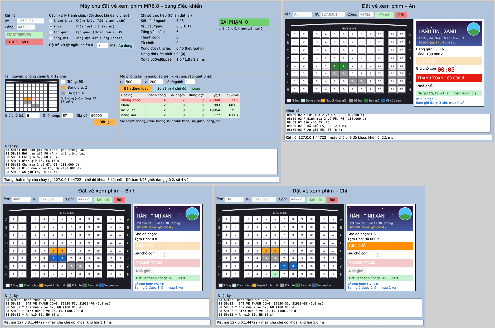
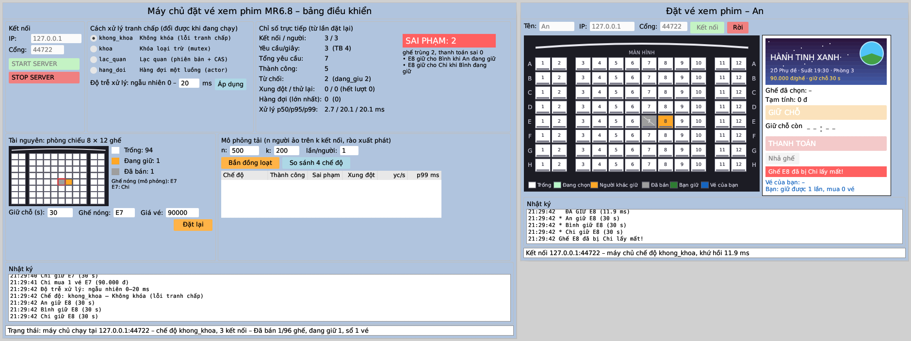
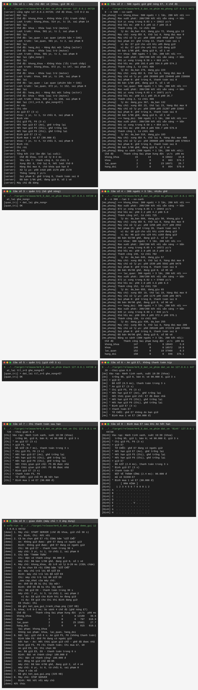

# Bài mở rộng MR6.8 – Đặt vé xem phim: giữ chỗ có thời hạn, n người cùng tranh một ghế (Rust)

| Thông tin | Nội dung |
|---|---|
| Loại | **Bài mở rộng**, không có trong giáo trình và không có mã giả tương ứng. Thuộc nhóm "tranh chấp tài nguyên" MR6.6–MR6.14, dùng chung khung của [MR6.6](../BaiMR6.6_DauGia/) |
| Liên hệ với giáo trình | Chương 6: Bài 6.1 (server đa luồng, một luồng mỗi kết nối), Bài 6.7 (kiểm thử tải); Chương 3: Bài 3.2 (định khung thông điệp theo dòng); bài mở rộng MR5.4/MR5.5 (luồng, đồng bộ) |
| Thư viện | Thư viện chuẩn Rust: `std::net`, `std::thread`, `std::sync` (`Mutex`, `RwLock`, `Condvar`, `AtomicU64`, `mpsc`), `std::time::Instant`; crate `serde_json` 1.0.154 (`preserve_order`), `socket2` 0.5.10, `ctrlc` 3.4.7, `chrono` 0.4.41, `miniz_oxide` 0.8.9 (PNG). Ứng dụng giao diện: `eframe`/`egui` 0.29.1. Mọi crate ghim bằng `=` và `Cargo.lock` |
| Bản ngôn ngữ khác | [Python](../../../python/Chuong06/BaiMR6.8_DatVePhim/), [C#](../../../csharp/Chuong06/BaiMR6.8_DatVePhim/), [Java](../../../java/Chuong06/BaiMR6.8_DatVePhim/), [Go](../../../go/Chuong06/BaiMR6.8_DatVePhim/) |

## Mục tiêu
Bài mô phỏng một ứng dụng đặt vé xem phim. Phòng chiếu có **8 hàng (A–H) × 12 ghế**. Người xem chọn ghế rồi **giữ chỗ** (`giu_cho`): ghế được giữ riêng cho họ trong **30 giây** (TTL). Trong thời gian đó họ **thanh toán** (`thanh_toan`) để nhận vé, hoặc **nhả** (`nha`) ghế. Quá hạn mà chưa thanh toán thì ghế **tự nhả**: luồng nền của máy chủ dọn ghế quá hạn mỗi 100 ms, và một lượt giữ quá hạn cũng bị coi là trống ngay cả khi chưa kịp dọn. Thanh toán sau hạn bị từ chối. Mỗi ghế là một ô tài nguyên, và mọi thao tác là "đọc → kiểm tra (giả lập độ trễ cơ sở dữ liệu 0–2 ms) → ghi", xử lý theo **bốn cách**: không khóa, khóa loại trừ theo từng ghế, lạc quan, hàng đợi một luồng. **Sổ kiểm toán** đếm ghế giữ/bán cho hai người và thanh toán sai. **Bộ mô phỏng tải** chạy hai tình huống: 500 người cùng giữ một ghế "nóng" E7, và 300 người × 3 lần thử chọn nhóm 1–2 ghế ngẫu nhiên trên cả rạp.

Phần khung (`chung.rs`, `khach.rs`, `mo_phong.rs`, `server.rs`, `gui_chung.rs`) chép nguyên từ MR6.6 (chỉ khác dòng đầu). Bài này chỉ viết nghiệp vụ (`may_chu.rs`, `nguoi_ao.rs`), người đặt vé dòng lệnh, ứng dụng giao diện, bảng tài nguyên của máy chủ và kịch bản demo.

## Kiến thức chính
Số liệu dưới đây lấy từ `ket_qua.txt`, là một lần chạy thật trên máy cục bộ (127.0.0.1, Rust 1.97, 2 lõi, độ trễ xử lý ngẫu nhiên 0–2 ms). Mỗi lần chạy, số liệu lệch đi đôi chút.

```
500 người cùng giữ ghế nóng E7 (giữ được thì thanh toán ngay):
  Chế độ       Thành công Sai phạm Xung đột  yc/s  p99 ms
  khong_khoa           15       14        0 19922    15.0
  khoa                  2        0        0   863   574.2
  lac_quan              2        0       23 16971    26.7
  hang_doi              2        0        0   854   579.0
300 người × 3 lần thử, nhóm 1–2 ghế ngẫu nhiên (96 ghế):
  Chế độ       Thành công Sai phạm Xung đột  yc/s  p99 ms
  khong_khoa          147       25        0 18943     5.0
  khoa                146        0        0 16572    16.8
  lac_quan            152        0       19 37068     6.3
  hang_doi            150        0        0   846   376.1
```
("Thành công" đếm cả lần giữ chỗ và lần thanh toán được chấp nhận; "Sai phạm" do sổ kiểm toán đếm; "Xung đột" là số lần so sánh-và-đổi thất bại; "yc/s" và "p99" (khứ hồi) đo ở bộ mô phỏng; 200 kết nối.)

- **Tranh chấp trên một ghế nóng.** Ở `khong_khoa`, 500 người cùng đọc "E7 trống", và **14** người cùng được báo "ĐÃ GIỮ" (15 thành công = 14 lần giữ + 1 lần thanh toán). Sổ kiểm toán đếm **13** lần "ghế trùng" (ví dụ `E7 giữ cho u41 khi u15 đang giữ`) và 1 lần "thanh toán sai". Mười ba người kia đi thanh toán thì bị từ chối "ghế E7 không do bạn giữ" (`khong_giu 13`), vì lượt giữ của họ đã bị đè mất. Người dùng thật thấy điều này trên giao diện: vừa được báo "Đã giữ E8" thì ngay sau đó là "Ghế E8 đã bị Chi lấy mất!". Ba chế độ còn lại cho đúng 1 người giữ, 1 vé, 0 sai phạm. Chế độ `khong_khoa` chỉ dùng để minh họa lỗi trong phòng lab (loopback).
- **Khóa theo từng tài nguyên.** Ở tình huống nhiều ghế, mỗi yêu cầu chỉ chạm 1–2 ô. Chế độ `khoa` khóa riêng từng ghế, nên hai người chọn hai ghế khác nhau chạy **song song**: thông lượng **16572 yc/s** (thời gian xử lý ở máy chủ p50 1,5 ms), gấp khoảng 20 lần `hang_doi` (846 yc/s, p50 295 ms, hàng đợi max 299), trong khi với một ghế nóng thì hai chế độ ngang nhau (863 và 854 yc/s). Đây là điều MR6.6 và MR6.7 (một điểm nóng) không cho thấy được: một khóa toàn cục hay một luồng duy nhất tuần tự hóa cả những thao tác không hề đụng nhau. Rust chạy luồng đa lõi thật nên khoảng cách này lớn hơn nhiều so với bản Python (5545 so với 842 yc/s).
- **Khóa nhiều ô theo thứ tự, không khóa chết.** Giữ "E7, E8" phải khóa cả hai ô cùng lúc (nhóm ghế hoặc được cả, hoặc không được gì). Khung xin khóa theo **thứ tự tên ô đã sắp xếp**, nên hai người giữ "E8, E7" và "E7, E8" không bao giờ chờ nhau vòng tròn (Coffman và cộng sự 1971). Ở tình huống nhiều ghế, ba chế độ đúng đều bán hết 96/96 ghế, sổ 96 vé.
- **Lạc quan.** Chế độ `lac_quan` đọc (giá trị, phiên bản) của các ghế trong yêu cầu, kiểm tra ngoài khóa, rồi so sánh-và-đổi (`AtomicU64::compare_exchange` trên phiên bản, dưới một khóa CAS rất ngắn). Xung đột ít (23 và 19), vì phần lớn yêu cầu bị từ chối ngay sau lần đọc ("đã bán", "đang có người giữ"), nên thông lượng cao nhất ở tình huống nhiều ghế (37068 yc/s).
- **Giữ chỗ có thời hạn (TTL) và luồng dọn.** Lượt giữ lưu thời điểm hết hạn theo **đồng hồ đơn điệu** (`Instant`), còn client nhận `con_lai_ms` chứ không nhận thời điểm tuyệt đối. Nhả ghế quá hạn cũng là một thao tác ghi đi qua cùng chế độ xử lý tranh chấp, nên ở `khoa` không thể có chuyện "luồng dọn nhả ghế đúng lúc chủ ghế đang thanh toán". Ở `khong_khoa` thì có thể: luồng dọn đọc "giữ quá hạn của An", trong lúc đó Bình giữ lại ghế, rồi luồng dọn ghi "trống" đè lên lượt giữ của Bình. Lượt chạy dòng lệnh (giữ chỗ 3 s) cho thấy:
  - An giữ E7 rồi không thanh toán. Bình giữ E7 khi An còn hạn thì bị từ chối "ghế E7 đang có người giữ". Hết hạn, máy chủ báo "Hết hạn giữ E7 (An), ghế trống lại", rồi Bình giữ và mua được E7 (mã vé `S1930-E7`).
  - An bấm thanh toán muộn thì nhận "TỪ CHỐI: ghế E7 không do bạn giữ" (ghế đã là của Bình).
  - Chi giữ F5, F6, thanh toán sau hạn thì nhận "TỪ CHỐI: giữ chỗ F5 đã hết hạn" (máy chủ nhớ ai giữ ghế lần cuối để báo đúng lý do).
- **Sổ kiểm toán.** Sổ giữ bản sao "ghế → (giữ/bán, người, hạn)" và kiểm tra từng giao dịch theo thứ tự ghi: một lượt giữ hay bán cho ghế mà người khác đang giữ còn hạn hoặc đã mua là `trung_ghe`; một lần thanh toán được chấp nhận cho ghế không do mình giữ hoặc đã quá hạn là `tt_sai`. Thời điểm dùng để kiểm tra hạn là thời điểm mà hàm nghiệp vụ đã dùng (trường nội bộ `_luc`, bỏ đi trước khi trả lời client), nên sổ không báo nhầm khi thanh toán sát giờ hết hạn.
- **Ảnh chụp trạng thái có số thứ tự.** Mỗi lần ghi được đánh số (`kq["phien"]`), và mỗi `cap_nhat` mang `"phien"` lúc chụp. Client chỉ kết luận "ghế đã bị lấy" hoặc "đã hết hạn" từ bản cập nhật có `phien` ≥ số của lần giữ của mình, nên một bản cập nhật cũ tới muộn không làm giao diện báo sai.

### Giao thức (giống hệt ở 5 ngôn ngữ)
Khung chung (chào, quản trị, `kq`, `cap_nhat`, `su_kien`, `thong_ke`) xem [README MR6.6](../BaiMR6.6_DauGia/README.md#giao-thức-giống-hệt-ở-5-ngôn-ngữ). Phần riêng của bài:

| Chiều | Thông điệp |
|---|---|
| người dùng → server | `{"loai":"giu_cho","ma_yc":k,"ghe":["E7","E8"]}`, `{"loai":"thanh_toan","ma_yc":k,"ghe":[…]}`, `{"loai":"nha","ma_yc":k,"ghe":[…]}` (1–8 mã ghế A1–H12, không trùng). Kết nối gộp thêm `"nguoi":"u17"` |
| quản trị → server | `{"loai":"dat_lai","ma_yc":k,"ttl_s":30,"ghe_nong":"E7"\|"","gia_ve":90000,"phim":…,"suat":"19:30"}` |
| server → client | giữ: `{"loai":"kq","ok":true,"ghe":[…],"moi":[…],"het_han_ms":30000,"nguoi","phien"}`; thanh toán: `{"ok":true,"ghe","ma_ve":["S1930-E7"],"tien","nguoi","phien"}`; nhả: `{"ok":true,"ghe","nguoi","phien"}`; từ chối: `"ma_loi":"dang_giu"\|"da_ban"\|"khong_giu"\|"het_han"\|"xung_dot"\|"sai_du_lieu"\|…` (giữ thất bại kèm `"ghe_ban":[…]`) |
| server → tất cả | `{"loai":"cap_nhat","che_do","phien","phim","suat","gia_ve","ttl_s","ghe_nong","hang":"ABCDEFGH","cot":12,"so_do":["....g..b....",…] (. trống, g đang giữ, b đã bán),"chu":{"E7":"An",…},"con_lai_ms":{"E7":27000,…},"dem":{"trong","giu","ban"}}`; `su_kien` cho người dùng thật: "An giữ E7 (30 s)", "Bình mua 1 vé E7 (90.000 đ)", "Hết hạn giữ E7 (An), ghế trống lại" |

Sai phạm trong `thong_ke`: `ghế trùng`, `thanh toán sai`; `tom_tat`: `Đã bán 96/96 ghế, đang giữ 0, sổ 96 vé`.

## Cấu trúc tệp
Gói Cargo `mr6_8_dat_ve_phim` (một chương trình, chọn vai trò bằng lệnh con):
- **Khung chung (chép nguyên từ MR6.6):** `src/chung.rs`, `src/khach.rs`, `src/mo_phong.rs`, `src/server.rs`, `src/gui_chung.rs`.
- **Nghiệp vụ:** `src/may_chu.rs` (`DatVe: NghiepVu`, ô `Ghe`, `LuatDatVe: LuatKiemToan`, luồng dọn ghế quá hạn trong `dinh_ky`), `src/nguoi_ao.rs` (`NguCanh`: sơ đồ ghế đã biết; `NguoiAo`: giữ ghế nóng rồi thanh toán, bị từ chối thì chọn nhóm 1–2 ghế trống khác), `src/dat_ve.rs` (người đặt vé dòng lệnh, in sơ đồ ghế).
- **Giao diện:** `src/dat_ve_gui.rs` (sơ đồ ghế `SoDoGhe` dùng chung với máy chủ, áp phích phim, ứng dụng đặt vé), `src/server_gui.rs` (khung "Tài nguyên"), `src/demo_gui.rs`, `src/main.rs`.
- `Cargo.toml`, `Cargo.lock`, `demo.json`, `ket_qua.txt`, `ket_qua.png`, `ket_qua_gui.png`, `ket_qua_gui_tranh_chap.png`.

## Cách chạy
Trong thư mục bài (`cargo build -q --release` một lần; `B=../../target/release/mr6_8_dat_ve_phim`, Windows: `..\..\target\release\mr6_8_dat_ve_phim.exe`):
```bash
$B server 127.0.0.1 9000 [--ttl 30] [--ghe-nong E7]       # cửa sổ 1 (gõ lệnh ở đây)
$B mo_phong 127.0.0.1 9000 --n 500 --so-sanh              # 500 người giữ ghế nóng E7
$B khach 127.0.0.1 9000 dat_lai ghe_nong=                 # bỏ ghế nóng: chọn ngẫu nhiên
$B mo_phong 127.0.0.1 9000 --n 300 --lan 3 --so-sanh      # nhiều ghế
$B khach 127.0.0.1 9000 dat_lai ttl_s=3 ghe_nong=E7
$B dat_ve An 127.0.0.1 9000                               # gõ giu E7 / tt / nha / xem / thoat
```
- Lệnh máy chủ, quản trị, tùy chọn `--che-do`, `--tre-ms` như MR6.6; tham số đặt lại `ttl_s` (1–600), `ghe_nong` (mã ghế hoặc rỗng), `gia_ve`, `phim`, `suat`. Lệnh của `dat_ve`: `giu E7 [E8 …]`, `tt [ghế…]` (mặc định: các ghế vừa giữ), `nha [ghế…]`, `xem` (sơ đồ: `.` trống, `g` người khác giữ, `b` đã bán, `G` mình giữ, `V` vé của mình), `thoat`.
- Tái lập kết quả từ thư mục gốc của kho: `python3 tools/demo.py rust/Chuong06/BaiMR6.8_DatVePhim` (cổng 44720, giao diện 44722).

## Ứng dụng giao diện


Ảnh trên là lần chạy thật của `demo_gui` (Linux, Xvfb + Mesa llvmpipe, egui 0.29.1): bảng điều khiển máy chủ (trên trái) và ba ứng dụng đặt vé An, Bình, Chi. Máy chủ đã chạy so sánh 4 chế độ ngay trong giao diện (500 người giữ ghế nóng E7; dòng `khong_khoa` tô đỏ: 5 thành công, 3 sai phạm; ba chế độ còn lại 2 / 0) rồi đặt lại với giữ chỗ 6 s: An giữ F5, F6 mà không thanh toán, hết hạn ghế trống lại; Bình giữ và mua F5, F6, Chi mua G7, G8 (ghế xanh dương "vé của bạn"); An đang giữ E5, E6 (xanh lá, đồng hồ giữ chỗ 00:05 màu đỏ); Chi đang chọn H6.



Ở bước trước đó, máy chủ đang ở `khong_khoa` với độ trễ xử lý 0–20 ms. Cả ba chọn E8 rồi cùng bấm "GIỮ CHỖ": máy chủ trả lời "ĐÃ GIỮ E8" cho cả ba, sổ kiểm toán đếm 2 lần ghế trùng (`E8 giữ cho Bình khi An đang giữ`), và sau bản cập nhật kế tiếp hai người thấy "Ghế E8 đã bị … lấy mất!". Cùng thao tác với E7 ở chế độ `khoa` thì một người giữ được, hai người nhận "Không giữ được: ghế E7 đang có người giữ".

- **Máy chủ** (`server_gui`): mọi phần chung như MR6.6; **tài nguyên**: sơ đồ phòng chiếu thu nhỏ (trống / đang giữ / đã bán, ghế nóng viền đỏ), số ghế mỗi loại, ai đang giữ ghế nóng, và ô **Giữ chỗ (s)**, **Ghế nóng**, **Giá vé** cho nút **Đặt lại**.
- **Đặt vé** (`dat_ve_gui`): sơ đồ 8 × 12 ghế vẽ bằng bút vẽ egui (màn hình cong, lối đi, nhãn hàng A–H, tay vịn, ghế đã bán gạch chéo) với chú giải 6 màu (trống / đang chọn / người khác giữ / đã bán / bạn giữ / vé của bạn); **bấm ghế** để chọn (tối đa 8); áp phích phim; tạm tính; nút **GIỮ CHỖ**; **đồng hồ giữ chỗ** (đỏ khi còn dưới 10 s, theo `con_lai_ms` của máy chủ); nút **THANH TOÁN** ghi số tiền (chỉ bấm được khi còn hạn); **Nhả ghế**; dòng thông báo có màu; danh sách vé của mình. Ghế đang chọn mà người khác vừa giữ thì tự bỏ chọn và báo.

### Cách chạy
```bash
cargo build --release
$B server_gui 127.0.0.1 44722                      # bấm START SERVER (giữ chỗ 30 s)
$B dat_ve_gui An 127.0.0.1 44722
$B dat_ve_gui Bình 127.0.0.1 44722
```
- **Windows:** Rust bản MSVC như các bài Rust khác; giao diện không cần cài thêm gì. Kịch bản tự động (Linux, cần `xvfb`): `xvfb-run -a -s "-screen 0 2600x1700x24" $B demo_gui 127.0.0.1 44722`.
- Chạy riêng từng cửa sổ: nhật ký (tiền tố `[server]`, `[An]`) và cứ 5 giây một dòng số liệu cũng in ra dòng lệnh.
- Cửa sổ người dùng nối được với máy chủ của mọi ngôn ngữ (và ngược lại). Thử trên nhiều máy: máy chủ nghe IP card mạng (hoặc `0.0.0.0`), mở tường lửa cho cổng, **chỉ dùng `khoa`, `lac_quan`, `hang_doi`**.

## Kết quả thực thi


## Ghi chú
- **Chạy chéo với bản Python** (đã thử): (a) bộ mô phỏng Rust `mo_phong --n 500 --so-sanh` → máy chủ Python: `khong_khoa` 12 thành công / 10 sai phạm, `khoa` 2 / 0, `lac_quan` 2 / 0 (4 xung đột), `hang_doi` 2 / 0; (b) `mo_phong.py --n 500 --so-sanh` → máy chủ Rust: `khong_khoa` 3 / 1, `khoa` 2 / 0, `lac_quan` 2 / 0 (6 xung đột), `hang_doi` 2 / 0; quản trị Python `dat_lai ttl_s=3 ghe_nong=E7` → máy chủ Rust in `Đặt lại (ttl_s=3.0, ghe_nong=E7)`; An, Chi (Python) và Bình (Rust) cùng kịch bản TTL 3 s trên máy chủ Rust: An hết hạn rồi bị từ chối "không do bạn giữ", Chi "đã hết hạn", Bình giữ và mua E7, 0 sai phạm.
- Luồng dọn ghế quá hạn chạy trên luồng nền 100 ms của khung; mỗi ghế quá hạn là một `thuc_hien` riêng (khóa đúng một ô), và một tập `dang_don` tránh dọn một ghế hai lần khi chế độ `hang_doi` còn đang xếp việc.
- Kiểm thử: Linux, Rust 1.97.0, tools/demo.py; giao diện egui 0.29.1 dưới Xvfb + Mesa llvmpipe (xem Ghi chú README MR6.6 về việc gộp lần vẽ để máy chủ trong cùng tiến trình có CPU). Bản giao diện chưa thử trên Windows.

## Bài tập gợi ý
1. Chạy tình huống nhiều ghế với `--tre-ms 0`, `2`, `10`. Khoảng cách thông lượng giữa `khoa` và `hang_doi` thay đổi thế nào? Giải thích bằng số ghế mà các yêu cầu đồng thời chạm vào.
2. Bật `khoa_ngay_tho` của `KhoTranhChap` (khóa theo thứ tự người dùng gửi) rồi cho một nửa số người ảo giữ "E8, E7" và nửa kia giữ "E7, E8". Có xuất hiện `khoa_cho_lau` (nghi khóa chết) không? So sánh với thứ tự đã sắp xếp.
3. Thêm thao tác `gia_han` (gia hạn giữ chỗ thêm 30 s, tối đa một lần). Sổ kiểm toán cần thêm luật nào để phát hiện gia hạn quá số lần ở `khong_khoa`?
4. Bỏ "lazy expiry" (chỉ để luồng dọn nhả ghế quá hạn). Một người đến đúng lúc ghế vừa hết hạn mà luồng dọn chưa chạy sẽ thấy gì? Đo xem điều đó làm giảm bao nhiêu vé bán được trong một suất có TTL 3 s.
5. Làm "ghế đôi" (cặp ghế bán cùng nhau, ví dụ H5–H6). Giữ một nửa cặp phải bị từ chối. Viết hàm nghiệp vụ và luật sổ kiểm toán tương ứng.
6. Giao diện: vẽ trên sơ đồ, cho ghế người khác đang giữ, một vòng tròn nhỏ thể hiện thời gian giữ còn lại (từ `con_lai_ms`).

## Đọc thêm
- H. T. Kung, J. T. Robinson (1981). *On Optimistic Methods for Concurrency Control*. ACM Transactions on Database Systems 6(2).
- E. G. Coffman, M. J. Elphick, A. Shoshani (1971). *System Deadlocks*. ACM Computing Surveys 3(2): điều kiện khóa chết và cách phòng bằng thứ tự khóa (khung khóa nhiều ghế theo thứ tự tên ô).
- Tài liệu Rust: [`std::sync`](https://doc.rust-lang.org/std/sync/index.html) (`Mutex`, `RwLock`, `Condvar`, `mpsc`), [`std::sync::atomic`](https://doc.rust-lang.org/std/sync/atomic/index.html), [`std::time::Instant`](https://doc.rust-lang.org/std/time/struct.Instant.html) (đồng hồ đơn điệu), [`std::net`](https://doc.rust-lang.org/std/net/index.html); [egui 0.29.1](https://docs.rs/egui/0.29.1/egui/).

Mã nguồn của bài được viết mới cho kho này.
