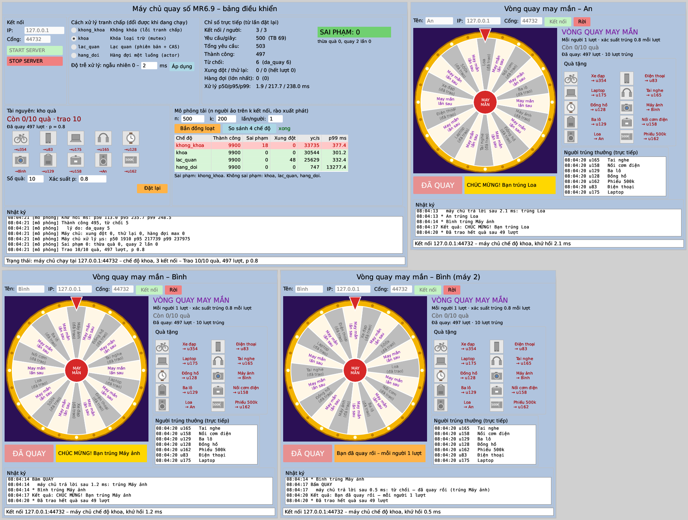
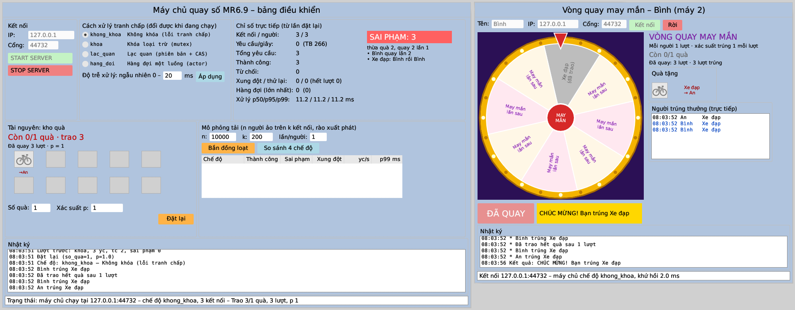
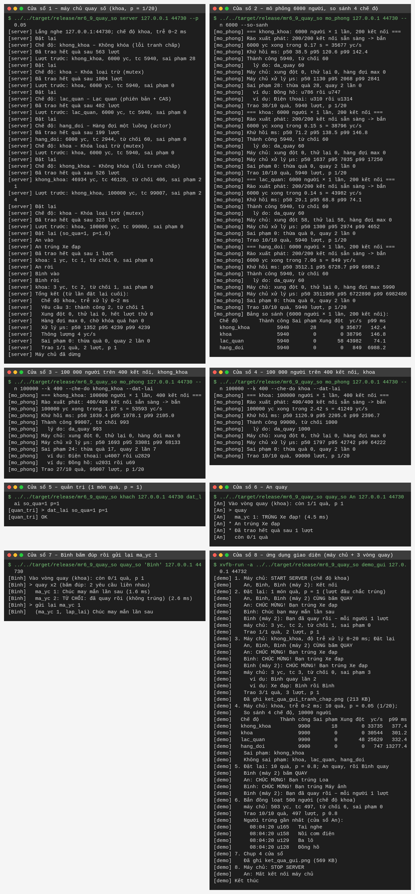

# Bài mở rộng MR6.9 – Quay số trúng thưởng: 100 000 lượt quay tranh 10 món quà (Rust)

| Thông tin | Nội dung |
|---|---|
| Loại | **Bài mở rộng**, không có trong giáo trình và không có mã giả tương ứng. Thuộc nhóm "tranh chấp tài nguyên" MR6.6–MR6.14, dùng chung khung của [MR6.6](../BaiMR6.6_DauGia/) |
| Liên hệ với giáo trình | Chương 6: Bài 6.1 (server đa luồng, một luồng mỗi kết nối), Bài 6.7 (kiểm thử tải); Chương 3: Bài 3.2 (định khung thông điệp theo dòng); bài mở rộng MR5.4/MR5.5 (luồng, đồng bộ) |
| Thư viện | Thư viện chuẩn Rust: `std::net`, `std::thread`, `std::sync` (`Mutex`, `RwLock`, `Condvar`, `AtomicU64`, `mpsc`); crate `serde_json` 1.0.154 (`preserve_order`), `socket2` 0.5.10, `ctrlc` 3.4.7, `chrono` 0.4.41, `miniz_oxide` 0.8.9; giao diện `eframe`/`egui` 0.29.1. Mọi crate ghim bằng `=` và `Cargo.lock` |
| Bản ngôn ngữ khác | [Python](../../../python/Chuong06/BaiMR6.9_QuaySo/), [C#](../../../csharp/Chuong06/BaiMR6.9_QuaySo/), [Java](../../../java/Chuong06/BaiMR6.9_QuaySo/), [Go](../../../go/Chuong06/BaiMR6.9_QuaySo/) |

## Mục tiêu
Bài mô phỏng chương trình khuyến mãi "Vòng quay may mắn". Kho có **10 món quà**, hàng chục nghìn khách hàng mỗi người được **quay đúng một lần**. Mỗi lượt trúng với xác suất **p** (mặc định 1/2000) nếu kho còn quà, và người trúng nhận ngẫu nhiên một món còn lại. Có hai tài nguyên bị tranh chấp:
- **kho quà** (một ô "nóng", mọi lượt trúng cùng ghi);
- **lượt quay của từng người** (một ô cho mỗi người). Hai thiết bị của cùng một người, hoặc một lần bấm đúp, cùng gửi yêu cầu `quay`.

Máy chủ TCP đa luồng (một `std::thread` mỗi kết nối) xử lý thao tác "đọc → kiểm tra (giả lập độ trễ cơ sở dữ liệu 0–2 ms) → ghi" theo **bốn cách** chọn được ngay lúc đang chạy: không khóa, khóa loại trừ, lạc quan, hàng đợi một luồng. **Sổ kiểm toán** đếm hai sai phạm: **thừa quà** (một món đã trao lại được trao lần nữa) và **quay 2 lần** (một người có hai lượt quay được chấp nhận). Bộ mô phỏng tải dồn **100 000 người lên 400 kết nối** (pipelining) để đo thông lượng.

Giao thức, câu chữ và định dạng dòng in giống hệt bản Python, nên máy chủ, bộ mô phỏng và người dùng viết bằng các ngôn ngữ khác nhau chạy chung được (đã thử chạy chéo, xem Ghi chú).

## Kiến thức chính
Số liệu dưới đây lấy từ `ket_qua.txt`, là một lần chạy thật trên máy cục bộ (127.0.0.1, Rust 1.97, 2 lõi, độ trễ xử lý ngẫu nhiên 0–2 ms). Để sai phạm hiện rõ trong vài giây, máy chủ trong demo chạy với **p = 1/20** (`server --p 0.05`) thay vì 1/2000. Mỗi lần chạy, số liệu lệch đi đôi chút.

```
  Chế độ       Thành công Sai phạm Xung đột  yc/s  p99 ms
  khong_khoa         5940       28        0 35677   142.4
  khoa               5940        0        0 38796   146.8
  lac_quan           5940        0       58 43982    74.1
  hang_doi           5940        0        0   849  6988.2
```
(6000 người × 1 lượt quay, 200 kết nối, 10 quà, p = 1/20. "Thành công" là số lượt quay được chấp nhận (trúng hoặc không). 60 yêu cầu còn lại là thiết bị thứ hai của 60 người và đúng ra phải bị từ chối. "Sai phạm" do sổ kiểm toán đếm, "Xung đột" là số lần so sánh-và-đổi thất bại, "yc/s" và "p99" (khứ hồi) đo ở bộ mô phỏng.)

**100 000 người trên 400 kết nối**, cùng p = 1/20:

| Chế độ | Thời gian | yc/s | Khứ hồi p99 | Thành công / từ chối | Sai phạm |
|---|---|---|---|---|---|
| `khong_khoa` | 1,87 s | 53593 | 2,1 s | 99 007 / 993 | 24 (thừa quà 17, quay 2 lần 7: **trao 27/10 quà**) |
| `khoa` | 2,42 s | 41249 | 2,4 s | 99 000 / 1000 | 0 (trao 10/10) |

- **Tranh chấp (race condition) trên kho quà.** Ở `khong_khoa`, hai lượt trúng gần như cùng lúc cùng đọc kho (ví dụ còn Đồng hồ, Loa, …), cùng bốc ngẫu nhiên một món rồi ghi lại. Có khi hai người bốc trúng **cùng một món** (trong sổ: `Đồng hồ: u786 rồi u747`), có khi bản ghi sau đè bản trước làm món vừa trao "sống lại" trong kho rồi lại được trao tiếp: 6000 người được trao **38 món** từ kho 10 món. Rust chạy đa lõi thật, nên cuộc tranh diễn ra ngay cả khi lượt `khong_khoa` chỉ kéo dài 0,17 s. Chế độ này chỉ dùng để minh họa lỗi trong phòng lab (loopback).
- **An toàn bộ nhớ khi cố tình "không đồng bộ".** Như khung MR6.6: giá trị mỗi ô nằm trong `Mutex<Arc<OQuay>>` chỉ giữ lúc chép/thay con trỏ, phiên bản là `AtomicU64`. Từng lần đọc, ghi đều trọn vẹn, không có `unsafe`, nhưng chuỗi "đọc – nghỉ – xử lý – ghi" thì không, nên mất cập nhật vẫn xảy ra. Giá trị ô là một `enum OQuay { Qua(Vec<usize>), ChuaQuay, DaQuay(Option<usize>) }`.
- **Idempotency theo tên, không chỉ theo `ma_yc`.** Khung đã chống *gửi lại* (cùng `ma_yc`): máy chủ trả lại kết quả cũ kèm `"lap_lai": true` (cửa sổ 7: `gui_lai 1` nhận lại đúng "Chúc may mắn lần sau" mà không quay lần nữa). Bấm đúp hay mở hai thiết bị lại sinh **hai `ma_yc` khác nhau**, nên luật "mỗi người một lượt" phải nằm trong trạng thái: ô `ng:<tên>` ghi kết quả lượt quay, yêu cầu thứ hai nhận `da_quay` ("đã quay rồi (không trúng)"). Ở `khong_khoa`, cả hai yêu cầu cùng đọc thấy "chưa quay" nên cả hai được chấp nhận (sổ đếm 7 lần "quay 2 lần" trong lượt 100 000 người). Ở giao diện, Bình bấm QUAY trên hai thiết bị: `khoa` cho đúng một lượt, `khong_khoa` cho cả hai.
- **Mỗi người một ô – thêm ô O(1).** Ô `ng:<tên>` được tạo lúc người đó quay lần đầu (100 000 ô trong lượt lớn). Khung Rust giữ bảng ô trong `RwLock<BangO>` (một `Vec` các ô + `HashMap` tên → vị trí); bài này thêm hàm `KhoTranhChap::dat_o(khóa, giá_trị)` **đẩy một ô mới vào cuối bảng** dưới khóa ghi rất ngắn. Không chép lại cả bảng mỗi lần thêm (chép cả bảng là O(n) mỗi lần, tức O(n²) cho 100 000 người – vấn đề mà bản C#/Java đã gặp). Việc tạo ô diễn ra dưới một khóa tạo ô riêng (hai thiết bị không tạo hai ô cho một người); đó không phải khóa nghiệp vụ, việc kiểm tra "đã quay chưa" vẫn đi qua chế độ đang chọn.
- **Khóa theo tài nguyên, và chỉ khóa thứ thật sự tranh.** Việc rút thăm (`ngau_nhien() < p`) làm **trước**, ngoài vùng găng, vì nó không phụ thuộc trạng thái. Lượt không trúng chỉ khóa ô của chính người đó, nên hàng trăm lượt chạy song song; chỉ lượt trúng mới khóa thêm ô `qua` (hai khóa, xin theo thứ tự đã sắp xếp nên không khóa chết). Khi kho đã hết, lượt trúng thăm không cần chạm ô `qua` nữa. Nhờ vậy `khoa` và `lac_quan` có thông lượng ngang `khong_khoa` (khoảng 36 000–44 000 yc/s), khác hẳn MR6.6 nơi một món hàng là điểm nóng của mọi yêu cầu.
- **Lạc quan (Kung & Robinson 1981).** `lac_quan` đọc (giá trị, phiên bản) của các ô liên quan, xử lý ngoài khóa, rồi so sánh-và-đổi (`AtomicU64::compare_exchange` trên phiên bản). Chỉ 58 xung đột (lượt trúng đụng nhau ở ô `qua`, hoặc hai thiết bị đụng nhau ở ô của một người), mỗi xung đột thử lại thành công, sai phạm 0.
- **Hàng đợi một luồng (actor).** `hang_doi` đúng tuyệt đối nhưng **tuần tự**: mọi lượt quay, kể cả lượt không trúng (vốn chạy song song được), đều đi qua một luồng nhận từ kênh `mpsc`, nên chỉ đạt 849 yc/s, hàng đợi dài tới 5990, p99 khứ hồi 7,0 s. Với 100 000 người chế độ này sẽ mất khoảng 2 phút, vì thế lượt 100 000 người chỉ chạy `khong_khoa` và `khoa`.
- **Pipelining, rào xuất phát.** 400 kết nối, mỗi kết nối chở 250 người ảo (`"so_nguoi"` trong lời chào, tên người ở `"nguoi"`), cùng bắn sau rào xuất phát, mỗi kết nối gửi 250 yêu cầu trong một lần `write_all`. Người thứ 100, 200, … mang tên của người liền trước (thiết bị thứ hai), nên đúng 1000 yêu cầu bị từ chối `da_quay` ở `khoa`.
- **Đẩy trạng thái có gộp.** `cap_nhat` (số quà còn, món nào đã trao cho ai, số lượt đã quay, 20 người trúng gần nhất) được gửi tối đa 10 lần/giây. Thông báo "X trúng Y" (`su_kien`) chỉ phát cho người dùng thật, người ảo của bộ mô phỏng chỉ hiện trong danh sách người trúng.

### Giao thức (giống hệt ở 5 ngôn ngữ)
TCP, mỗi dòng một JSON UTF-8 kết thúc `\n`, tối đa 64 KB một dòng. Phần chung (chào, quản trị, `thong_ke`, `lap_lai`) xem [README MR6.6](../BaiMR6.6_DauGia/README.md#giao-thức-giống-hệt-ở-5-ngôn-ngữ).

| Chiều | Thông điệp |
|---|---|
| người dùng → server | `{"loai":"quay","ma_yc":k}` (kết nối gộp thêm `"nguoi":"u17"`) |
| server → client | `{"loai":"kq","ma_yc":k,"ok":true,"trung":true,"qua":3,"ten_qua":"Tai nghe","nguoi":"An","con_lai":9}` · `{"loai":"kq","ma_yc":k,"ok":true,"trung":false,"qua":null,"nguoi":"An"}` · `{"loai":"kq","ma_yc":k,"ok":false,"ma_loi":"da_quay","ly_do":"đã quay rồi (trúng Tai nghe)","qua":3}` |
| server → tất cả | `{"loai":"cap_nhat","che_do":…,"so_qua":10,"p":0.0005,"con_lai":7,"qua":[{"ma","ten","con","nguoi"}…],"da_quay":12345,"so_trung":3,"nguoi_trung":[{"nguoi","qua","gio"}…]}` (≤ 10 lần/s); `{"loai":"su_kien","noi_dung":"An trúng Tai nghe"}` |
| quản trị → server | `{"loai":"dat_lai","ma_yc":k,"so_qua":10,"p":0.0005}` (số quà 1–10, p trong [0, 1]) |

## Cấu trúc tệp
Gói Cargo `mr6_9_quay_so` (một chương trình, chọn vai trò bằng lệnh con):
- **Khung chung**, chép từ MR6.6: `src/chung.rs`, `src/khach.rs`, `src/mo_phong.rs`, `src/server.rs`, `src/gui_chung.rs`. Khác MR6.6 ba chỗ nhỏ, giống nhau ở 5 bài MR6.9–MR6.13: `chung.rs` thêm `KhoTranhChap::dat_o`/`co_o` (thêm một ô khi đang chạy) và `MayChu::dat_mot_tham_so` (đổi một tham số không đặt lại – MR6.13 dùng); `gui_chung.rs` mở `CuaSoServer::xong_mo_phong` thành `pub` (kịch bản demo hiện lại bảng so sánh 4 chế độ như bản Python).
- **Nghiệp vụ:** `src/may_chu.rs` (`QuaySo: NghiepVu`, `LuatQuaySo: LuatKiemToan`, `enum OQuay`, ô `ng:<tên>` tạo bằng `dat_o`, rút thăm ngoài vùng găng, `chu_p`), `src/nguoi_ao.rs` (`NguoiAo`: quay `lan` lần; người thứ 100, 200, … dùng tên người liền trước), `src/quay_so.rs` (người quay dòng lệnh: `quay`, `quay x2`, `gui_lai [k]`).
- **Giao diện:** `src/server_gui.rs` (khung "Tài nguyên": kho quà), `src/vong_quay_gui.rs` (vòng quay may mắn, ảnh 10 món quà vẽ bằng bút vẽ egui), `src/demo_gui.rs` (kịch bản tự thao tác + chụp), `src/main.rs`.
- `Cargo.toml`, `Cargo.lock`, `demo.json`, `ket_qua.txt`, `ket_qua.png`, `ket_qua_gui.png`, `ket_qua_gui_tranh_chap.png`: kịch bản và kết quả thực thi thật.

## Cách chạy
Trong thư mục bài (`cargo build -q --release` một lần; `B=../../target/release/mr6_9_quay_so`, Windows: `..\..\target\release\mr6_9_quay_so.exe`):
```bash
$B server 127.0.0.1 9000 --p 0.05                              # cửa sổ 1 (gõ lệnh ở đây)
$B mo_phong 127.0.0.1 9000 --n 6000 --so-sanh                  # cửa sổ 2: bảng so sánh 4 chế độ
$B mo_phong 127.0.0.1 9000 --n 100000 --k 400 --che-do khoa --dat-lai
$B khach 127.0.0.1 9000 dat_lai so_qua=10 p=0.0005              # chương trình thật: p = 1/2000
$B quay_so An 127.0.0.1 9000                                   # cửa sổ 3, 4…: gõ quay / quay x2
```
- Lệnh của máy chủ: `che_do khong_khoa|khoa|lac_quan|hang_doi`, `tre <ms>`, `dat_lai [so_qua=… p=…]`, `thong_ke`, `thoat` (Ctrl+C cũng in tổng kết rồi dừng). Tùy chọn: `--che-do`, `--tre-ms`, `--so-qua`, `--p`.
- Lệnh của `quay_so`: `quay`; `quay x2` (bấm đúp: hai yêu cầu với hai `ma_yc` khác nhau); `gui_lai [k]` (gửi lại đúng `ma_yc` k); `thoat`. Dòng `@t lệnh` chờ tới giây thứ t rồi mới chạy lệnh.

Tái lập kết quả từ thư mục gốc của kho: `python3 tools/demo.py rust/Chuong06/BaiMR6.9_QuaySo` (cổng 44730, giao diện 44732; bước chuẩn bị tự biên dịch; khoảng 1 phút). Cổng 447x0 nằm trong dải cổng tạm của Linux: nếu gặp "Address already in use" (một kết nối ra ngoài vừa mượn đúng cổng đó) thì chạy lại.

## Ứng dụng giao diện


Ảnh trên là lần chạy thật của `demo_gui` (Linux, Xvfb + Mesa llvmpipe, egui 0.29.1): bảng điều khiển máy chủ (trên trái), An (trên phải), Bình và "Bình (máy 2)" (dưới). Kịch bản đã chạy so sánh 4 chế độ ngay trong giao diện (10 000 người, p = 1/20; dòng `khong_khoa` tô đỏ: 18 sai phạm; `khoa`, `lac_quan` (48 xung đột), `hang_doi` 0). Sau đó, với 10 quà và p = 0,8, An quay trúng Loa, Bình trúng Máy ảnh, còn "Bình (máy 2)" bấm QUAY thì nhận "Bạn đã quay rồi – mỗi người 1 lượt". Cuối cùng 500 người ảo quay hết số quà còn lại, danh sách người trúng cập nhật trực tiếp ở cả ba cửa sổ.



Ở bước trước đó (ảnh trên), máy chủ chạy `khong_khoa` với độ trễ xử lý 0–20 ms, kho có **1 món quà** và p = 1. An, Bình và Bình (máy 2) cùng bấm QUAY: **cả ba** đều trúng chiếc Xe đạp. Ô **SAI PHẠM** chuyển đỏ (3: thừa quà 2, quay 2 lần 1), tóm tắt ghi "Trao 3/1 quà". Cùng thao tác đó ở `khoa` cho đúng một người trúng (An), Bình "Chúc bạn may mắn lần sau", thiết bị thứ hai của Bình bị từ chối.

- **Máy chủ** (`server_gui`): IP, cổng, START/STOP; **4 nút chọn chế độ**; độ trễ xử lý; **chỉ số trực tiếp** (kết nối/người, yêu cầu/giây, thành công, từ chối theo mã lỗi, xung đột/thử lại, hàng đợi, xử lý p50/p95/p99, **SAI PHẠM** xanh/đỏ kèm ví dụ); **tài nguyên**: số quà còn lại và số đã trao (đỏ khi trao quá số quà), số lượt đã quay, p, ảnh 10 món quà (viền xanh là còn, xám kèm tên người nhận là đã trao), ô số quà và p, nút **Đặt lại**; **mô phỏng tải**: n, k, số lần/người, **Bắn đồng loạt**, **So sánh 4 chế độ**; nhật ký.
- **Vòng quay may mắn** (`vong_quay_gui`): bánh xe vẽ bằng bút vẽ egui (mỗi ô là một đa giác lồi hình quạt, chữ xoay theo ô bằng `TextShape::with_angle`), mỗi món quà một ô màu, xen giữa là ô "May mắn lần sau", món đã trao chuyển xám "(đã trao)"; kim chỉ ở đỉnh; đèn viền nhấp nháy khi quay. Bấm **QUAY**: bánh xe quay tự do ngay (vẽ lại 30 ms/lần), khi có kết quả thì giảm tốc (ease-out, 2,6 s) và dừng **đúng ô kết quả**, rồi hiện "CHÚC MỪNG! Bạn trúng …", "Chúc bạn may mắn lần sau" hoặc "Bạn đã quay rồi", nút chuyển thành "ĐÃ QUAY". Bên phải: số quà còn lại, số lượt đã quay, ảnh từng món kèm trạng thái còn hoặc "→ người nhận", danh sách **người trúng thưởng trực tiếp** (tên mình tô xanh).

### Cách chạy
```bash
cargo build --release
$B server_gui 127.0.0.1 44732                  # bấm START SERVER (10 quà, p = 1/2000)
$B vong_quay_gui An 127.0.0.1 44732
$B vong_quay_gui Bình 127.0.0.1 44732
```
- **Windows:** cần Rust bản MSVC như các bài Rust khác; giao diện không cần cài thêm gì. **Linux:** thư viện OpenGL/X11 (hoặc Wayland). Kịch bản tự động (Linux, cần `xvfb`): `xvfb-run -a -s "-screen 0 2600x1700x24" $B demo_gui 127.0.0.1 44732`.
- Chạy riêng từng cửa sổ: mọi dòng nhật ký và cứ 5 giây một dòng số liệu cũng in ra dòng lệnh.
- Cửa sổ người dùng nối được với máy chủ dòng lệnh của mọi ngôn ngữ, và ngược lại.
- Thử trên nhiều máy: máy chủ nghe trên IP card mạng (hoặc `0.0.0.0`) và mở tường lửa cho cổng; mỗi sinh viên chạy `vong_quay_gui` với IP của máy thầy. Muốn cả lớp có người trúng, đặt p = 0,1–0,3 và số quà bằng khoảng 1/5 số sinh viên. Khi đó **chỉ dùng `khoa`, `lac_quan`, `hang_doi`**.

## Kết quả thực thi


## Ghi chú
- **Chạy chéo với bản Python** (đã thử, p = 1/20, 6000 người): xem số liệu ở tệp trạng thái `docs/_status/morong_mr69_rust.json`. Cả hai chiều đều cho `khong_khoa` có sai phạm, ba chế độ còn lại 0; người quay Python (`quay x2`, `gui_lai 1`) trên máy chủ Rust nhận `da_quay` và `lap_lai` đúng như trên máy chủ Python.
- `gui_lai` của `quay_so` gửi lại đúng `ma_yc` cũ bằng `gui_yc("quay", {"ma_yc": k})`: trường `ma_yc` của tham số ghi đè số mới do khung đánh, trả lời có `"lap_lai": true` nên đi tới `khi_tin` (khung không cần sửa).
- Với 100 000 người, khứ hồi p50 khoảng 1 s là do mỗi kết nối xếp 250 yêu cầu nối đuôi nhau (một luồng máy chủ mỗi kết nối xử lý lần lượt), không phải do khóa.
- Dòng 5 giây và dòng "Lượt trước" của máy chủ có thể dài 65–66 ký tự khi số yêu cầu lên tới 100 000 (định dạng của khung chung, như bản Python).
- Trong kịch bản giao diện, máy chủ, bộ mô phỏng và 4 cửa sổ cùng chạy trong một tiến trình trên 2 lõi, Mesa llvmpipe vẽ bằng CPU, nên yc/s thấp hơn bản dòng lệnh.
- Kiểm thử: Linux, Rust 1.97.0 (`cargo build` không cảnh báo), tools/demo.py; giao diện egui 0.29.1 dưới Xvfb + Mesa llvmpipe. Bản giao diện chưa thử trên Windows.

## Bài tập gợi ý
1. Chạy `$B mo_phong --n 30000 --so-sanh` với p = 1/2000 (giá trị thật). `khong_khoa` có còn trao thừa quà không? Vì sao xác suất hai lượt trúng "đụng nhau" phụ thuộc vào p × (số yêu cầu đang xử lý cùng lúc) × (độ rộng khe đọc–ghi)?
2. Bỏ đoạn "hết quà thì khỏi chạm ô `qua`" trong `may_chu.rs`, rồi đo lại thông lượng của `khoa` với p = 1/20. Giải thích kết quả.
3. Gộp ô của mọi người thành một ô `da_quay` (một `HashSet<String>`). Thông lượng của `khoa` và số xung đột của `lac_quan` thay đổi thế nào? Đây là bài học về độ mịn của khóa (lock granularity).
4. Viết lại `dat_o` theo kiểu "chép cả bảng rồi thay" (copy-on-write: `Arc<BangO>` mới mỗi lần thêm ô) và đo thời gian lượt 100 000 người. Vì sao chậm hẳn đi?
5. Ở chế độ `lac_quan`, nếu rút thăm *bên trong* `xu_ly` (mỗi lần thử lại rút lại) thì xác suất trúng thực tế có còn là p không? Vì sao phải rút thăm một lần, ngoài vùng găng?
6. Giao diện: cho bánh xe dừng có "nảy" nhẹ (thêm một dao động tắt dần sau ease-out).

## Đọc thêm
- H. T. Kung, J. T. Robinson (1981). *On Optimistic Methods for Concurrency Control*. ACM Transactions on Database Systems 6(2).
- E. G. Coffman, M. J. Elphick, A. Shoshani (1971). *System Deadlocks*. ACM Computing Surveys 3(2): thứ tự khóa (lượt trúng giữ hai khóa: ô người và ô quà).
- Tài liệu Rust: [`std::sync`](https://doc.rust-lang.org/std/sync/index.html) (`Mutex`, `RwLock`, `Condvar`, `mpsc`), [`std::sync::atomic`](https://doc.rust-lang.org/std/sync/atomic/index.html) (`AtomicU64::compare_exchange`), [`std::collections::HashMap`](https://doc.rust-lang.org/std/collections/struct.HashMap.html); The Rust Programming Language, chương 16 "Fearless Concurrency".
- [egui](https://docs.rs/egui/0.29.1/egui/) 0.29.1 (`Painter`, `Shape::convex_polygon`, `epaint::TextShape`).

Mã nguồn của bài được viết mới cho kho này.
