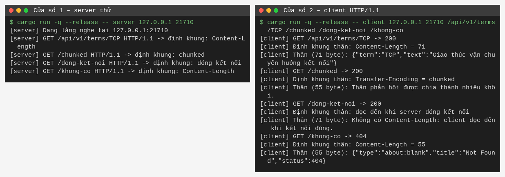

# Bài 7.1 – Client HTTP/1.1 tối giản trên socket TCP (Rust)

| Thông tin | Nội dung |
|---|---|
| Mã giả tương ứng | Mã giả 7.1 (Client HTTP/1.1 tối giản trên socket TCP) |
| Mục giáo trình | 7.2.1 HTTP/1.1 |
| Kế thừa | Mã giả 2.2 (SAFE_CONNECT), Mã giả 3.4 (RECV_EXACT), Mã giả 3.5 (READ_LINE, Reader) |
| Thư viện | Thư viện chuẩn: `std::net::TcpStream`, `std::net::TcpListener`, `std::io` |

## Mục tiêu
Cài đặt `HTTP_REQUEST`, `READ_HEADERS`, `READ_CHUNKED`: ghép dòng yêu cầu và tiêu đề (có `Host` kèm cổng, `Connection: close`, dòng trống), đọc dòng trạng thái, đọc tiêu đề đến dòng trống và đọc thân theo đúng một trong ba cách định khung của HTTP/1.1: `Transfer-Encoding: chunked`, `Content-Length`, hoặc đọc đến khi server đóng kết nối. Server thử đi kèm trả về cả ba kiểu để kiểm tra từng nhánh của mã giả.

## Tệp
- `src/main.rs` – phân nhánh theo tham số `client` / `server`; đọc tham số cổng.
- `src/http_client.rs` – Mã giả 7.1: `http_request`, `read_headers`, `read_chunked`, `Reader`, `read_line`, `read_exact`.
- `src/server_thu.rs` – server thử tuần tự trả về ba kiểu định khung thân.
- `Cargo.toml`, `Cargo.lock` – gói Cargo `bai7_1_http_client` (không dùng crate ngoài).
- `demo.json` – kịch bản chạy minh họa (dùng với `tools/demo.py`).
- `ket_qua.txt`, `ket_qua.png` – kết quả thực thi thật.

## Cách chạy
Mở hai cửa sổ dòng lệnh trong thư mục bài:
```bash
cargo build --release
# Cửa sổ 1 – server thử
cargo run --release -- server 0.0.0.0 8080
# Cửa sổ 2 – client, mỗi đường dẫn là một yêu cầu GET
cargo run --release -- client 127.0.0.1 8080 /api/v1/terms/TCP /chunked /dong-ket-noi /khong-co
```
Dừng server bằng Ctrl+C.

## Kết quả thực thi


Bốn yêu cầu đi qua ba nhánh định khung. Thân JSON có 58 ký tự nhưng `Content-Length` = 71 byte vì chữ tiếng Việt chiếm 2–3 byte UTF-8; thân chunked gồm ba khối (khối đầu có phần mở rộng `;vi-du=mo-rong`, cuối có trailer `X-So-Khoi`) được ghép lại đủ 55 byte; nhánh không có độ dài đọc đến khi server đóng kết nối; mã 404 vẫn có thân `application/problem+json`.

## Ghi chú
- `READ_EXACT(r, n)` lấy phần dư `pending` của bộ đọc trước rồi mới nhận tiếp từ socket, đúng như chú thích của mã giả; đọc thẳng trên socket sẽ mất phần đầu của thân đã đến cùng tiêu đề.
- `READ_HEADERS` dừng ở dòng trống; nếu kết nối đóng giữa phần tiêu đề (`READ_LINE` trả `None`), hàm báo lỗi `ConnectionClosed` (ở đây là `io::Error` loại `UnexpectedEof`) như dòng 29 của Mã giả 7.1.
- Client chỉ minh họa cấu trúc giao thức: không hỗ trợ TLS, chuyển hướng, nén, giữ kết nối. Ứng dụng thật dùng thư viện HTTP (Mục 7.2.1).
- Thời gian chờ nhận 5 000 ms (không có trong mã giả) để client không treo nếu server không trả lời. Mọi lỗi (kết nối, dòng trạng thái sai, kích thước khối sai…) được trả về dạng `io::Error` và in thành `[client] Lỗi: …`.
- Đã thử thêm với server tĩnh của Python: `python3 -m http.server 8000` rồi gọi client với cổng 8000 và đường dẫn một tệp (phản hồi có `Content-Length`).
- Thư viện chuẩn Rust không có hàm bắt Ctrl+C, nên server thử dừng ngay khi nhận tín hiệu và không in dòng `[server] Dừng server` như bản Python.
- Kiểm thử: Linux, Rust 1.97.0.
