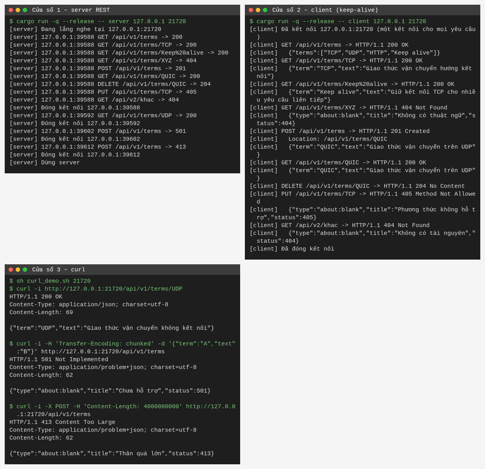

# Bài 7.2 – Server REST tối giản trên HTTP/1.1 (Rust)

| Thông tin | Nội dung |
|---|---|
| Mã giả tương ứng | Mã giả 7.2 (Server REST tối giản trên HTTP/1.1) |
| Mục giáo trình | 7.2.3 Thiết kế RESTful API |
| Kế thừa | Mã giả 6.3 (server bất đồng bộ), Mã giả 7.1 (READ_HEADERS), Mã giả 3.7 (DICT nạp từ `glossary.json`) |
| Thư viện | crate `tokio` (`TcpListener`, `BufReader`, `spawn`, `signal`), `serde_json`; client dùng thư viện chuẩn `std::net`, `std::io` |

## Mục tiêu
Cài đặt `HTTP_SESSION`, `ROUTE`, `RESPOND` cho dịch vụ tra cứu thuật ngữ theo thiết kế RESTful của Mục 7.2.3: giữ kết nối cho nhiều yêu cầu, từ chối thân chunked (501) và thân quá lớn (413) trước khi đọc, trả lỗi theo Problem Details (`application/problem+json`), tính `Content-Length` theo byte UTF-8. Bổ sung theo bài tập cuối chương: `POST /api/v1/terms` (201 kèm `Location`, 400, 409) và `DELETE /api/v1/terms/{term}` (204).

## Tệp
- `src/main.rs` – phân nhánh theo tham số `server` / `client`; đọc tham số cổng.
- `src/rest_server.rs` – Mã giả 7.2: `http_session`, `route`, `respond`, `problem`; `url_decode`, `url_encode`.
- `src/rest_client.rs` – client thử, gửi nhiều yêu cầu trên một kết nối keep-alive.
- `glossary.json` – từ điển thuật ngữ.
- `curl_demo.sh` – ba lệnh curl minh họa 200, 501, 413 (giống bản Python).
- `Cargo.toml`, `Cargo.lock` – gói Cargo `bai7_2_rest_server`.
- `demo.json` – kịch bản chạy minh họa (dùng với `tools/demo.py`).
- `ket_qua.txt`, `ket_qua.png` – kết quả thực thi thật.

## Cách chạy
```bash
cargo build --release
# Cửa sổ 1 – server
cargo run --release -- server 0.0.0.0 8080
# Cửa sổ 2 – client keep-alive
cargo run --release -- client 127.0.0.1 8080
# Cửa sổ 3 – curl
sh curl_demo.sh 8080
```
Mỗi dòng nhập ở client có dạng `PHƯƠNG_THỨC ĐƯỜNG_DẪN [THÂN_JSON]`, ví dụ:
```
GET /api/v1/terms/TCP
POST /api/v1/terms {"term":"QUIC","text":"Giao thức vận chuyển trên UDP"}
DELETE /api/v1/terms/QUIC
```
Script `curl_demo.sh [port]` chạy ba lệnh curl của phần kết quả (cần `sh` và `curl`; trên Windows dùng Git Bash hoặc WSL).

## Kết quả thực thi


Client gửi chín yêu cầu trên cùng một kết nối (server ghi cùng một cổng nguồn cho cả chín yêu cầu) và nhận đủ các mã 200, 404, 201 kèm `Location`, 204 không có thân, 405; `Keep%20alive` được giải mã thành thuật ngữ có dấu cách. Cửa sổ curl cho thấy yêu cầu có `Transfer-Encoding: chunked` nhận 501, yêu cầu khai báo `Content-Length: 4000000000` nhận 413 ngay mà server không cấp phát bộ đệm, và kết nối bị đóng sau hai mã này.

## Ghi chú
- `tokio::io::BufReader` bọc nửa đọc của socket đóng vai `Reader` (có bộ đệm riêng): `READ_LINE_ASYNC` là `read_until(b'\n')` qua `take(8193)` nên một dòng dài hơn 8 192 byte bị từ chối mà không đọc hết; `READ_EXACT_ASYNC` là `read_exact`.
- `MAX_BODY` không có giá trị trong giáo trình; bài dùng 1 048 576 byte (bằng `MAX_FRAME` của Mã giả 3.6). `Content-Length` được đọc bằng `TO_INT64` (`i64`) và giá trị âm hoặc lớn hơn `MAX_BODY` nhận 413 trước khi cấp phát bộ đệm, như Mã giả 7.2 (đã thử thêm `Content-Length: -5` → 413). `READ_HEADERS` báo lỗi khi kết nối đóng giữa phần tiêu đề (Mã giả 7.1).
- Bổ sung so với mã giả: dòng yêu cầu không đủ ba phần nhận 400 rồi đóng kết nối; `PATH(target)` bỏ phần truy vấn sau `?` (nên `?page=1&size=50` được chấp nhận nhưng chưa phân trang); mã 204 không gửi `Content-Type`, `Content-Length` (RFC 9110).
- Như mã giả, server coi mọi kết nối là được giữ lại (không xét HTTP/1.0) và không áp dụng thời gian chờ nhàn rỗi.
- Thư viện chuẩn Rust không có hàm mã hóa URL; `url_decode` (`%XX` → byte → UTF-8) và `url_encode` (giữ `A–Z a–z 0–9 - . _ ~ /`, như `quote` của Python) được viết trực tiếp trong bài.
- Các tác vụ chạy trên nhiều luồng thợ của tokio nên `DICT` (`serde_json::Map` giữ thứ tự chèn) được bảo vệ bằng `std::sync::Mutex`; khóa chỉ giữ trong `route`, không có `.await` bên trong.
- Thử thêm bằng curl: `curl -i http://127.0.0.1:8080/api/v1/terms`, `curl -i -X POST -d '{"term":"QUIC","text":"..."}' http://127.0.0.1:8080/api/v1/terms`.
- Kiểm thử: Linux, Rust 1.97.0, tokio 1.54.1, serde_json 1.0.154.
