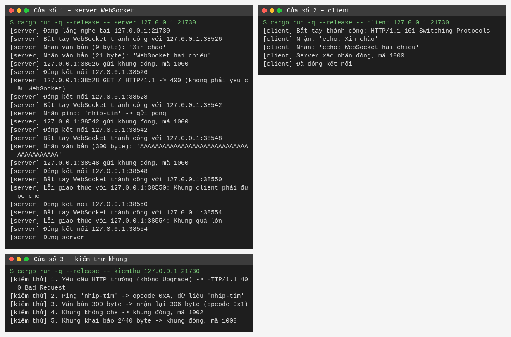

# Bài 7.3 – Server WebSocket tối giản và client thử (Rust)

| Thông tin | Nội dung |
|---|---|
| Mã giả tương ứng | Mã giả 7.3 (Bắt tay mở đầu WebSocket phía server), Mã giả 7.4 (Đọc một khung WebSocket) |
| Mục giáo trình | 7.3.2 WebSocket |
| Kế thừa | Mã giả 7.2 (dòng đầu, READ_HEADERS, RESPOND), Mã giả 3.4 (READ_EXACT), Mã giả 6.3 (mỗi kết nối một tác vụ) |
| Thư viện | crate `tokio` (server), `sha1`, `base64` (tính `Sec-WebSocket-Accept`); client và kiểm thử dùng thư viện chuẩn `std::net` |

## Mục tiêu
Cài đặt bắt tay mở đầu `WS_ACCEPT` (kiểm tra `Upgrade`, `Sec-WebSocket-Version: 13`, khóa `Sec-WebSocket-Key` giải mã Base64 được đúng 16 byte, tính `Sec-WebSocket-Accept` = Base64(SHA-1(khóa + GUID))) và đọc khung `WS_READ_FRAME` (bit FIN, opcode, bit MASK, độ dài 7/16/64 bit, bỏ che bằng XOR). Server gửi trả khung văn bản `echo: …`, trả lời ping bằng pong, đáp khung đóng, đóng kết nối với mã 1009 khi khung vượt `MAX_FRAME` và 1002 khi khung từ client không được che. Chương trình kiểm thử tự tạo khung, kể cả khung vi phạm đặc tả.

## Tệp
- `src/main.rs` – phân nhánh theo tham số `server` / `client` / `kiemthu`; `WS_GUID`, `accept_key`, `random_bytes`.
- `src/ws_server.rs` – Mã giả 7.3 `ws_accept`, Mã giả 7.4 `ws_read_frame`, `ws_close`, vòng phục vụ.
- `src/ws_client.rs` – client WebSocket tự viết (giống bản Python): bắt tay, che khung, đọc khung.
- `src/ws_kiem_thu.rs` – năm ca kiểm thử với khung tự tạo.
- `Cargo.toml`, `Cargo.lock` – gói Cargo `bai7_3_websocket`.
- `demo.json` – kịch bản chạy minh họa (dùng với `tools/demo.py`).
- `ket_qua.txt`, `ket_qua.png` – kết quả thực thi thật.

## Cách chạy
```bash
cargo build --release
# Cửa sổ 1 – server
cargo run --release -- server 0.0.0.0 8080
# Cửa sổ 2 – client: nhập từng dòng, Ctrl+D để đóng
cargo run --release -- client 127.0.0.1 8080
# Cửa sổ 3 – kiểm thử khung
cargo run --release -- kiemthu 127.0.0.1 8080
```

## Kết quả thực thi


Client bắt tay thành công (101), nhận lại hai thông điệp kèm tiếng Việt và đóng bình thường với mã 1000. Năm ca kiểm thử đều cho kết quả mong đợi: yêu cầu không có `Upgrade` nhận 400; ping nhận pong cùng dữ liệu; thông điệp 300 byte (độ dài mở rộng 16 bit) được trả lại 306 byte; khung không che nhận khung đóng 1002; khung khai báo 2^40 byte nhận khung đóng 1009 ngay sau tiêu đề, trước khi server đọc hay cấp phát dữ liệu.

## Ghi chú
- Ngoài mã giả, server ghép khung tiếp nối (opcode 0x0) đến khi FIN = 1, trả lời ping (0x9) bằng pong (0xA) và đáp khung đóng bằng cùng mã đóng (1000 nếu khung đóng không có mã), như đoạn giải thích bước (7) của Mã giả 7.4.
- Khóa `Sec-WebSocket-Key` không giải mã Base64 được thành đúng 16 byte bị từ chối 400 như Mã giả 7.3 (đã thử thêm với khóa `abc`).
- Như mã giả, độ dài 64 bit có bit cao bằng 1 được gộp vào nhánh “quá lớn” (1009) thay vì 1002.
- Định khung WebSocket được viết trực tiếp như bản Python; chỉ phần băm SHA-1 và mã hóa Base64 dùng crate `sha1`, `base64` vì thư viện chuẩn Rust không có. Khóa `Sec-WebSocket-Key` và khóa che 4 byte lấy từ `random_bytes` (giá trị băm của `RandomState`), đủ cho minh họa; ứng dụng thật nên dùng bộ sinh số ngẫu nhiên an toàn mật mã.
- Server không kiểm tra `Origin`, không thương lượng giao thức con/phần mở rộng và không có TLS (`wss://`); ứng dụng thật nên luôn dùng `wss://`.
- Client tự viết đọc phản hồi bắt tay từng byte đến `\r\n\r\n` để không lấy lố sang khung đầu tiên; kiểm tra `Sec-WebSocket-Accept` trước khi coi là thành công. Đã thử thêm client và chương trình kiểm thử Rust với server Python của bài: kết quả giống hệt.
- Kiểm thử: Linux, Rust 1.97.0, tokio 1.54.1, sha1 0.10.6, base64 0.22.1.
