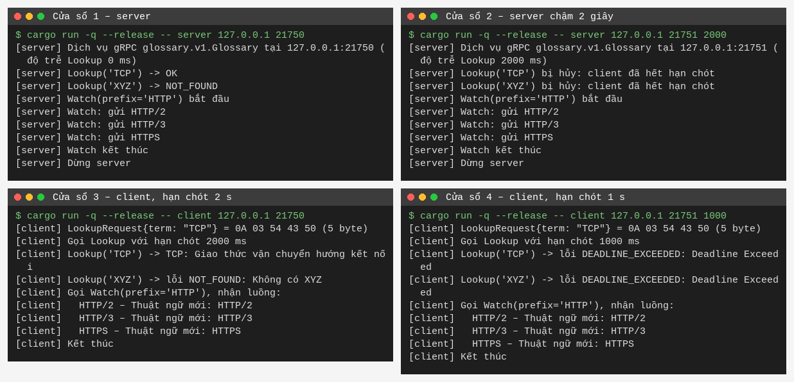

# Bài 7.5 – Dịch vụ gRPC tra cứu thuật ngữ (Rust)

| Thông tin | Nội dung |
|---|---|
| Mã giả tương ứng | Mã giả 7.6 (Cài đặt và gọi dịch vụ gRPC – mã nghiệp vụ) |
| Mục giáo trình | 7.4.2 Protocol Buffers, 7.4.3 Bốn kiểu gọi và cơ chế truyền trên HTTP/2 |
| Kế thừa | Mã giả 3.7 (nhánh "lookup" của PROCESS_REQUEST thành phương thức Lookup) |
| Thư viện | NGOẠI LỆ thư viện: crate `tonic` 0.12.3, `prost` 0.13.5, `tonic-build` 0.12.3, `protoc-bin-vendored` 3.1.0 (sinh mã khi biên dịch); `tokio`, `tokio-stream` |

## Mục tiêu
Cài đặt phần nghiệp vụ của dịch vụ gRPC theo hợp đồng `tra_cuu.proto` (Mục 7.4.2): kiểu `GlossaryService` cài đặt trait cơ sở do công cụ sinh, phương thức unary `Lookup` (báo `NOT_FOUND` bằng mã trạng thái gRPC) và phương thức luồng từ server `Watch` (lọc theo tiền tố, dừng khi client hủy); phía client gọi `Lookup` có hạn chót và đọc luồng `Watch`. Client in cách mã hóa Protocol Buffers của `LookupRequest{term: "TCP"}` để đối chiếu với ví dụ 5 byte `0A 03 54 43 50` của giáo trình. Bài tập “Dịch vụ gRPC có hạn chót” được minh họa bằng server cố ý chậm 2 giây và client đặt hạn chót 1 giây.

## Tệp
- `tra_cuu.proto` – hợp đồng dịch vụ (bản sao nguyên văn của tệp dùng chung ở các ngôn ngữ khác).
- `build.rs` – sinh mã Rust từ `tra_cuu.proto` bằng `tonic-build` mỗi khi biên dịch (dùng `protoc` đóng gói trong `protoc-bin-vendored`).
- `src/main.rs` – phân nhánh theo tham số `server` / `client`; mô-đun `pb` chứa mã sinh (`tonic::include_proto!`).
- `src/glossary_server.rs` – `GlossaryService` cài đặt trait `Glossary`: `lookup`, `watch`; server `tonic::transport::Server`.
- `src/glossary_client.rs` – gọi `Lookup` có hạn chót, đọc luồng `Watch`.
- `Cargo.toml`, `Cargo.lock` – gói Cargo `bai7_5_grpc`.
- `demo.json` – kịch bản chạy minh họa (dùng với `tools/demo.py`).
- `ket_qua.txt`, `ket_qua.png` – kết quả thực thi thật.

## Cách chạy
```bash
cargo build --release            # lần đầu tải crate từ crates.io và sinh mã từ tra_cuu.proto
```
```bash
# Cửa sổ 1 – server
cargo run --release -- server 0.0.0.0 5001
# Cửa sổ 2 – client (hạn chót mặc định 2000 ms)
cargo run --release -- client 127.0.0.1 5001
# Bài tập hạn chót: server chậm 2 giây, client chờ 1 giây
cargo run --release -- server 0.0.0.0 5002 2000
cargo run --release -- client 127.0.0.1 5002 1000
```

## Kết quả thực thi


`LookupRequest{term: "TCP"}` được mã hóa đúng 5 byte `0A 03 54 43 50` như Mục 7.4.2. Với server bình thường, `Lookup('TCP')` thành công, `Lookup('XYZ')` nhận `NOT_FOUND` và `Watch` trả ba thuật ngữ bắt đầu bằng “HTTP”. Với server chậm 2 giây, cả hai lời gọi `Lookup` có hạn chót 1 giây nhận `DEADLINE_EXCEEDED`, đồng thời server ghi nhận lời gọi bị hủy: hạn chót được truyền sang server qua `grpc-timeout` nên server dừng xử lý.

## Ghi chú
- Trait cơ sở `Glossary` (server) và kiểu `GlossaryClient` do `tonic-build` sinh (tương ứng `GlossaryBase`, `GlossaryClient` của mã giả); mã sinh nằm trong thư mục build của Cargo (`rust/target`), không lưu trong kho.
- `RAISE RpcError(NOT_FOUND, …)` là `Err(Status::not_found(…))`; `stream.write(t)` là gửi vào kênh `mpsc` được bọc thành luồng (`ReceiverStream`); `ctx.cancelled` là `stream.is_closed()` (client hủy thì đầu nhận của kênh bị hủy); `deadline ← 2000` là `Request::set_timeout` (gửi tiêu đề `grpc-timeout`).
- Khi hết hạn chót, tonic hủy bỏ tác vụ đang xử lý `Lookup` ở server; giá trị `CancelGuard` bị hủy theo và in dòng "bị hủy" (Rust không có ngoại lệ hủy như `CancelledError` của Python).
- tonic không tự áp hạn chót ở phía client (chỉ gửi `grpc-timeout`), nên client bọc lời gọi trong `tokio::time::timeout` và báo `DEADLINE_EXCEEDED` khi hết giờ. Server tonic 0.12 báo hết `grpc-timeout` bằng mã `CANCELLED` "Timeout expired" (đặc tả gRPC quy định `DEADLINE_EXCEEDED`); vì hai bên hết giờ gần như cùng lúc, client quy trường hợp này về `DEADLINE_EXCEEDED` để kết quả ổn định.
- Tệp `tra_cuu.proto` giống nguyên văn các ngôn ngữ khác (dòng chú thích trong tệp vẫn ghi "ba ngôn ngữ"); các dòng `option csharp_namespace`, `java_package`, `java_multiple_files` bị trình sinh mã Rust bỏ qua. `Import` và `Sync` có trong hợp đồng nhưng không được cài đặt (gọi sẽ nhận `UNIMPLEMENTED`), đúng phạm vi của Mã giả 7.6.
- Mã giả dùng `https://glossary.local:5001` (HTTP/2 trên TLS); bài chạy HTTP/2 không mã hóa (h2c, địa chỉ `http://…`) trên máy cục bộ cho phòng thí nghiệm. Triển khai thật phải dùng TLS (Chương 8).
- `CHANGES_FEED()` được mô phỏng bằng danh sách cố định HTTP/2, QUIC, HTTP/3, gRPC, HTTPS, mỗi 0,5 giây một mục; `Watch(prefix='HTTP')` nhận ba mục.
- Tham số thứ ba của server là độ trễ cố ý của `Lookup` (ms), dùng cho bài tập hạn chót; mặc định 0. Server chỉ nhận địa chỉ IP dạng số (ví dụ `0.0.0.0`, `127.0.0.1`).
- Đã thử chéo: client Rust với server Python (grpcio 1.85.1) và client Python với server Rust, kết quả giống hệt.
- Kiểm thử: Linux, Rust 1.97.0, tonic 0.12.3, prost 0.13.5, tokio 1.54.1.
