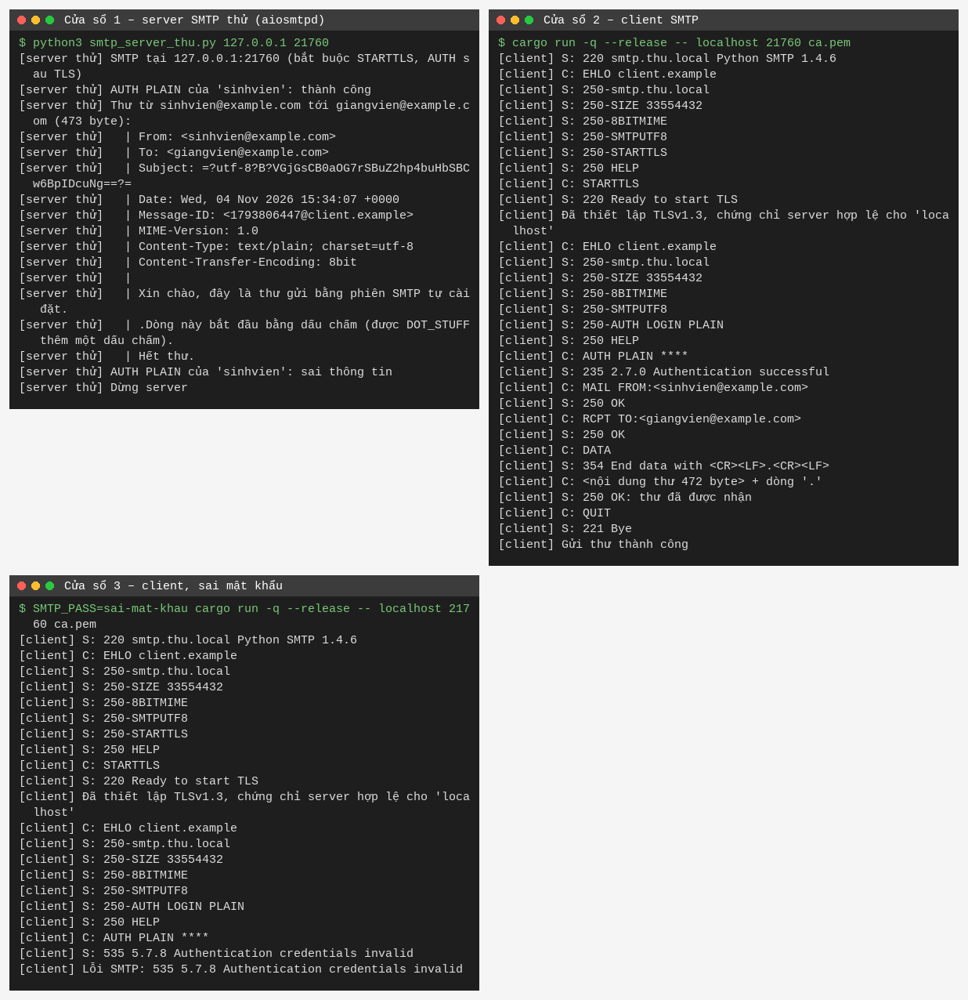

# Bài 7.6 – Phiên gửi thư SMTP có STARTTLS và xác thực (Rust)

| Thông tin | Nội dung |
|---|---|
| Mã giả tương ứng | Mã giả 7.7 (Phiên gửi thư SMTP có STARTTLS và xác thực) |
| Mục giáo trình | 7.5.1 Thư điện tử: SMTP và IMAP |
| Kế thừa | Mã giả 2.2 (SAFE_CONNECT), Mã giả 3.5 (READ_LINE); TLS_WRAP (Mục 8.4) |
| Thư viện | Thư viện chuẩn: `std::net`, `std::io`; crate `rustls` (bộ mật mã `ring`), `base64`; server thử: `aiosmtpd` (PyPI, dùng chung với các ngôn ngữ khác) |

## Mục tiêu
Cài đặt `SMTP_REPLY` (phản hồi nhiều dòng `250-…`/`250 …`), `CMD` (gửi lệnh, so chữ số đầu của mã), `SEND_MAIL` (lời chào 220, EHLO, STARTTLS, nâng cấp TLS có kiểm tra chứng chỉ và tên máy, EHLO lại, AUTH PLAIN, MAIL FROM, RCPT TO, DATA, nội dung kết thúc bằng dòng `.`, QUIT) và `DOT_STUFF`. Thư thử có Subject tiếng Việt mã hóa MIME và một dòng bắt đầu bằng dấu chấm. Server thử nghiệm cục bộ (aiosmtpd) bắt buộc STARTTLS và chỉ cho AUTH sau TLS.

## Tệp
- `src/main.rs` – Mã giả 7.7: `smtp_reply`, `cmd`, `send_mail`, `dot_stuff`, `build_message`, `Reader`.
- `smtp_server_thu.py` – server SMTP thử nghiệm (aiosmtpd): bắt buộc STARTTLS, AUTH PLAIN/LOGIN sau TLS, in thư nhận được; giống tệp của các ngôn ngữ khác.
- `tao_chung_chi.sh` – tạo CA nội bộ `ca.pem` và chứng chỉ server `cert.pem`/`key.pem` do CA ký (CN và SAN: `localhost`, `127.0.0.1`) bằng openssl (khác bản Python, xem Ghi chú).
- `chay_server_thu.sh` – tạo chứng chỉ nếu chưa có rồi khởi động server thử.
- `requirements.txt` – `aiosmtpd` cho server thử.
- `Cargo.toml`, `Cargo.lock` – gói Cargo `bai7_6_smtp`.
- `demo.json` – kịch bản chạy minh họa (dùng với `tools/demo.py`).
- `ket_qua.txt`, `ket_qua.png` – kết quả thực thi thật.

## Cách chạy
Chuẩn bị server thử (cần Python ≥ 3.11 và openssl; trên Windows chạy các lệnh `sh` bằng Git Bash hoặc WSL):
```bash
pip install -r requirements.txt
# Cửa sổ 1 – server thử (tạo ca.pem, cert.pem, key.pem nếu chưa có); cổng 587 cần quyền quản trị nên dùng 2525
sh chay_server_thu.sh 127.0.0.1 2525
```
Tài khoản thử lấy từ biến môi trường `SMTP_USER`, `SMTP_PASS` (mặc định `sinhvien` / `matkhau-thu`); client đọc cùng hai biến này.
```bash
# Cửa sổ 2 – client (host, cổng, tệp CA)
cargo build --release
export SMTP_USER=sinhvien SMTP_PASS=matkhau-thu
cargo run --release -- localhost 2525 ca.pem
```

## Kết quả thực thi


Cửa sổ client in toàn bộ hội thoại `C:`/`S:`: danh sách mở rộng trước TLS có `STARTTLS` nhưng chưa có `AUTH`; sau STARTTLS (TLS 1.3, chứng chỉ được kiểm tra với `ca.pem` và tên `localhost`) danh sách có `AUTH LOGIN PLAIN`; xác thực 235, DATA 354, thư được nhận 250. Server thử in thư nhận được, trong đó dòng bắt đầu bằng dấu chấm đã được server bỏ dấu chấm thêm vào. Cửa sổ thứ ba chạy với mật khẩu sai: server trả 535 và client báo lỗi SMTP thay vì gửi tiếp.

## Ghi chú
- `TLS_WRAP(s, CLIENT, host)` là `rustls::ClientConnection::new(config, ServerName(host))` bọc socket bằng `StreamOwned`; `config` chỉ tin cậy chứng chỉ trong tệp CA (`RootCertStore`), rustls luôn kiểm tra chứng chỉ và tên máy. Bắt tay được hoàn tất tường minh (`complete_io`) để lỗi chứng chỉ được báo là "Lỗi TLS".
- rustls (qua webpki) từ chối chứng chỉ tự ký có `CA:TRUE` làm chứng chỉ server (lỗi `CaUsedAsEndEntity`), trong khi `tao_chung_chi.sh` của bản Python tạo đúng loại chứng chỉ đó. Bản Rust vì vậy tạo CA nội bộ `ca.pem` (có `keyUsage`) và dùng CA ký `cert.pem`; server thử vẫn nạp `cert.pem`, `key.pem` như cũ, client tin cậy `ca.pem` (tham số mặc định). Truyền `cert.pem` làm tệp CA sẽ nhận `UnknownIssuer` (đã thử). Các tệp `.pem` được tạo khi chạy và không lưu trong kho (`key.pem` là khóa riêng).
- Bản Rust không hỗ trợ tham số `-` (kho chứng chỉ của hệ điều hành) để không thêm crate; cần tệp CA ở dạng PEM.
- Mật khẩu không ghi trong mã nguồn mà lấy từ biến môi trường; dòng AUTH được in dạng `AUTH PLAIN ****`.
- Sau STARTTLS, `Reader` cũ bị bỏ (chỉ lấy lại socket) và `Reader` mới bọc luồng TLS, nên mọi byte nhận trước khi bắt tay TLS bị bỏ, tránh lỗi chèn lệnh vào phiên đã mã hóa. `Reader<S: Read + Write>` dùng chung cho socket thường và luồng TLS.
- `SMTP_REPLY` theo Mã giả 7.7: dòng `NULL` (server đóng kết nối) hoặc ngắn hơn 3 ký tự (ở đây gồm cả ba ký tự đầu không phải chữ số) là `ProtocolError`; dòng chỉ gồm mã ba chữ số (RFC 5321 cho phép bỏ phần văn bản) là dòng cuối.
- Ngoài mã giả: kiểm tra mã lời chào là 220. Thân thư dùng `Content-Transfer-Encoding: 8bit` và server thử có quảng bá 8BITMIME; client đầy đủ nên gửi `BODY=8BITMIME` hoặc mã hóa quoted-printable/base64. Tiêu đề `Date` được tạo theo giờ UTC bằng phép đổi ngày tự viết (thư viện chuẩn Rust không có lịch).
- Mã giả cố định cổng 587; bài nhận cổng qua tham số (mặc định 587) để chạy server thử ở cổng không đặc quyền. Ứng dụng thật nên dùng thư viện SMTP/MIME (ví dụ crate `lettre`).
- Kiểm thử: Linux, Rust 1.97.0, rustls 0.23.46 (ring 0.17.14), base64 0.22.1; server thử Python 3.13.18, aiosmtpd 1.4.6, OpenSSL 3.0.13.
