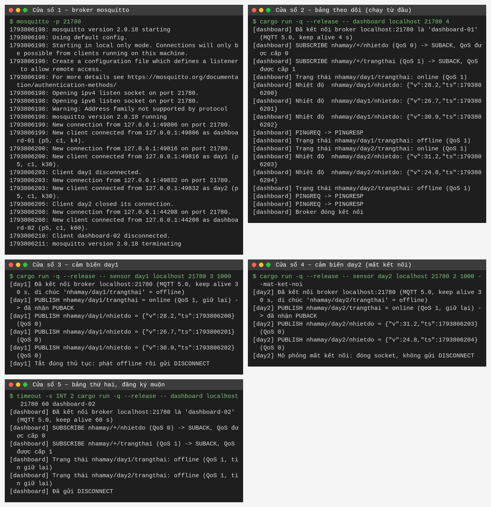

# Bài 7.8 – Thiết bị cảm biến và bảng theo dõi dùng MQTT (Rust)

| Thông tin | Nội dung |
|---|---|
| Mã giả tương ứng | Mã giả 7.9 (Thiết bị cảm biến và bảng theo dõi dùng MQTT) |
| Mục giáo trình | 7.5.5 MQTT |
| Kế thừa | Mã giả 6.6 (broker phát lại theo chủ đề), mô hình publish/subscribe Mục 1.3.3; RECV_EXACT (Mã giả 3.4) |
| Thư viện | Thư viện chuẩn: `std::net::TcpStream`, `std::io`; crate `ctrlc` (bắt Ctrl+C ở bảng theo dõi); broker: Mosquitto |

## Mục tiêu
Cài đặt hai thủ tục của Mã giả 7.9: `SENSOR` kết nối với di chúc (Last Will) `offline` giữ lại, phát `online` (QoS 1, giữ lại), rồi phát số đo JSON `{v, ts}` với QoS 0 theo chu kỳ; `DASHBOARD` đăng ký `nhamay/+/nhietdo` (QoS 0) và `nhamay/+/trangthai` (QoS 1) rồi chạy vòng sự kiện. Như các ngôn ngữ khác, bài tự cài đặt client MQTT 5.0 tối giản trên socket TCP: CONNECT/CONNACK, PUBLISH QoS 0 và 1 (PUBACK), SUBSCRIBE/SUBACK, PINGREQ/PINGRESP, DISCONNECT – một ví dụ nữa của định khung tiền tố độ dài (varint “độ dài còn lại”).

## Tệp
- `src/main.rs` – phân nhánh theo tham số `sensor` / `dashboard`; đọc tham số.
- `src/mqtt_mini.rs` – client MQTT 5.0 tối giản: mã hóa gói, `read_packet`, `connect`, `publish`, `subscribe`, `run_event_loop`, `disconnect`, `topic_matches`.
- `src/sensor.rs` – Mã giả 7.9, `SENSOR`.
- `src/dashboard.rs` – Mã giả 7.9, `DASHBOARD` với `on_temp` (ON_TEMP), `on_status` (ON_STATUS).
- `Cargo.toml`, `Cargo.lock` – gói Cargo `bai7_8_mqtt`.
- `demo.json` – kịch bản chạy minh họa (dùng với `tools/demo.py`).
- `ket_qua.txt`, `ket_qua.png` – kết quả thực thi thật.

## Cách chạy
Cần broker MQTT, ví dụ Mosquitto (`apt install mosquitto` trên Linux; bản cài đặt cho Windows tại mosquitto.org). Mosquitto 2.x khi chạy không có tệp cấu hình chỉ nhận kết nối từ máy cục bộ và cho phép client ẩn danh.
```bash
cargo build --release
# Cửa sổ 1 – broker
mosquitto -p 1883
# Cửa sổ 2 – bảng theo dõi (Ctrl+C để dừng)
cargo run --release -- dashboard localhost 1883
# Cửa sổ 3 – cảm biến day1 chạy mãi, mỗi 5 giây một số đo
cargo run --release -- sensor day1 localhost 1883
# Cửa sổ 4 – cảm biến day2: 2 số đo, chu kỳ 1 s, rồi mô phỏng mất kết nối
cargo run --release -- sensor day2 localhost 1883 2 1000 --mat-ket-noi
```

## Kết quả thực thi


Bảng theo dõi (keep alive 4 s) nhận số đo của cả hai dây nhờ ký tự đại diện `+`, nhận `online`/`offline` của day1 (day1 tắt đúng thủ tục: phát `offline` rồi DISCONNECT, broker ghi “disconnected”) và `offline` của day2 do broker phát từ di chúc khi day2 đóng socket không gửi DISCONNECT (broker ghi “closed its connection”); khi im lặng, bảng gửi PINGREQ mỗi 2 giây và nhận PINGRESP. Bảng thứ hai đăng ký muộn nhận ngay hai tin trạng thái giữ lại (cờ retain) dù không còn thiết bị nào kết nối, rồi gửi DISCONNECT khi nhận Ctrl+C (lệnh `timeout -s INT`; broker ghi “disconnected”). Cuối kịch bản broker dừng trước nên bảng thứ nhất báo broker đóng kết nối.

## Ghi chú
- Phiên bản giao thức: MQTT 5.0 (mức giao thức 5) theo Mục 7.5.5; Mosquitto 2.0.18 chấp nhận (nhật ký ghi `p5`). Client luôn gửi độ dài thuộc tính 0 và bỏ qua thuộc tính nhận được; không hỗ trợ QoS 2, phiên lưu (Clean Start luôn bật), tên/mật khẩu.
- Khác mã giả: mã giả kết nối `broker.local:8883` với TLS; bài kết nối TCP không mã hóa tới broker cục bộ (mặc định `localhost:1883`) vì client tối giản chưa có TLS (Chương 8). Bảng theo dõi nhận thêm tham số keep alive và client_id (mặc định 60 s và `dashboard-01`) để minh họa PINGREQ và bảng thứ hai.
- Thêm so với mã giả: số lần đo và chu kỳ (mặc định 0 = chạy mãi, 5000 ms như `SLEEP(5000)`), cách kết thúc đúng thủ tục (phát `offline` rồi DISCONNECT – di chúc bị broker hủy khi nhận DISCONNECT mã 0) và tùy chọn `--mat-ket-noi` mô phỏng mất điện để quan sát di chúc. `READ_SENSOR()` trả giá trị ngẫu nhiên 24–32 °C (lấy từ khóa băm của `RandomState` vì thư viện chuẩn Rust không có bộ sinh số ngẫu nhiên); JSON số đo được ghép bằng `format!`.
- Keep alive tính theo thời điểm client GỬI gói cuối (đặc tả yêu cầu client gửi một gói điều khiển trong mỗi khoảng keep alive); client gửi PINGREQ khi đã im lặng nửa khoảng. Chỉ byte đầu của gói được chờ với thời gian đến lần ping kế tiếp (`set_read_timeout`), nên hết giờ không làm mất byte của gói đang đọc dở.
- Thư viện chuẩn Rust không có hàm bắt Ctrl+C; bảng theo dõi dùng crate `ctrlc`: hàm xử lý chạy ở luồng riêng, gửi gói DISCONNECT (2 byte `E0 00`) qua bản sao socket (`try_clone`), in "Đã gửi DISCONNECT" rồi kết thúc chương trình. Lời gọi `read` đang chờ ở luồng chính bị tín hiệu ngắt (`Interrupted`) được gọi lại thay vì coi là lỗi.
- Hai client trùng client_id thì broker ngắt client cũ (session takeover), nên bảng thứ hai dùng `dashboard-02`.
- Kiểm thử: Linux, Rust 1.97.0, ctrlc 3.4.7, Mosquitto 2.0.18.
