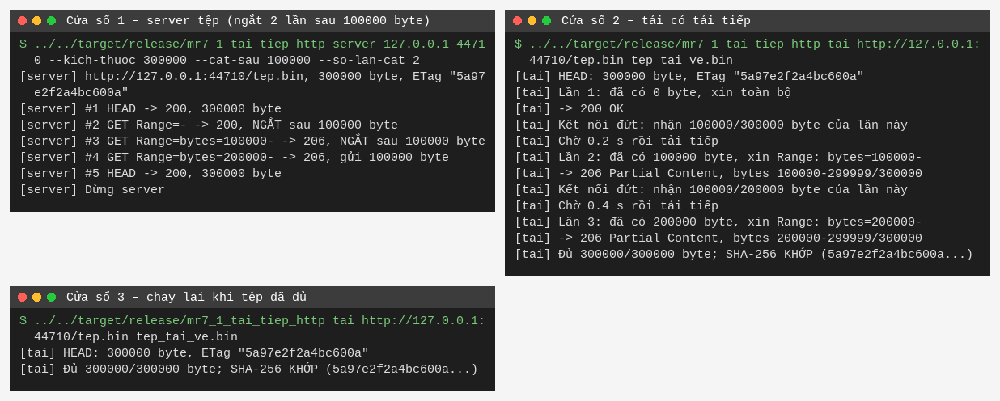

# Bài mở rộng MR7.1 – Tải tệp HTTP có tải tiếp (Range, If-Range) (Rust)

| Thông tin | Nội dung |
|---|---|
| Loại | **Bài mở rộng** – không có trong giáo trình, không có mã giả tương ứng |
| Liên hệ với giáo trình | Chương 7: Bài 7.1 (client HTTP); Chương 5: Bài 5.5 (tải tệp), Bài 5.6 (thử lại có lùi thời gian); Chương 3: Bài 3.4 (kiểm tra SHA-256) |
| Thư viện | Thư viện chuẩn Rust: `std::net` (HTTP/1.1 viết tay), `std::io::BufReader`, `std::fs::OpenOptions` (ghi nối); crate `sha2` 0.10.9, `ctrlc` 3.4.7 |
| Bản ngôn ngữ khác | [C#](../../../csharp/Chuong07/BaiMR7.1_TaiTiepHTTP/), [Java](../../../java/Chuong07/BaiMR7.1_TaiTiepHTTP/), [Python](../../../python/Chuong07/BaiMR7.1_TaiTiepHTTP/), [Go](../../../go/Chuong07/BaiMR7.1_TaiTiepHTTP/) |

## Mục tiêu
Khi tải tệp lớn mà kết nối đứt giữa chừng, tải lại từ đầu là lãng phí. HTTP cho phép xin một phần tài nguyên (RFC 9110): client gửi `Range: bytes=<đã_có>-`, server trả `206 Partial Content` kèm `Content-Range`. Tiêu đề `If-Range: <ETag>` bảo đảm chỉ nối tiếp khi tệp trên server chưa đổi (nếu đã đổi, server trả `200` toàn bộ). Server trong bài giả lập sự cố: hai yêu cầu GET đầu tiên bị ngắt sau 100 000 byte; client tự thử lại có lùi thời gian, nối tiếp từ chỗ dừng và kiểm tra SHA-256 khi xong.

## Tệp
- `Cargo.toml`, `Cargo.lock` – gói Cargo `mr7_1_tai_tiep_http`.
- `src/main.rs` – phân nhánh vai trò `server` / `tai`, hàm `sha256_hex`.
- `src/http.rs` – đọc dòng đầu và tiêu đề HTTP/1.1 (`read_head`), dùng chung cho hai vai trò.
- `src/server.rs` – server tệp: HEAD, GET có `Range`/`If-Range`, 416, giả lập ngắt kết nối.
- `src/tai_tiep.rs` – client tải tiếp: `head`, `get_range`, vòng thử lại, kiểm tra SHA-256.
- `demo.json` – kịch bản chạy minh họa (dùng với `tools/demo.py`).
- `ket_qua.txt`, `ket_qua.png` – kết quả thực thi thật.

## Cách chạy
Trong thư mục bài (`cargo build -q --release` một lần; `B=../../target/release/mr7_1_tai_tiep_http`):
```bash
$B server 127.0.0.1 8000 --kich-thuoc 300000 --cat-sau 100000 --so-lan-cat 2   # cửa sổ 1
$B tai http://127.0.0.1:8000/tep.bin tep_tai_ve.bin                           # cửa sổ 2
```
Thử thêm bằng curl: `curl -H "Range: bytes=10-19" -o - http://127.0.0.1:8000/tep.bin | xxd` (206), `-H "Range: bytes=400000-"` (416), `-H "Range: bytes=10-" -H 'If-Range: "khac"'` (200 toàn bộ). Kịch bản `demo.json` (cổng 44710) xóa `tep_tai_ve.bin` trước khi chạy; xóa tệp này sau khi thử.

Tái lập kết quả từ thư mục gốc của kho: `python3 tools/demo.py rust/Chuong07/BaiMR7.1_TaiTiepHTTP`.

## Kết quả thực thi


Lần 1 xin toàn bộ, nhận `200` nhưng chỉ được 100 000/300 000 byte thì kết nối đứt; lần 2 xin `bytes=100000-`, nhận `206` nhưng lại đứt sau 100 000 byte; lần 3 xin `bytes=200000-` và nhận đủ phần còn lại. Thời gian chờ giữa các lần tăng gấp đôi (0,2 s rồi 0,4 s). Tệp ghép lại có SHA-256 khớp với giá trị server công bố. Lần chạy thứ hai thấy tệp đã đủ nên không gửi GET nào. Bản Rust cho cùng kết quả và cùng thông điệp với bản Python và Go (cùng nội dung tệp, cùng ETag). Đã thử chạy chéo: client Python tải từ server Rust và client Rust tải từ server Python (có ngắt) – SHA-256 KHỚP; ba lệnh curl ở trên cho 206, 416, 200 với server Rust.

## Ghi chú
- ETag ở đây là 16 ký tự đầu của SHA-256 nội dung (ETag mạnh). `X-Checksum-SHA256` là tiêu đề tự đặt cho bài; chuẩn hiện hành cho mã băm nội dung là trường `Repr-Digest` (RFC 9530).
- Bản Rust viết tay cả server lẫn client HTTP/1.1 trên `TcpStream` (một yêu cầu mỗi kết nối, `Connection: close`) để thấy rõ từng tiêu đề; tự phân tích `Range`, chỉ hỗ trợ một dải dạng `a-` hoặc `a-b` (không hỗ trợ nhiều dải `multipart/byteranges` hay dạng hậu tố `-n`). Ứng dụng thật nên dùng crate `reqwest`/`hyper`.
- Khi server đóng kết nối sớm, `read` trả 0 (EOF) – không phải lỗi. Client phải tự so số byte đã nhận với `Content-Length` (cùng bài học “TCP EOF chưa chắc là đủ dữ liệu” ở Chương 3).
- Tệp được mở bằng `OpenOptions::new().append(true)` để ghi nối phần nhận được ở mỗi lần tải tiếp.
- Kiểm thử: Linux, Rust 1.97.0.

## Đọc thêm
- Matt Butcher, Matt Farina, *Go in Practice*, Manning, 2016, Chương 8 (Technique 49 *Detecting timeouts*, Technique 50 *Timing out and resuming with HTTP*).
- M. O. Faruque Sarker, *Python Network Programming Cookbook*, Packt, 2014, Chương 4 (công thức *Writing an HTTP fail-over client with resume and partial downloading*; sách dùng `urllib.FancyURLopener` của Python 2, không còn trong Python 3).

Mã nguồn của bài được viết mới cho kho này; sách trên chỉ là tài liệu tham khảo ý tưởng.
