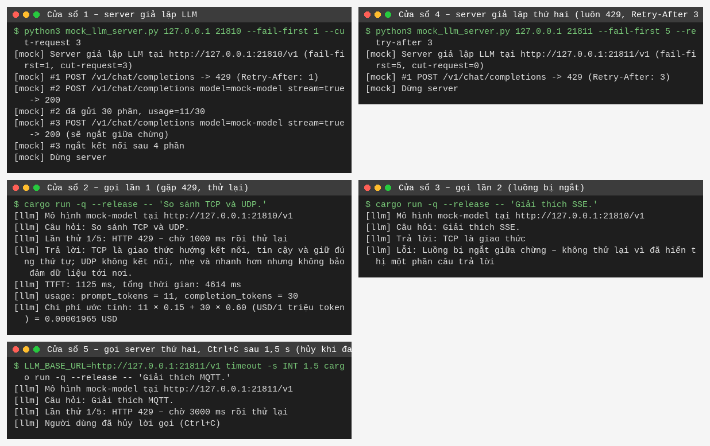

# Bài 8.1 – Gọi API LLM: truyền luồng SSE, giới hạn tần suất, thử lại (Rust)

| Thông tin | Nội dung |
|---|---|
| Mã giả tương ứng | Mã giả 8.1 (Nhận câu trả lời của LLM theo luồng SSE), Mã giả 8.2 (Gọi LLM có giới hạn tần suất, thử lại và hạn chót) |
| Mục giáo trình | 8.2.2 Truyền luồng kết quả bằng SSE, 8.2.3 Giới hạn tần suất, thử lại và thời gian chờ, 8.2.5 Chi phí |
| Kế thừa | Mã giả 7.5 (SSE_READ), Mã giả 7.1 (READ_HEADERS, READ_CHUNKED), Mã giả 5.8 (RETRY_ASYNC), Mã giả 8.3 (ACQUIRE_TOKENS), lớp NetError của Mã giả 2.2 |
| Thư viện | Thư viện chuẩn: `std::net`, `std::io`, `std::thread`; crate `serde_json`, `rustls` + `rustls-native-certs` (khi `LLM_BASE_URL` là `https://`), `ctrlc` (tín hiệu hủy) |

## Mục tiêu
Gọi API mô hình ngôn ngữ lớn theo định dạng tương thích OpenAI Chat Completions (`POST {LLM_BASE_URL}/chat/completions`, `"stream": true`), hiển thị từng phần câu trả lời ngay khi nhận sự kiện SSE, đo TTFT và tổng thời gian, ghi nhận `usage` và tính chi phí theo Công thức (8.1). Lời gọi được bọc trong thủ tục thử lại có lùi thời gian và nhiễu ngẫu nhiên, tôn trọng `Retry-After` khi gặp mã 429, chỉ thử lại khi chưa nhận token nào, tự giới hạn tần suất bằng thùng token và dừng được bằng tín hiệu hủy `ct` (Ctrl+C). Khóa API chỉ lấy từ biến môi trường. Demo dùng server giả lập cục bộ `mock_llm_server.py`, không gọi dịch vụ LLM thật.

## Tệp
- `src/main.rs` – chương trình chính: đọc cấu hình, cài Ctrl+C làm tín hiệu hủy, in câu trả lời, TTFT, usage, chi phí.
- `src/llm_client.rs` – CALL_LLM(req, on_token, ct) (Mã giả 8.2), RETRY (Mã giả 5.8), SECRET, ESTIMATE_TOKENS, PARSE_RETRY_AFTER.
- `src/llm_stream.rs` – lỗi `CallError` (NetError, Timeout, Cancelled), SSE_READ (Mã giả 7.5), STREAM_COMPLETION (Mã giả 8.1).
- `src/https_post.rs` – HTTPS_POST tối giản trên socket (dòng yêu cầu, READ_HEADERS, giải mã chunked dạng luồng, TLS bằng rustls) và `CancelToken`.
- `src/thung_token.rs` – ACQUIRE_TOKENS (Mã giả 8.3, bản đồng bộ chép gọn).
- `mock_llm_server.py` – server giả lập API LLM (Python, thư viện chuẩn), giống tệp của các ngôn ngữ khác: phát luồng SSE mã hóa khối, trả 401 khi thiếu khóa, `--fail-first N` trả 429 kèm `Retry-After` cho N yêu cầu đầu, `--cut-request K` ngắt kết nối giữa luồng ở yêu cầu thứ K.
- `Cargo.toml`, `Cargo.lock` – gói Cargo `bai8_1_goi_llm`.
- `demo.json` – kịch bản chạy minh họa (dùng với `tools/demo.py`).
- `ket_qua.txt`, `ket_qua.png` – kết quả thực thi thật.

## Cách chạy
```bash
cargo build --release
# Cửa sổ 1 – server giả lập
python3 mock_llm_server.py 127.0.0.1 9000 --fail-first 1 --cut-request 3
# Cửa sổ 2 – client
export LLM_BASE_URL=http://127.0.0.1:9000/v1 LLM_API_KEY=khoa-thu-nghiem LLM_MODEL=mock-model
export LLM_PRICE_IN=0.15 LLM_PRICE_OUT=0.60      # tùy chọn: đơn giá USD/1 triệu token
cargo run --release -- "So sánh TCP và UDP."
```
Trên Windows (PowerShell) đặt biến bằng `$env:LLM_API_KEY = "khoa-thu-nghiem"`, tương tự cho các biến khác. Khóa API không được ghi vào mã nguồn hay tệp cấu hình đưa lên kho mã. Nhấn Ctrl+C trong lúc chờ hoặc đang nhận luồng để hủy lời gọi.

## Kết quả thực thi


Lần gọi thứ nhất nhận 429 kèm `Retry-After: 1`, chương trình chờ 1 000 ms rồi thử lại và nhận câu trả lời theo luồng; TTFT đo từ lúc bắt đầu gọi nên gồm cả thời gian chờ thử lại. Lần gọi thứ hai bị server giả lập ngắt giữa luồng: không gặp `[DONE]` nên chương trình báo "Luồng bị ngắt giữa chừng" và không thử lại vì đã hiển thị một phần câu trả lời. Cửa sổ 5 (bổ sung so với bản Python) gọi server giả lập thứ hai luôn trả 429 với `Retry-After: 3`; Ctrl+C ở giây thứ 1,5 (lệnh `timeout -s INT`) dừng ngay khoảng chờ giữa hai lần thử, không gửi thêm yêu cầu nào (server thứ hai chỉ nhận yêu cầu #1).

## Ghi chú
- Thư viện chuẩn Rust không có client HTTP; `https_post.rs` tự viết phần cần thiết dựa trên Bài 7.1 và 7.4: gửi `POST` có `Content-Length`, đọc dòng trạng thái và tiêu đề, trả thân dưới dạng luồng (`Body` cài đặt `std::io::Read`, đã giải mã chunked). URL `https://` được bọc TLS bằng rustls, tin cậy kho chứng chỉ của hệ điều hành (`rustls-native-certs`, trên Linux tôn trọng biến `SSL_CERT_FILE`). Nhánh TLS đã được thử với server giả lập bọc TLS cục bộ (CA của phòng lab qua `SSL_CERT_FILE`): nhận đủ câu trả lời; không tin cậy CA thì báo "Lỗi TLS … UnknownIssuer" và không thử lại.
- Theo Mã giả 8.2 và 5.8 hiện hành, CALL_LLM nhận tín hiệu hủy `ct` và truyền xuống RETRY và HTTPS_POST. `CancelToken` là cờ nguyên tử kèm bản sao socket đang dùng: Ctrl+C (crate `ctrlc`) gọi `cancel()`, đặt cờ và đóng socket nên lời gọi đọc đang chờ trả về ngay; khoảng chờ giữa hai lần thử ngủ từng đoạn 50 ms và kiểm tra cờ. `Cancelled` không được RETRY bắt nên không thử lại. RETRY bắt `Timeout` (hết thời gian chờ kết nối hoặc chờ phản hồi) và luôn coi là đáng thử lại; NetError chỉ thử lại khi `retry` bằng TRUE.
- `ESTIMATE_TOKENS` không được giáo trình định nghĩa; bài dùng ước lượng thô: tổng số ký tự các thông điệp chia 4, cộng `max_tokens`. Thùng token đặt dung lượng 20 000, nạp 2 000 token/giây (hạn mức tự đặt để minh họa).
- Lỗi kết nối được ánh xạ như Mã giả 2.2: bị từ chối → `REFUSED`, không thử lại (đã thử); không tới được → `UNREACHABLE`, thử lại; hết thời gian chờ → `Timeout`.
- Thời gian chờ kết nối 3 000 ms; thời gian chờ mỗi lần đọc 30 000 ms đóng vai thời gian chờ nhàn rỗi giữa hai sự kiện của luồng (Mục 8.2.3).
- `PARSE_RETRY_AFTER` nhận cả số giây lẫn ngày giờ HTTP (`Sun, 06 Nov 1994 08:49:37 GMT`, đổi ngày bằng phép tính tự viết vì thư viện chuẩn Rust không có lịch). Nhiễu ngẫu nhiên lấy từ khóa băm của `RandomState`.
- Đơn giá tính chi phí lấy từ `LLM_PRICE_IN`, `LLM_PRICE_OUT` (USD cho 1 triệu token); không đặt thì không in chi phí.
- Đổi sang dịch vụ thật (Ollama cục bộ `http://localhost:11434/v1` hoặc nhà cung cấp đám mây qua `https://`) chỉ cần đổi `LLM_BASE_URL`, `LLM_MODEL`, `LLM_API_KEY`; cần đối chiếu tài liệu của nhà cung cấp về tên trường và cách xác thực. Bài không gọi dịch vụ LLM thật nào.
- Như bản Python, CALL_LLM, RETRY và ACQUIRE_TOKENS được cài đặt dạng đồng bộ (chờ bằng `thread::sleep`); với chương trình dòng lệnh, hành vi tương đương bản ASYNC của mã giả.
- Kiểm thử: Linux, Rust 1.97.0, serde_json 1.0.154, rustls 0.23.46, rustls-native-certs 0.8.5, ctrlc 3.4.7; server giả lập Python 3.13.18.
