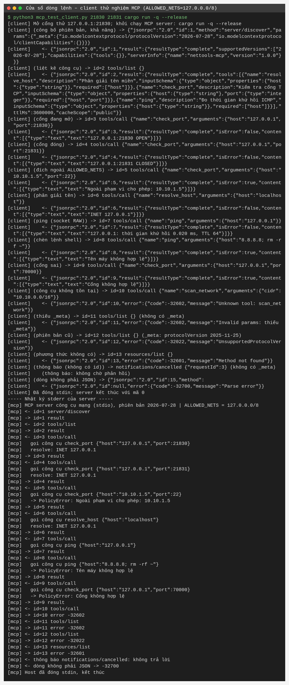

# Bài 8.3 – MCP server công cụ mạng qua kênh stdio (Rust)

| Thông tin | Nội dung |
|---|---|
| Mã giả tương ứng | Mã giả 8.4 (MCP server công cụ mạng qua kênh stdio), Mã giả 8.5 (Thực thi công cụ có kiểm soát đầu vào), Mã giả 8.7 (Kiểm soát đích của công cụ mạng) |
| Mục giáo trình | 8.3.2–8.3.5 Model Context Protocol, 8.5.4 An toàn của MCP server |
| Kế thừa | Mã giả 3.5 (READ_LINE), Mã giả 1.1 (RESOLVE_HOST), Mã giả 1.2 (PORT_CHECK), Mã giả 7.8 (PING) |
| Thư viện | Thư viện chuẩn: `std::io` (stdin/stdout/stderr), `std::net`; crate `serde_json` (JSON-RPC), `socket2` (socket RAW cho ICMP) |

## Mục tiêu
Xây dựng MCP server qua kênh stdio theo đặc tả 2026-07-28 như giáo trình trình bày: JSON-RPC 2.0, mỗi thông điệp một dòng UTF-8 trên stdin/stdout, nhật ký chỉ ghi ra stderr; không có bắt tay `initialize`, mỗi yêu cầu mang `_meta` với `io.modelcontextprotocol/protocolVersion` và `io.modelcontextprotocol/clientCapabilities` (thiếu → −32602, phiên bản không hỗ trợ → −32022 UnsupportedProtocolVersion); `server/discover`, `tools/list` (kèm `ttlMs`, `cacheScope`), `tools/call`; mọi kết quả có `resultType`. Ba công cụ `resolve_host`, `check_port`, `ping` cài đặt bằng socket API, không gọi shell. Lỗi thực thi, lỗi phân giải, hết thời gian chờ và lỗi chính sách trả về kết quả `isError: true`; công cụ không tồn tại trả lỗi JSON-RPC −32602. Đích của `check_port`, `ping` phải nằm trong `ALLOWED_NETS` (Mã giả 8.7): mọi địa chỉ phân giải được đều được kiểm tra, công cụ kết nối đúng địa chỉ đã kiểm tra (chống DNS rebinding).

## Tệp
- `src/main.rs` – MCP_STDIO_SERVER (`main`), DISPATCH, WRITE_MSG (Mã giả 8.4), CALL_TOOL (Mã giả 8.5), TOOLS.
- `src/net_tools.rs` – RESOLVE_HOST, PORT_CHECK, PING (ghi nhật ký ra stderr), `ToolError` (NetError, PolicyError, ResolveError, Timeout), `Cidr`, ALLOWED_NETS và VALIDATE_NAME, VALIDATE_TARGET, VALIDATE_PORT (Mã giả 8.7).
- `mcp_test_client.py` – client thử nghiệm đóng vai host (Python, thư viện chuẩn), giống tệp của các ngôn ngữ khác: khởi chạy server như tiến trình con, gửi 15 thông điệp, in phản hồi, thu riêng stderr của server và in ở cuối; mở sẵn một cổng TCP để `check_port` thấy trạng thái OPEN.
- `Cargo.toml`, `Cargo.lock` – gói Cargo `bai8_3_mcp_server`.
- `demo.json` – kịch bản chạy minh họa (dùng với `tools/demo.py`).
- `ket_qua.txt`, `ket_qua.png` – kết quả thực thi thật.

## Cách chạy
```bash
cargo build --release
ALLOWED_NETS=127.0.0.0/8 python3 mcp_test_client.py 9000 9001 cargo run -q --release
```

Trên Windows (PowerShell) đặt biến trước: `$env:ALLOWED_NETS = "127.0.0.0/8"`. Để dùng với một host MCP thật (ứng dụng chat hỗ trợ MCP, MCP Inspector), cấu hình host khởi chạy trực tiếp tệp thực thi `rust/target/release/bai8_3_mcp_server` (hoặc `cargo run -q --release` trong thư mục bài; `-q` để cargo không in gì thêm) và đặt `ALLOWED_NETS` là dải mạng lab, ví dụ `10.10.0.0/16`. Công cụ `ping` dùng socket RAW nên cần quyền quản trị (root hoặc Administrator).

## Kết quả thực thi


Cổng đang mở cho `127.0.0.1:<cổng> OPEN`, cổng không có chương trình lắng nghe cho `CLOSED`; đích 10.10.1.5 ngoài `ALLOWED_NETS`, chuỗi `8.8.8.8; rm -rf ~` và cổng 70000 đều bị từ chối dưới dạng kết quả `isError: true`; công cụ lạ, thiếu `_meta`, phiên bản 2025-11-25, phương thức lạ và dòng JSON hỏng nhận các mã lỗi −32602, −32602, −32022, −32601, −32700; thông báo không có `id` không được trả lời. Nhật ký stderr cho thấy stdout chỉ chứa thông điệp JSON. Đầu ra trùng với bản Python (trừ số cổng, thời gian khứ hồi).

## Ghi chú
- `DISCOVER_RESULT` không được giáo trình mô tả chi tiết; bài dùng các trường `resultType`, `supportedVersions`, `capabilities`, `serverInfo` (công bố phiên bản, khả năng và định danh như Mục 8.3.4). Cần đối chiếu đặc tả và SDK chính thức của MCP trước khi dùng thật.
- `TOOL(tên, mô tả, tham số)` được mã hóa thành `{name, description, inputSchema}` với `inputSchema` là JSON Schema kiểu `object`, mọi tham số bắt buộc. `serde_json` bật `preserve_order` để thứ tự khóa của thông điệp giống bản Python.
- Theo Mã giả 8.5 hiện hành, CALL_TOOL bắt cả `NetError`, `PolicyError`, `ResolveError` (tên miền không phân giải được trong `VALIDATE_TARGET`) và `Timeout` (PING không nhận Echo Reply trong 2 000 ms) và trả `isError: true`; nhật ký stderr ghi tên loại lỗi. Đã thử thêm `khong-co.invalid` → ResolveError và ping 192.0.2.250 → Timeout. Rust không có ngoại lệ nên lỗi ngoài dự kiến (−32603 của bản Python) không xảy ra theo cách đó; mọi lỗi của công cụ là giá trị `ToolError`.
- Theo Mã giả 8.7 hiện hành, `VALIDATE_NAME` nhận ngay địa chỉ IP dạng số, kể cả IPv6 như `::1` (kiểm tra bằng `str::parse::<IpAddr>`), địa chỉ đó vẫn phải nằm trong `ALLOWED_NETS`; tên miền phải gồm tối đa 253 ký tự `[A-Za-z0-9.-]`. Đã thử `check_port` tới `::1` với `ALLOWED_NETS` chứa `::1/128` (kết quả in dạng `[::1]:cổng`). `ALLOWED_NETS` vắng hoặc rỗng → chặn mọi đích. Thư viện chuẩn Rust không có kiểu mạng CIDR; `Cidr` tự viết so sánh `prefix` bit đầu của địa chỉ (IPv4 và IPv6).
- Theo Mã giả 8.5, `VALIDATE_PORT` báo `PolicyError` nên cổng sai kiểu/phạm vi trả về `isError: true`.
- `resolve_host` chỉ kiểm tra tên (Mã giả 8.5), không áp dụng `ALLOWED_NETS`.
- `PING` dùng socket RAW ICMP như Bài 7.7 (`socket2`, hạn chót chung theo Mã giả 7.8); không có quyền quản trị → kết quả `isError: true` "Không mở được socket RAW".
- Thông điệp JSON không phải đối tượng được coi như không có `id` (thông báo).
- Kiểm thử: Linux, Rust 1.97.0, serde_json 1.0.154, socket2 0.6.5; client thử nghiệm Python 3.13.18.
