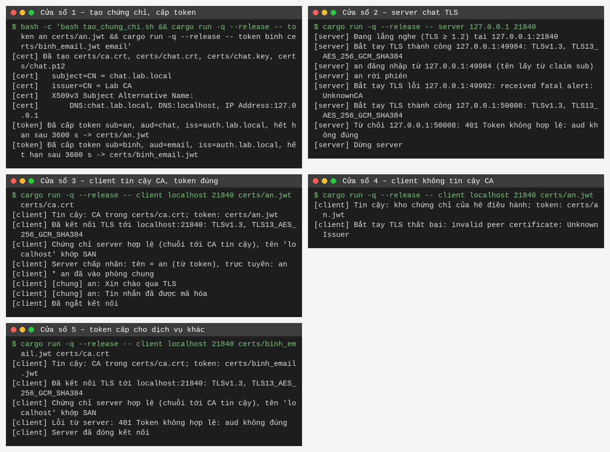

# Bài 8.4 – Bổ sung TLS và xác thực token cho hệ thống chat (Rust)

| Thông tin | Nội dung |
|---|---|
| Mã giả tương ứng | Mã giả 8.6 (Bổ sung TLS và xác thực token cho hệ thống chat) |
| Mục giáo trình | 8.4.5 Lập trình socket an toàn với TLS, 8.4.6 Quản lý khóa bí mật |
| Kế thừa | Mã giả 6.5, 6.6 (server chat), Mã giả 5.5 (ChatClient), Mã giả 5.1 (khung JSON bất đồng bộ), Mã giả 2.2 (SAFE_CONNECT); kiểm tra JWT theo Mục 7.2.4 |
| Thư viện | crate `tokio`, `rustls` + `tokio-rustls` (bộ mật mã `ring`), `rustls-native-certs`, `hmac` + `sha2` (HS256), `base64`, `serde_json` |

## Mục tiêu
Bọc kết nối TCP của server và client chat bằng TLS (tối thiểu TLS 1.2, thư viện thương lượng TLS 1.3 khi hai bên hỗ trợ) mà không sửa giao thức khung JSON và logic chat. Server bắt tay TLS ngay sau ACCEPT (TLS_SESSION), ghi nhật ký và đóng kết nối khi bắt tay lỗi. Client bọc TLS sau khi kết nối TCP với `server_name ← host`, kiểm tra chuỗi chứng chỉ tới CA tin cậy và tên máy trong SAN; không bao giờ tắt kiểm tra chứng chỉ. Thông điệp `hello` mang token JWT (HS256) thay cho tên tự khai báo; server kiểm tra thuật toán, chữ ký, `exp`, `iss`, `aud = "chat"` và lấy tên người dùng từ claim `sub`. Chứng chỉ do CA nội bộ của phòng lab cấp, tạo bằng OpenSSL; bí mật (khóa ký JWT) chỉ lấy từ biến môi trường.

## Tệp
- `src/main.rs` – phân nhánh theo tham số `server` / `client` / `token`.
- `src/tls_chat_server.rs` – TLS_SESSION, CHAT_SESSION có VERIFY_JWT, BROADCAST, WRITER, LOAD_CERT_AND_KEY.
- `src/tls_chat_client.rs` – ChatClient: CONNECT (kết nối rồi bọc TLS), RECEIVE_LOOP, SEND_MESSAGE có khóa.
- `src/jwt_hs256.rs` – ký và kiểm tra JWT HS256; vai trò `token` cấp token thử nghiệm.
- `src/khung.rs` – RECV_JSON_ASYNC, SEND_JSON_ASYNC (Mã giả 5.1).
- `tao_chung_chi.sh`, `tao_chung_chi.ps1` – giống tệp của các ngôn ngữ khác: tạo CA nội bộ (có `basicConstraints`, `keyUsage` như Mục 8.4.5) và chứng chỉ server (SAN: `chat.lab.local`, `localhost`, `127.0.0.1`), xuất thêm `chat.p12`. Kết quả nằm trong `certs/` (chứa khóa riêng, đã có trong `.gitignore`).
- `Cargo.toml`, `Cargo.lock` – gói Cargo `bai8_4_tls_chat`.
- `demo.json` – kịch bản chạy minh họa (dùng với `tools/demo.py`).
- `ket_qua.txt`, `ket_qua.png` – kết quả thực thi thật.

## Cách chạy
```bash
cargo build --release
export TLS_KEY_PASS=matkhau-lab CHAT_JWT_KEY=khoa-ky-jwt-cua-phong-lab-0123456789
export TLS_CERT=certs/chat.crt TLS_KEY=certs/chat.key
bash tao_chung_chi.sh                                       # Windows: powershell -File tao_chung_chi.ps1
cargo run --release -- token an certs/an.jwt                # cấp token cho người dùng "an"
cargo run --release -- server 0.0.0.0 9200                  # cửa sổ 1
cargo run --release -- client localhost 9200 certs/an.jwt certs/ca.crt   # cửa sổ 2, nhập vài dòng rồi Ctrl+D
```
Trên Windows (PowerShell) đặt biến bằng `$env:TEN = "giá trị"`. Bỏ tham số tệp CA ở client để thấy bắt tay bị từ chối; cấp token với đối tượng khác (tham số thứ ba, ví dụ `email`) để thấy server từ chối mã 401. Giá trị mật khẩu, khóa ở trên chỉ dùng cho phòng lab.

## Kết quả thực thi


Client tin cậy CA nội bộ bắt tay TLSv1.3 (`TLS13_AES_256_GCM_SHA384`, tên rustls của `TLS_AES_256_GCM_SHA384`), được server chấp nhận với tên `an` lấy từ token và nhận lại tin của chính mình trong phòng `chung`. Client chỉ dùng kho tin cậy của hệ điều hành từ chối chứng chỉ của server (`UnknownIssuer`: CA nội bộ không có trong kho) và gửi cảnh báo TLS, server ghi "received fatal alert: UnknownCA". Token cấp cho đối tượng `email` bị server từ chối với mã 401 "aud không đúng" dù kênh TLS hợp lệ.

## Ghi chú
- `tao_chung_chi.sh` tạo CA có `basicConstraints=critical,CA:TRUE` và `keyUsage=critical,keyCertSign,cRLSign`, chứng chỉ server có `basicConstraints=CA:FALSE`, `keyUsage`, `extendedKeyUsage=serverAuth` như các lệnh OpenSSL của Mục 8.4.5; rustls (webpki) kiểm tra chặt các trường này theo RFC 5280.
- SAN có thêm `localhost` và `127.0.0.1` để chạy thử trên một máy mà không sửa tệp hosts. Kết nối bằng một tên không có trong SAN sẽ bị client từ chối do tên không khớp.
- `LOAD_CERT_AND_KEY` đọc `TLS_CERT` (chứng chỉ PEM) và `TLS_KEY` (khóa riêng PEM, PKCS#8) bằng `PemObject` của `rustls-pki-types`; rustls không đọc PKCS12 và khóa PEM có mật khẩu, nên `TLS_KEY_PASS` chỉ dùng cho bước `openssl pkcs12 -export` của script (khóa được tạo không mật khẩu theo lệnh `-nodes` của giáo trình), như bản Python.
- rustls chỉ cài đặt TLS 1.2 và TLS 1.3, nên cấu hình mặc định đã đúng yêu cầu `min ← TLS1_2`; TLS 1.3 được ưu tiên. Client không in CN của chứng chỉ server như bản Python (cần thêm crate phân tích X.509); thông báo chỉ khẳng định chuỗi chứng chỉ và tên máy đã được kiểm tra.
- Server chat là bản rút gọn của Mã giả 6.5–6.6: hỗ trợ `hello`, `join`, `msg`, `ping` (loại khác nhận lỗi 400); `welcome` có thêm trường `name` (tên lấy từ token) và lỗi có trường `text`. Token sai trả mã 401 (giáo trình không quy định mã cho trường hợp này). Bảng `users`, `rooms` được bảo vệ bằng `std::sync::Mutex` vì tokio chạy nhiều luồng; luồng TLS được tách bằng `tokio::io::split` (nửa đọc cho phiên, nửa ghi cho tác vụ ghi).
- Token được cấp bằng vai trò `token` đóng vai server ủy quyền giản lược (khóa đối xứng HS256 dùng chung qua `CHAT_JWT_KEY`, `iss = auth.lab.local`); chữ ký được so sánh trong thời gian hằng (`Mac::verify_slice`). Hệ thống thật nên dùng token do server ủy quyền OAuth 2.0 cấp, ký bất đối xứng (RS256/ES256).
- Sau khi gửi các dòng nhập, client gửi `ping` và chỉ ngắt khi nhận `pong`: vì mỗi client có một tác vụ ghi theo thứ tự, `pong` đến sau mọi tin trước đó. Vòng nhận báo cho chương trình chính qua kênh `mpsc` (thay cho các `asyncio.Event` của bản Python).
- Đã thử chéo: client Python với server Rust và client Rust với server Python (cùng chứng chỉ, cùng token): kết quả như nhau.
- `tao_chung_chi.ps1` chưa chạy trong môi trường biên soạn (không có PowerShell); script `.sh` đã chạy trong demo.
- Kiểm thử: Linux, Rust 1.97.0, tokio 1.54.1, rustls 0.23.46, tokio-rustls 0.26.6, hmac 0.12.1, sha2 0.10.9, base64 0.22.1, OpenSSL 3.0.13.
