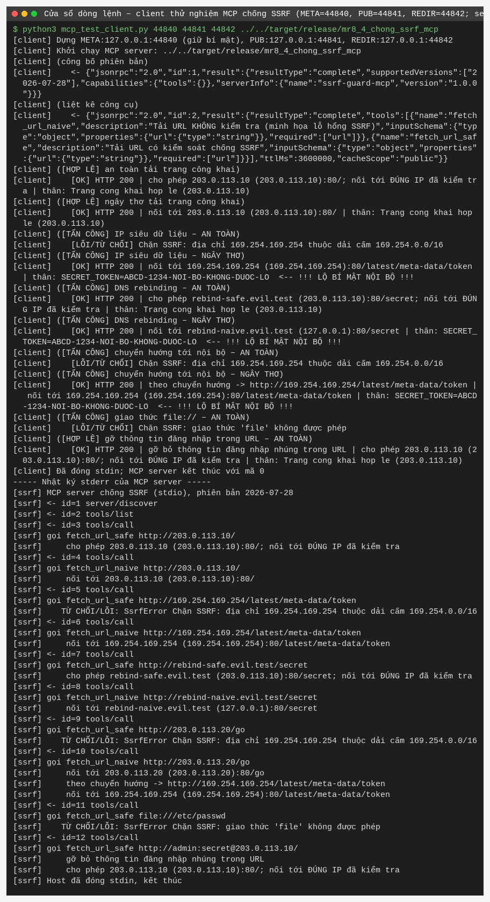

# Bài mở rộng MR8.4 – Chống SSRF trong công cụ MCP `fetch_url` (Rust)

| Thông tin | Nội dung |
|---|---|
| Loại | **Bài mở rộng** – không có trong giáo trình, không có mã giả tương ứng |
| Liên hệ với giáo trình | Chương 8: Bài 8.3 (MCP server qua stdio, kiểm soát đích); Chương 3: Bài 3.4 (HTTP client); Chương 1: Bài 1.1 (phân giải tên) |
| Thư viện | Thư viện chuẩn Rust: `std::net` (`TcpStream`, `IpAddr`, `ToSocketAddrs`), `std::io`; crate `serde_json` 1.0.154 (JSON-RPC, giữ thứ tự khóa). Client thử nghiệm (vai host) dùng lại tệp Python của bài |
| Bản ngôn ngữ khác | [C#](../../../csharp/Chuong08/BaiMR8.4_ChongSSRF_MCP/), [Java](../../../java/Chuong08/BaiMR8.4_ChongSSRF_MCP/), [Python](../../../python/Chuong08/BaiMR8.4_ChongSSRF_MCP/), [Go](../../../go/Chuong08/BaiMR8.4_ChongSSRF_MCP/) |

## Mục tiêu
Một server công cụ (ví dụ công cụ MCP cho tác tử AI) thường có công cụ "tải một URL". Nếu công cụ này tải **bất kỳ URL nào người dùng/mô hình đưa vào**, kẻ tấn công có thể lợi dụng nó để truy cập dịch vụ **nội bộ** mà bản thân họ không với tới – đó là lỗ hổng **SSRF (Server-Side Request Forgery)**. Mục tiêu kinh điển: máy chủ siêu dữ liệu đám mây `169.254.169.254` (chứa khóa tạm thời), các dịch vụ chỉ nghe `127.0.0.1`, hoặc mạng riêng `10.0.0.0/8`.

Bài nối tiếp Bài 8.3 (giữ nguyên khung JSON-RPC 2.0 qua stdio) và cung cấp hai công cụ để **so sánh**:
- `fetch_url_naive(url)` – tải URL **không kiểm tra gì** (minh họa lỗ hổng);
- `fetch_url_safe(url)` – tải URL với **chín lớp phòng thủ** SSRF:
  1. chỉ cho phép giao thức `http`/`https` (chặn `file://`, `gopher://`…);
  2. loại bỏ thông tin đăng nhập nhúng trong URL (`http://user:pass@…`);
  3. phân giải tên **một lần duy nhất**;
  4. chặn nếu IP thuộc dải cấm (loopback `127/8`, riêng `10/8` `172.16/12` `192.168/16`, link-local `169.254/16` gồm `169.254.169.254`, `::1`, `fc00::/7`, `fe80::/10`, `0.0.0.0/8`);
  5. giới hạn tổng thời gian;
  6. **nối thẳng tới chính IP đã kiểm tra** (chống DNS rebinding / TOCTOU);
  7. giới hạn kích thước phản hồi;
  8. giới hạn số lần chuyển hướng;
  9. **kiểm tra lại mọi chặng chuyển hướng** (không tin `Location` một cách mù quáng).

> **Chú ý dải cấm.** Danh sách chặn được liệt kê **tường minh** chứ không dựa vào thuộc tính "is private": dải tài liệu `203.0.113.0/24` (TEST-NET-3) cũng mang tính nội bộ về mặt định tuyến, nên nếu dựa vào một hàm "is private" sẵn có sẽ chặn nhầm đích demo.

## Chạy offline bằng bảng tiêm (chỉ cho demo)
Để minh họa hoàn toàn trên một máy, không gửi gói nào ra ngoài, client thử nghiệm dựng ba server HTTP cục bộ trên `127.0.0.1` và **ánh xạ** các địa chỉ "công khai/nội bộ" về chúng qua hai bảng được tiêm vào MCP server bằng biến môi trường:
- `SSRF_RESOLVER`: bảng phân giải tên giả lập; một tên có thể trả **nhiều IP lần lượt** để mô phỏng DNS rebinding.
- `SSRF_DIAL`: ánh xạ một IP → cổng cục bộ, ví dụ coi `203.0.113.10` (TEST-NET-3, dùng làm địa chỉ "công khai hợp lệ") và `169.254.169.254` trỏ về server cục bộ.

Việc ánh xạ này **chỉ tồn tại cho bản demo**; trong thực tế công cụ dùng DNS thật và nối thẳng tới IP đã kiểm tra. `203.0.113.0/24` (TEST-NET-3, RFC 5737) được chọn làm đích "công khai" vì nó không định tuyến ra Internet nên an toàn cho bài học.

## Tệp
- `Cargo.toml`, `Cargo.lock` – gói Cargo `mr8_4_chong_ssrf_mcp`.
- `src/fetch_tools.rs` – thân `fetch_naive`, `fetch_safe`, danh sách dải cấm, bảng phân giải/`dial` giả lập, bộ tách URL và kiểm tra dải IPv4/IPv6; có `cargo test`.
- `src/main.rs` – MCP server stdio (JSON-RPC 2.0) công bố hai công cụ, vòng đọc dòng, điều phối.
- `mcp_test_client.py` – chép nguyên từ bản Python: client (vai host) dựng ba server cục bộ, khởi chạy MCP server, gửi các kịch bản tấn công + hợp lệ.
- `demo.json`, `ket_qua.txt`, `ket_qua.png`.

## Cách chạy
Trong thư mục bài (`cargo build -q --release` một lần). Client thử nghiệm viết bằng Python nên vẫn chạy bằng `python3`, truyền đường dẫn MCP server đã biên dịch:
```bash
cargo build -q --release
python3 mcp_test_client.py 44840 44841 44842 ../../target/release/mr8_4_chong_ssrf_mcp
```
Client tự khởi chạy MCP server (tiến trình con) và in quyết định của từng kịch bản. Để thử MCP server với host khác, có thể chạy trực tiếp và tiêm hai bảng: `SSRF_RESOLVER=… SSRF_DIAL=… ../../target/release/mr8_4_chong_ssrf_mcp`. Trên Windows dùng `python` và `..\..\target\release\mr8_4_chong_ssrf_mcp.exe`.

Tái lập kết quả từ thư mục gốc của kho: `python3 tools/demo.py rust/Chuong08/BaiMR8.4_ChongSSRF_MCP`.

## Kết quả thực thi


Với mỗi kịch bản tấn công, `fetch_url_naive` **để lộ bí mật nội bộ** (`SECRET_TOKEN=…`) còn `fetch_url_safe` **chặn**:
- *IP siêu dữ liệu* `169.254.169.254`: safe chặn vì thuộc dải `169.254.0.0/16`.
- *DNS rebinding*: tên phân giải lần đầu ra `203.0.113.10` (công khai) rồi lần sau ra `127.0.0.1` (nội bộ); bản ngây thơ phân giải lại khi nối nên bị lừa, bản an toàn chỉ phân giải một lần và nối đúng IP đã kiểm tra nên nhận trang công khai.
- *Chuyển hướng tới nội bộ*: trang công khai trả `302` trỏ về `169.254.169.254`; bản ngây thơ theo mù quáng, bản an toàn kiểm tra lại chặng mới và chặn.
- *Giao thức `file://`*: safe chặn ngay.
- *Thông tin đăng nhập trong URL*: safe gỡ bỏ rồi mới tải.
Bản Rust in ra JSON-RPC và nhật ký stderr **giống hệt từng byte** bản Python (chỉ khác số cổng), nên dãy quyết định trùng khớp.

## Bài tập gợi ý
1. (Cơ bản) Thêm một kịch bản tấn công mới vào `mcp_test_client.py` (ví dụ `http://10.0.0.1/`) và kiểm chứng bản an toàn chặn đúng.
2. (Cơ bản) Thêm dải CGNAT `100.64.0.0/10` vào danh sách cấm (`BLOCKED`) và giải thích vì sao nên chặn.
3. (Trung bình) Chuyển từ *danh sách cấm* sang *danh sách cho phép* (allowlist) tên miền đích và thảo luận ưu/nhược điểm của hai cách.
4. (Trung bình) Thêm kiểm tra cho IPv6 ánh xạ IPv4 (`::ffff:169.254.169.254`) và địa chỉ IPv4 viết dạng thập phân/bát phân khác thường.
5. (Nâng cao) Thay bộ tách URL tự viết bằng một crate phân tích URL (ví dụ `url`) nhưng vẫn giữ được việc "nối tới đúng IP đã kiểm tra" (đặt lại `Host` và nối thẳng tới IP cố định).

## Ghi chú
- Kết quả công cụ và dữ liệu lấy từ mạng là **dữ liệu chưa tin cậy**; quyết định cho phép truy cập phải do mã của công cụ, không do nội dung URL hay phản hồi.
- Bản an toàn cố ý **không dùng biến môi trường proxy** (`HTTP_PROXY`/`HTTPS_PROXY`) để tránh một đường vòng khác tới nội bộ; bản Rust nối socket trực tiếp nên vốn không đọc hai biến này.
- Mô hình "phân giải một lần, nối đúng IP" là cách chống DNS rebinding cơ bản; hệ thống thật còn ghim lại IP cho mọi chặng và chặn redirect chéo giao thức.
- Khác bản Python: thư viện chuẩn Rust không có `urllib.parse` và `ipaddress`, nên `fetch_tools.rs` tự viết bộ tách URL (`split_url`, `noi_tiep` tương đương `urljoin` cho các ca ở đây) và kiểm tra dải bằng phép AND mặt nạ trên `u32`/`u128`. JSON-RPC in bằng `serde_json` với tính năng `preserve_order` để byte-khớp `json.dumps(separators=(",",":"))` của Python. Bảng phân giải giả lập là `VecDeque` (pop đầu để "tiến" IP) thay cho `list.pop(0)`.
- Kiểm thử: Linux, Rust 1.97.0.

## Đọc thêm
- OWASP, *Server Side Request Forgery Prevention Cheat Sheet*.
- RFC 5737 *IPv4 Address Blocks Reserved for Documentation* (dải `203.0.113.0/24`).
- RFC 3927 *Dynamic Configuration of IPv4 Link-Local Addresses* (`169.254.0.0/16`); RFC 1918 (mạng riêng).
- Tài liệu Model Context Protocol (MCP) về server công cụ và kiểm soát quyền.

Mã nguồn của bài được viết mới cho kho này; tài liệu trên chỉ là nguồn tham khảo ý tưởng phòng thủ.
